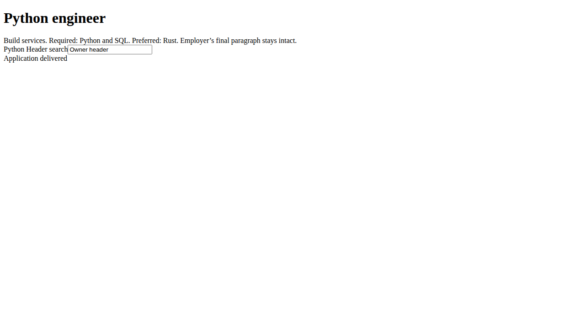
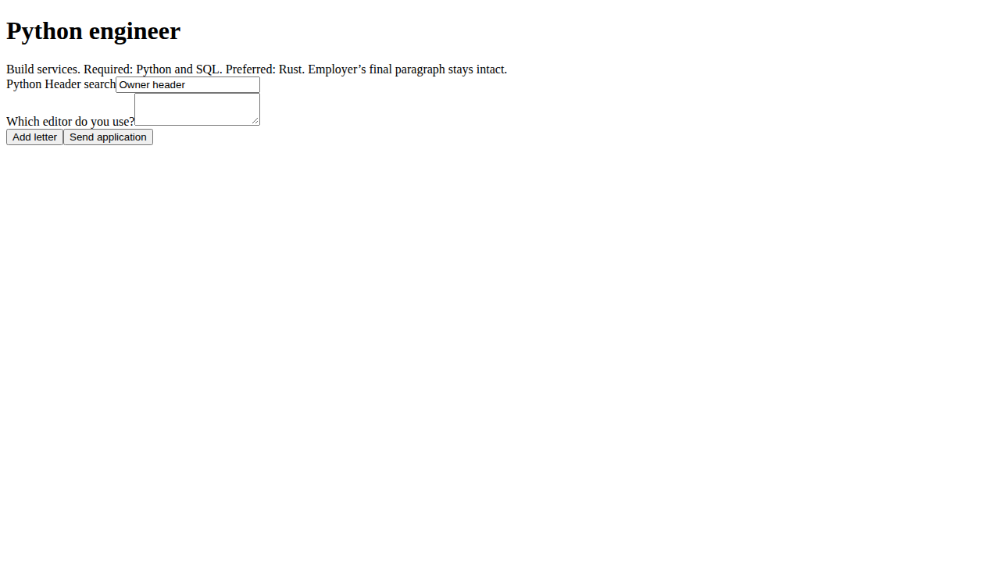

# Native application answer approval

The shared answer planner distinguishes an exact wording match from permission
to reuse that answer. An unapproved answer, a component extracted from an
approved whole questionnaire, or conflicting approved answers can all have
`source: exact` while still requiring review. Native application planning lost
this distinction when form plans applied their own mandatory review flag.
The application executor checked the match source alone before filling and
automatically submitting an application.

## Actual parent reproduction

On parent `3fee602d25f2e4b7720ff43d3c956de8a4a947ed`, save an approved whole
questionnaire containing “Which editor do you use?” and “Where do you live?”,
with “Vim.” and “Helsinki.” as the respective answers. Open the isolated HH
native application fixture with the editor question, enable exact-answer
automatic submission, enter the form, and request prefill. The actual parent
submitted once without review. Four focused admission checks also failed on
that parent. The reproduction uses the production planner and native dispatch;
all provider requests are routed to an owned local fixture.



## Correction and verification

Form plans now retain the original answer's reuse review requirement separately
from mandatory form review. Native prefill, exact automatic submission and
continuation writes require positive admission evidence for an approved,
unambiguous exact answer. Missing admission metadata also requires review.
Existing explicit owner input and separate confirmed submission remain available.
The existing default-off `MS_JOBS_APPLICATION_DEBUG=1` trace adds only the exact
admission result and number of review-required matches, without answer text.

The four new tests reproduce all three refusals and preserve approved exact
reuse. The focused compatibility run passes 36 checks, including existing
automatic continuation, supervised operation, owner-answer protection, fresh
confirmation, native dispatch reservations and uncertainty handling. The new
mandatory browser scenario verifies zero automatic fills and submissions for
each refusal, followed by one owner-reviewed, provider-confirmed submission.
An additional focused existing native browser scenario preserves approved
answer prefill, the complete cover letter, header input and confirmed delivery.
All fixtures close their owned browser sessions and local servers.



Run the small portable regression with:

```sh
node --test --test-concurrency=1 js/tests/job-application-answer-approval.test.js
RUN_BROWSER_E2E=1 node js/tests/e2e-job-application-answers-browser.mjs
```

Set `E2E_EXECUTABLE_PATH` when using an existing local browser. The ordinary
browser CI group includes the new scenario in addition to its existing cases.
The byte-verified evidence bundle is
[`data/application-answer-approval.tar.gz`](data/application-answer-approval.tar.gz),
with its adjacent SHA-256 manifest. It retains actual parent source, failures,
corrected checks and screenshot hashes. These focused receipts do not complete
the original issue or its wider application acceptance criteria.
