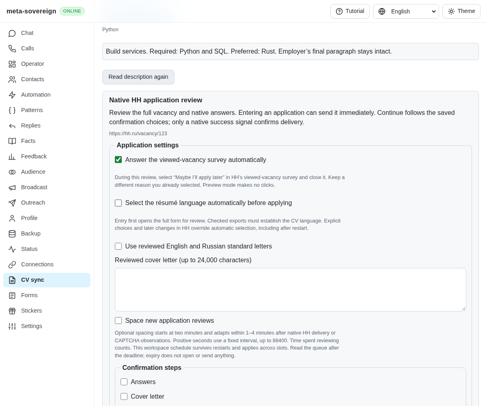
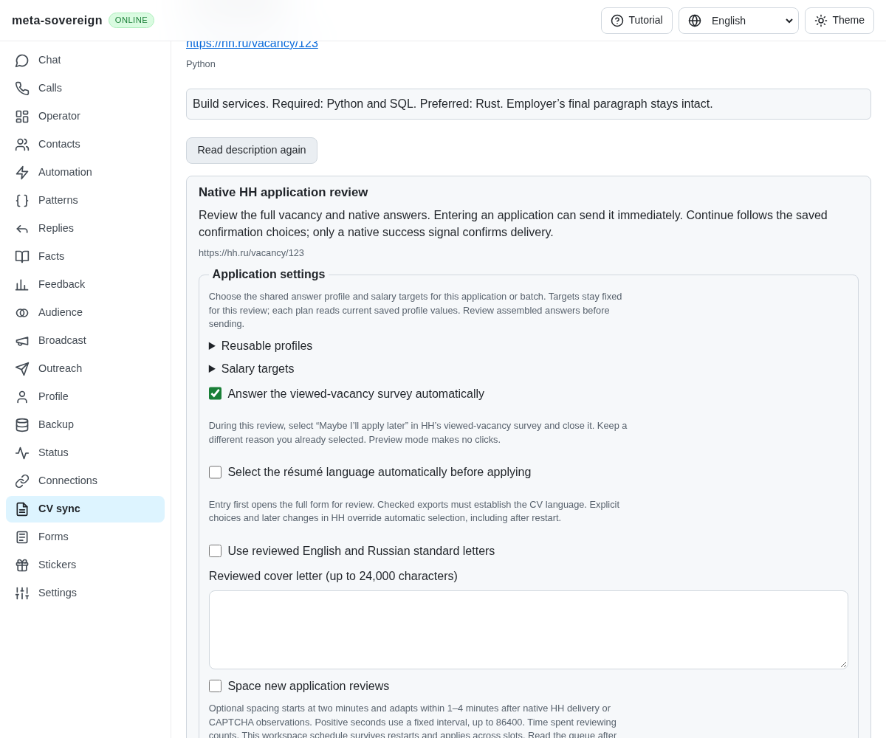
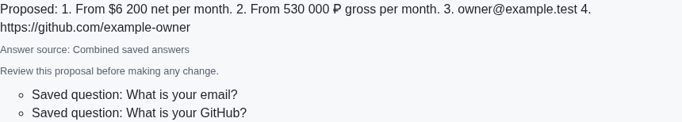
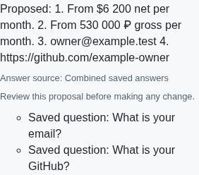

# Native applications retain shared answer context

The native application service discarded named answer profiles and salary
configuration before calling the shared form planner. Its CLI and application
settings also offered no way to select them. Chats and external forms could
assemble a questionnaire with current contacts and independent currency targets,
while the same native application lacked that context.

## Actual parent reproduction

On `e940cb62e34a893310b75a93b5e98f24231453cc`, run the six new tests in
`js/tests/job-application-answer-context.test.js` against the unchanged production
modules. All six fail: acknowledged settings lack the selected profile, and
native planning cannot retain its source revision and complete answer context.
The captured parent log preserves each actual failure.

The isolated native HH fixture has one textarea containing four questions: USD
salary, RUB salary before taxes, email and GitHub. The saved profile deliberately
has no fallback salary. Its contact rules reference profile values. Explicit
targets are USD 6,200 net and RUB 530,000 gross per month. All provider traffic
is routed to local owned HTML; no account or real application is used.

The before screenshot rebuilds the published application panel module in the
same UI shell. It shows the missing selection controls; the portable parent
regression separately demonstrates the lost backend context.



## Corrected behavior

Native single and batch applications retain a validated named profile reference
and salary configuration in their acknowledged settings and private journals.
The existing shared controls choose profiles, contacts and salary targets. The
receipt shows the fixed targets and approval state; browser recovery storage
retains only application identity. Each new plan reads the current profile
revision, including contact edits. A missing profile refuses planning, and an
absent new setting does not change legacy journal signatures.

The existing default-off `MS_JOBS_APPLICATION_DEBUG=1` trace records whether a
named profile was selected and the configured currency count, without contact
values, salary amounts or profile identifiers.

Each question component independently resolves its currency, net/gross basis and
contact key. Complete assembled answers still require owner review. Enabling
exact-answer automatic submission does not authorize them. Explicit native
owner edits and a separate confirmed submission remain available.







## Verification

Eleven new portable checks cover canonical settings, legacy compatibility,
current-profile reads, independent targets, malformed receipts, missing profiles,
single and batch foreground CLI, both Lino formats and all four translated
control sets. The final focused run also includes approval and existing batch
regressions. A separate 52-check compatibility run covers confirmation,
supervision, language selection, feedback and bounded browser registration.

The mandatory native browser scenario uses the real shared controls and native
planner, checks four complete components, edits the saved profile, recovers by
identity after reload, renders all four locales and checks phone width. It
observes zero automatic writes and submissions, then one reviewed,
provider-confirmed submission. The fixture drains all owned sessions.
Playwright MCP independently captures the published missing controls and the
corrected settings/proposal, including phone width. Its final server receipt
records four opened and closed sessions, zero provider clicks and no page errors.

```sh
node --test --test-concurrency=1 js/tests/job-application-answer-context.test.js js/tests/job-application-answer-context-controls.test.js
RUN_BROWSER_E2E=1 node js/tests/e2e-job-application-answers-browser.mjs
```

Use `E2E_EXECUTABLE_PATH` for an existing local browser. CI retains the existing
two-engine coverage and scenario bounds. Local verification uses only focused
portable tests and Chromium. The [evidence archive](data/application-answer-context.tar.gz)
and [SHA-256 manifest](data/application-answer-context.tar.sha256.json) preserve
the parent sources/failures, current sources, checks, MCP receipts and screenshot
hashes. Hosted checks on the published correction remain required. This unit
does not accept the wider QA09/QA10 or native application inventory criteria.
