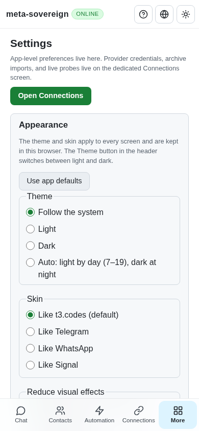
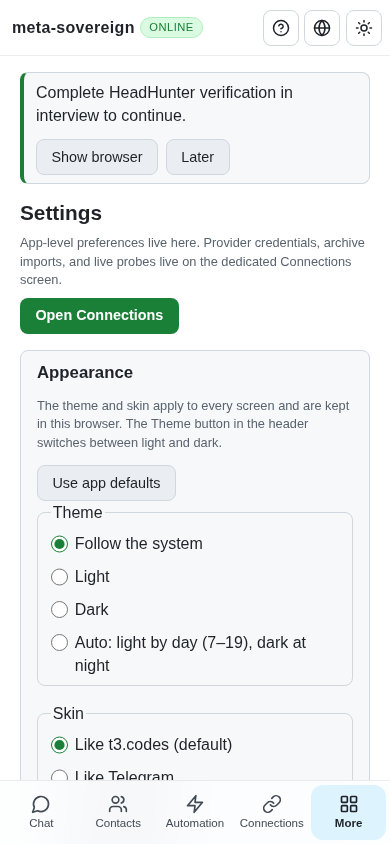

# HeadHunter application verification across views

The pinned notifier brings forward the browser that is waiting for its owner and offers repeat reminders. The published parent could latch the HeadHunter application verification hold while Settings showed no notice and the application console offered no way to focus that exact wait. [Pinned notifier](https://github.com/konard/hh-job-application-automation/blob/fa0991b8c2d0896fb3b4be6c69947f0590094b15/src/notify.mjs) · [PR #57](https://github.com/link-foundation/meta-sovereign/pull/57).

The app shell now shows an active HeadHunter verification wait in any view. **Show browser** focuses the exact live owned page when a visible window is available. **Later** defers that notice for fifteen minutes. The foreground application console offers `attention` and `focus <wait-id>`. Both Lino encodings support the same receipt. The read rechecks verification markers, including visible child frames, and the focus request must match the active wait, request and slot. Neither command reads or fills the answer control, issues an application command or writes the journal. After manual completion the notice clears. The existing application hold still governs any later attempt to send.

## Reproduction and verification

Enter the synthetic HeadHunter application form in the `interview` slot, show the fixture verification gate and read the application. Navigate to Settings at 390 pixels. The production bundle at `2396293e` has no banner and returns HTTP 404 for the attention read. The revised bundle shows the banner and focuses the exact named browser. Removing the gate clears the notice. Repeat with a gate in a visible child frame, then close the review to clear that notice. [Browser regression](../../../js/tests/helpers/e2e-application-attention.mjs).

```sh
node --test --test-concurrency=1 js/tests/job-application-attention.test.js js/tests/job-application-holds.test.js js/tests/job-application-hold-controls.test.js js/tests/forms-attention.test.js js/tests/i18n.test.js js/tests/hh-captcha-boundaries.test.js
deno test --no-check -A js/tests/job-application-attention.test.js js/tests/job-application-holds.test.js js/tests/job-application-hold-controls.test.js js/tests/forms-attention.test.js js/tests/i18n.test.js js/tests/hh-captcha-boundaries.test.js
RUN_BROWSER_E2E=1 HH_ATTENTION_ONLY=1 node js/tests/e2e-job-application-policies-browser.mjs
```

- Seven focused regressions fail on the parent. The revised checks cover the live receipt, exact identity, headless focus refusal, expiry, close races, no journal writes, both Lino encodings and the existing origin check. [Focused regression](../../../js/tests/job-application-attention.test.js).
- Production Chromium verified the main-document and nested gates, one exact focus, zero challenge-answer reads, zero provider submissions and closure. The fixture advertises the visible-window capability while the Chromium harness runs headless. The focus spy delegates to Playwright's real page focus action.
- Independent Playwright MCP verified focus at 390 pixels, persistence from Settings to Operator, no horizontal overflow, removal after owner verification and zero uncaught page errors. Its fixture recorded one focus, zero challenge-answer reads, zero submissions and a closed review. The console logged missing optional Telegram routes and favicon, a cache write failure, an event-stream disconnect at shutdown and a Content Security Policy rejection of the existing shared chime's blob URL. [Fixture](../../../experiments/issue-56/application-attention-mcp-server.mjs).





Manual login, production chime playback, native desktop alerts while the app is closed and authenticated provider verification remain required. HH01 and QA24 remain open. [Evidence archive](data/hh-application-attention.tar.gz) · [Per-file checksums](data/hh-application-attention.tar.sha256.json).
