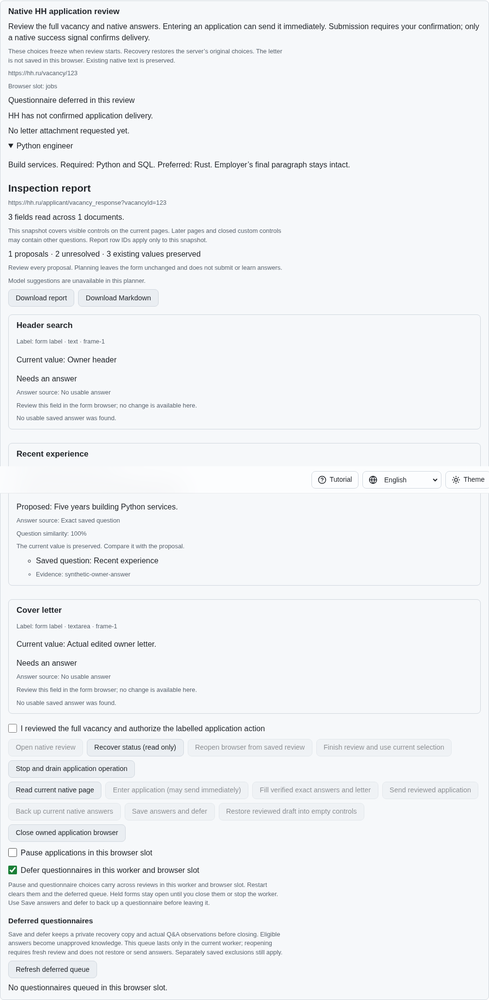
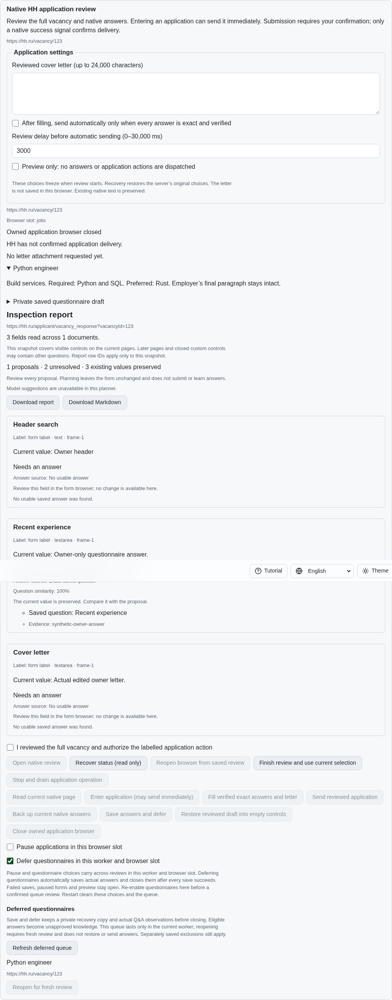
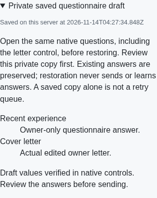

# Automatic backed questionnaire deferral

[PR #57](https://github.com/link-foundation/meta-sovereign/pull/57) extends the
explicit [backed deferral](application-deferrals.md) to the worker's optional
no-questionnaire policy. Supported full forms and popups now leave automatically
after acknowledging their actual private draft, Q&A observation and eligible
unapproved learning. HH08 remains unfinished: normal queue collection/pacing and
automatic revisits, generic-error five-hour retries, recruiter-panel behavior and
the supervised one-application preset still require implementation.

## Published reproduction and cause

On `24ef1b88`, enter a questionnaire, edit the actual native answer and letter,
then enable Defer questionnaires. The form stays open with state `deferred`;
only the separate explicit Save answers and defer action saves and closes it.
The mode interrupted sending but had no preservation/closure phase.

`python3 -B experiments/issue-56/application-automatic-before.py` runs the minimal
regression against that exact parent. `--native` verifies the same difference
through production native browser inspection and HTTP routing; `--mcp` serves
the isolated parent UI for independent visual verification. The wrapper restores
all replaced source bytes in `finally`. Fixtures intercept synthetic documents
and never authenticate to HH or send real applications.

## Ownership and preservation boundary

Each owned operation processes the latest worker policy before releasing the
workspace. An acknowledged ordinary mode change runs preservation only after
acceptance; a refused mode checkpoint cannot silently enable closure. Idle POSIX
signals acquire the same writer and inspect current native values. Signals during
an owned operation update RAM immediately and are processed at its boundary,
including a safely refused send interrupted during its final native guard.

Actual capture, complete private recovery, Q&A and guarded unapproved learning
reuse the explicit deferral path. Failed reads/checkpoints keep the questionnaire
open without automatically replaying a failed save. Late owner edits refuse
closure. A signal re-enabling questions or changing policy during an asynchronous
checkpoint cancels closure and retains the latest mode. The synchronous queue
admission after the last guard is the closure commitment; a later signal controls
future reviews. Debug events remain count/code only and disabled by default.

Pause and zero-effect preview keep questionnaires open. Challenges, account
limits, unsupported capture, missing scope and uncertain submission reservations
cannot enter automatic deferral. The existing exact-answer exception still
defers questionnaires under this policy; letter-only applications retain their
ordinary separately authorized path. Queue entries and run policies remain
worker/slot RAM; recovery drafts persist without becoming saved exclusions.

## Re-enabling review after closure

CLI, both Lino encodings and four-language controls can change the worker mode
using the inactive saved review's matching request and current revision. That
operation acknowledges a fresh journal revision and changes no provider state.
Stale identities and refused acknowledgement preserve the accepted policy.
Lost replies recover through status without replay. The UI keeps mode controls
available on a known closed review and refreshes the queue after operations.

Queue reopening refuses while questionnaires remain disabled. Re-enabling the
mode does not itself reopen a browser or send: the existing separately confirmed
queue action opens a fresh review, and restoration and submission keep their
own confirmation. Automatic paced revisits remain an unfinished criterion.

## Verification

The final focused Node application selection passes all 95 cases at concurrency
one. All 12 new service/interface cases also pass sequentially in Deno; all 25
dictionary checks pass. They cover actual owner values, failed Q&A/learning
flushes, failed explicit saves during a signal, foreign slots, mode races,
paused/preview retention, inactive journal identity and acknowledgement, both Lino
encodings, CLI and lost UI replies. A failed explicit save is never automatically
retried at the operation boundary. A later explicit fresh read can retry safely.

```bash
node --max-old-space-size=384 --test --test-concurrency=1 js/tests/job-application*.test.js
deno test --allow-all --no-check js/tests/job-application-automatic-deferral.test.js js/tests/job-application-automatic-controls.test.js
node --max-old-space-size=384 --test --test-concurrency=1 js/tests/i18n.test.js
RUN_BROWSER_E2E=1 E2E_BROWSER=chromium E2E_EXECUTABLE_PATH=/opt/google/chrome/chrome node --max-old-space-size=384 experiments/issue-56/application-automatic-native.mjs
```

All seven affected native Chromium application scenarios pass on the initial
draft. The final focused automatic-policy scenario verifies retained worker
choices, acknowledged automatic closure, a one-entry queue, explicit inactive
re-enabling and fresh empty review, with no submissions or page errors. The first
final-run command omitted the opt-in and skipped; the corrected recorded command
includes it and passes. Independent Playwright MCP verifies actual
answer/edited-letter preservation, queue survival through UI reload, renewed
confirmation, fresh empty controls and separate restoration of both values. The
phone surface has no horizontal overflow. Owned fixtures report all browsers
closed, no provider clicks and no page errors; no authenticated provider was used.

The exact published parent fails both the minimal Node and native automatic
closure assertions. Independent parent MCP shows the questionnaire still open
with the owner's answer after enabling the policy. Initial asynchronous-checkbox
probe failures and the later finite-save test assumptions remain in the archive
alongside corrected results. The driver now waits for acknowledged state.

Scoped lint, formatting, secret and diff checks and the unchanged 6.5% duplication
threshold are required before publication. Full browser/runtime matrices and
resource-intensive builds remain hosted; every hosted check for the published parent `24ef1b88` passes (main run
`43554063889`). Final-head hosted results must be checked independently. The [evidence archive](data/application-automatic-deferral.tar.gz)
and [manifest](data/application-automatic-deferral.tar.sha256.json) preserve source,
parent snapshots, logs and screenshots with verified hashes.

## Before and after

Published policy leaves the questionnaire open:



Acknowledged automatic preservation closes the owned browser and retains the queue:



The [queue after re-enabling questions](../../screenshots/application-automatic-queued.png)
requires renewed confirmation. Separate restoration recovers the actual owner
values on a narrow screen:


