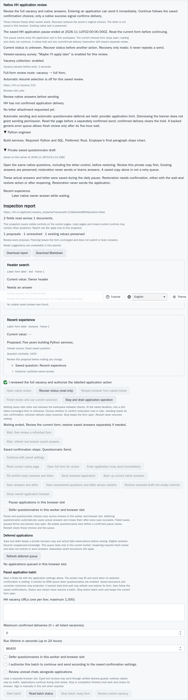
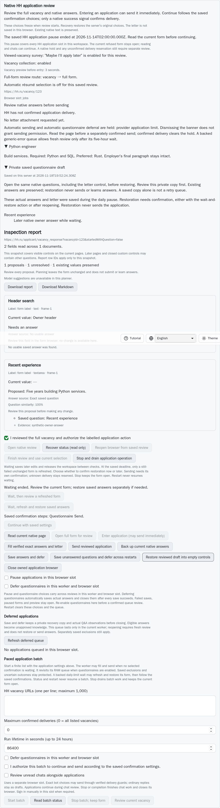

# Application controls during automatic status reads

The application panel polls every 1.5 seconds while a native form or limit wait needs observation. Previously `recover()` immediately marked the last acknowledged receipt unknown. This disabled the native action buttons until the response arrived. A poll starting between pointer-down and pointer-up could therefore discard the owner's click without sending a request.

Automatic reads now retain the last acknowledged receipt while pending. An owner action increments the existing sequence, so a delayed status response or failure cannot replace that newer action's result. Manual recovery still disables admission until its fresh response arrives. Background lookup cannot promote an already unknown session while pending; a current failed or foreign response invalidates authority. Server revision, document, draft and native-control checks remain in force.

## Reproduction and verification

The exact-source hosted WebKit job [135058574320](https://github.com/link-foundation/meta-sovereign/actions/runs/44375254274/job/135058574320) failed at the post-limit Restore click: its saved draft was intact, the fresh native field was empty, and confirmation remained checked without an unknown-state banner. Log lines 1743–1778 identify the completion timeout. An isolated, unmodified rerun passed. The precise hosted scheduling cannot be recovered from that screenshot alone.

The finite regression holds one real automatic status response after its server read completes, with the native Restore button pressed. On published source `ef34179a`, the button becomes disabled, release sends zero restore requests, and the owner field stays empty. On the corrected source, it stays enabled, release sends exactly one restore request, and the later saved owner answer is restored. Both WebKit runs use the existing deadlines, retain four-language and phone checks, record one entry and zero submissions, close the owned application, and drain the browser and fixture. This deterministic sequence reproduces a concrete lost-click cause consistent with the hosted failure; it does not establish the original runner's timing.

Run the native pair sequentially:

```sh
APPLICATION_BACKGROUND_BEFORE=1 node experiments/issue-56/application-limit-restore-probe.mjs
node js/scripts/build-web.mjs
node experiments/issue-56/application-limit-restore-probe.mjs
```

The same pending-response pointer sequence is included in the existing hosted application-limit scenario, without adding a browser group or increasing a deadline. Seven session regressions fail on the actual parent in three cases and pass after the fix. The complete focused selection passes 39 checks across background status, session ownership, automatic controls and deferral controls. A separate MCP browser check presses Read across a held automatic response, records exactly one owner read, zero submissions and no page errors, then closes the native application and owned fixtures. Its only console error is the fixture's missing favicon.

```sh
node --test --test-concurrency=1 js/tests/application-background-status.test.js
node --test --test-concurrency=1 experiments/issue-56/application-background-status-parent.mjs
```

Before: automatic status read disables the pressed Restore control.



After: the same held read preserves the acknowledged control; release restores the saved answer exactly once.



The separate profile-extras WebKit row-selection failure remains under investigation. No acceptance criterion is promoted by this correction. PR57 remains draft and unmerged with 88 criteria verified and 30 unfinished. This evidence uses isolated synthetic fixtures and makes no authenticated HH parity claim.

The collector preserves exact parent modules, current source, complete native receipts, focused logs, MCP results, the hosted failure and screenshots in `data/application-background-status.tar.gz` with independently verified entry hashes. Review fresh hosted results for the pushed source before treating its CI checks as passing.
