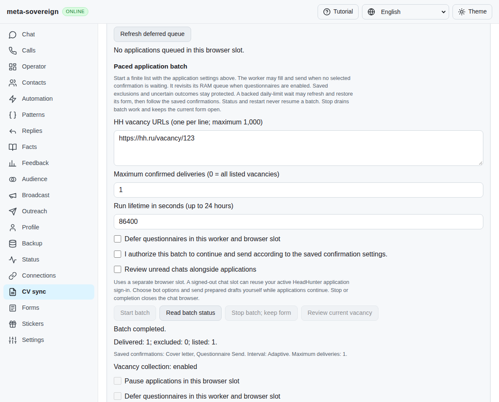
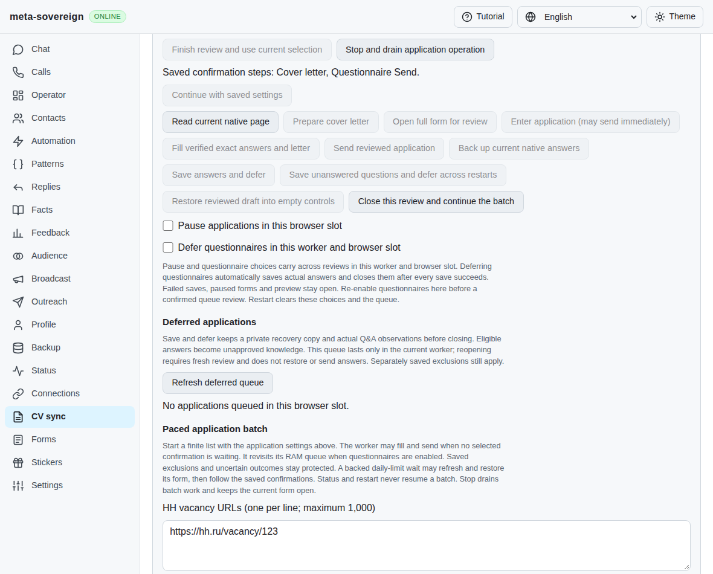

# Review separate cover letters in a HeadHunter batch

Set a reviewed cover letter in CV Sync, select **Cover letter** and **Questionnaire
Send** in the confirmation settings, then start a finite batch. When the current
vacancy confirms delivery and offers to attach a letter separately, choose **Review
current vacancy**. Confirm **Prepare cover letter**, inspect the native popup, and
confirm **Send cover letter**. The application counts once toward the delivery cap
while the letter is open. The saved batch Start authorizes prepare or send when
its corresponding confirmation choice is clear. Stop leaves the owned review
available.

**Close this review and continue the batch** retains the URL and its unsent
letter status. Open **Separate cover letters** in the batch receipt to see which
vacancies still need a manual check. A lost letter receipt stays unknown, leaves
the application confirmed, and prevents automatic repeat dispatch. Public
records omit the letter text.

The foreground batch CLI supports `status`, `letter-prepare`, `letter-send`, and
`close-review`. Use `status` to display the current vacancy before confirming an
action. The text and binary Lino routes use that application's request ID and
revision. Batch status returns a separate `letterAttachments` list.

## Verification

The published parent `13cd87f3` closed the owned browser on the next delivery
observation even when the letter was pending. Four focused tests reproduced
premature completion or a missing attachment receipt on that source. The parent
Chromium probe loaded the parent's batch worker and web bundle and reproduced the
disabled review action at the delivery cap.

Node passed 62 focused tests and Deno passed 49. The registered native Chromium
scenario starts with a previously delivered fixture vacancy, then verifies both
confirmation steps, a single attachment send, no application dispatch, and the
batch receipt after reload. A separate 390-pixel Playwright run verified that
closing the review retains the vacancy link after reload with zero native
application or letter dispatches. Both scenarios use a local provider fixture.

```sh
node --test --test-concurrency=1 js/tests/job-application-batch-attachment.test.js
RUN_BROWSER_E2E=1 node experiments/issue-56/application-batch-attachment-browser.mjs
```

| Parent completed before letter review                                                                       | Current batch keeps its pending offer open                                                                            |
| ----------------------------------------------------------------------------------------------------------- | --------------------------------------------------------------------------------------------------------------------- |
|  |  |

[Phone confirmation](../../screenshots/application-batch-attachment/phone.png) ·
[Confirmed batch receipt](../../screenshots/application-batch-attachment/after.png) ·
[Source and logs](data/application-batch-attachment.tar.gz) ·
[SHA-256 manifest](data/application-batch-attachment.json)

The search-card-first route and authenticated provider evidence remain open in
HH06 and HH08. This batch handles the same guarded vacancy-page offer as the
[standalone review](application-letter-attachment.md).
