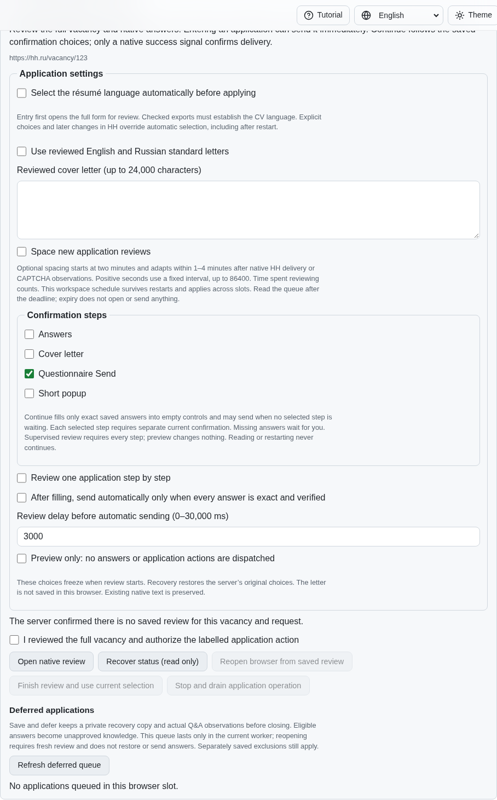
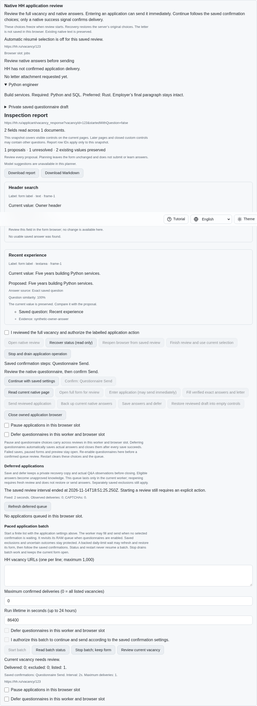
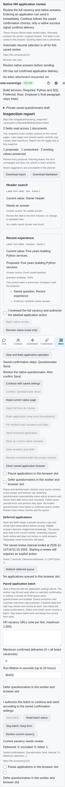

# Finite paced application batches

An explicitly started batch can now review a finite list of HH vacancies using
the existing guarded application executor. CLI, text/binary Lino API and the
four-language browser controls share this operation. This is a prerequisite for
HH06/HH08; automatic discovery, authenticated account scope, full reference parity
and all 81 original incomplete inventory rows remain required. PR57 stays draft
and unmerged.

The worker accepts a manually supplied list or the eligible URLs in an exact
[completed discovery receipt](discovery-batch-handoff.md) from the same browser
slot. It freezes 1–1,000 distinct canonical vacancy URLs, a delivery maximum
(zero means the supplied list), a finite lifetime of at most 24 hours, pacing and
the existing application settings. Supervised review caps the delivery maximum
at one. Only positive native delivery observations count, including an owner's
manual Send. Entry clicks and an issued action alone never count as delivery.
The default still waits for a separate Send confirmation. Selected confirmation
steps bind to the displayed current document and revision.

Pacing releases the workspace writer between checks. Pausing interrupts active
review delays; Stop and lifetime expiry abort owned work without dispatching a
later Send. Browser Stop leaves the current native form available for review;
foreground CLI EOF also drains and closes its owned browser. Saved status,
reloads, process restarts and repeated request IDs cannot recreate a worker.
An interrupted saved run needs a new explicit start rather than replaying its
previous cursor. Private snapshots retain validated identities and frozen
options; public receipts omit private letters.

Questionnaire deferrals and generic-error retries reuse the existing acknowledged
draft/Q&A backups and RAM queue. Enabling questionnaires, including SIGUSR2 in
the foreground CLI, automatically revisits eligible entries through fresh CV,
draft-restoration and dispatch guards. SIGUSR1 enables RAM deferral. Generic
errors retain their original five-hour deadline. Durable exclusions/deferred
choices remain effective, and unknown dispatch reservations cannot be retried
as a successful or unissued application.

A backed native daily-limit refusal can start this worker's owned wait. The wait
releases the writer, preserves later edits, refreshes at the acknowledged shared
deadline and restores protected empty controls before following the frozen
confirmation choices. Stop drains only this worker's wait. Repeated daily
refusals obtain distinct owned waits. A changed document, failed acknowledgement,
unsafe restoration or a separate hold refuses continuation. The existing daily
pause remains scoped conservatively to this workspace because authenticated HH
account identity is still unverified.

## Reproduction and automated verification

On published parent `af668771`, the batch operation and browser controls are
absent. These bounded probes temporarily restore the actual parent sources and
bundle, then restore the working tree in `finally`:

```sh
PYTHONDONTWRITEBYTECODE=1 python3 experiments/issue-56/application-batch-before.py
PYTHONDONTWRITEBYTECODE=1 python3 experiments/issue-56/application-batch-before.py --native
```

The parent fails with `paced batch orchestration is absent` and
`finite paced batch controls are absent`. The current focused Node selection
passes 64 tests; the three batch files pass 30 Deno tests. These cover the actual
registered foreground CLI, both API encodings, four-language rendering,
delivery counting, finite real-time expiry during an in-flight review delay,
pause/stop, exact request identity, rejected saves, unknown delivery, exclusions,
owner-edited restoration, original retry deadlines and repeated owned daily waits.
Public settings remain valid after JSON object-key reordering.

```sh
node --max-old-space-size=384 --test --test-concurrency=1 \
  js/tests/job-application-batch.test.js \
  js/tests/job-application-batch-safety.test.js \
  js/tests/job-application-batch-controls.test.js \
  js/tests/job-application-confirmations.test.js \
  js/tests/job-application-confirmation-guards.test.js \
  js/tests/job-application-confirmation-fixture.test.js \
  js/tests/ci-browser-shards.test.js
DENO_V8_FLAGS=--max-old-space-size=384 deno test --allow-all --no-check \
  js/tests/job-application-batch.test.js \
  js/tests/job-application-batch-safety.test.js \
  js/tests/job-application-batch-controls.test.js
MS_JOBS_APPLICATION_DEBUG=1 python3 -B experiments/issue-56/application-batch-native.py
```

The mandatory native scenario reports two deliveries, including one manual
delivery, two RAM revisits, zero entry clicks, four locales, phone layout,
no reload replay and drained resources. An independent Playwright MCP run
reports one delivery, one RAM revisit, one Send, zero entry clicks, four locales,
phone layout, no recovery replay, no browser errors and drained resources.

The fixture checks actual URL ownership and server-acknowledged mode changes.
Its batch phase predicate permits the existing multiple native navigation
settling cycles; individual interaction deadlines and the mandatory CI scenario
deadline remain unchanged. An initial independent fixture assertion incorrectly
included the two earlier search/description browsers in its batch-only opening
count. The retained failed result and corrected baseline-based assertion make
that test correction reviewable. Default-off document-ready/reviewed phase
traces remain available without logging form values.

Strict scoped ESLint, Prettier, secret scanning and diff checks pass. The
unchanged 6.5% duplication gate passes at 6.49%. Hosted checks for parent
`af668771` all pass, including Checks `43624524344`; the new batch commit must
receive its own exact-head hosted verification.

## Visual evidence

Before: the actual parent has application settings but no finite batch controls.



After: a backed questionnaire is revisited, its known answer is restored and the
default Send confirmation still waits.





The native scenario additionally retains the held queue, current review and
completed two-delivery states in `docs/screenshots/application-batch-*.png`.
The [checksummed archive](data/application-batch.tar.gz) and
[per-file manifest](data/application-batch.tar.sha256.json) retain parent/current
sources, all focused logs, browser/MCP receipts and screenshots. The archive is
recreated by `experiments/issue-56/collect-application-batch.py` after verification.
