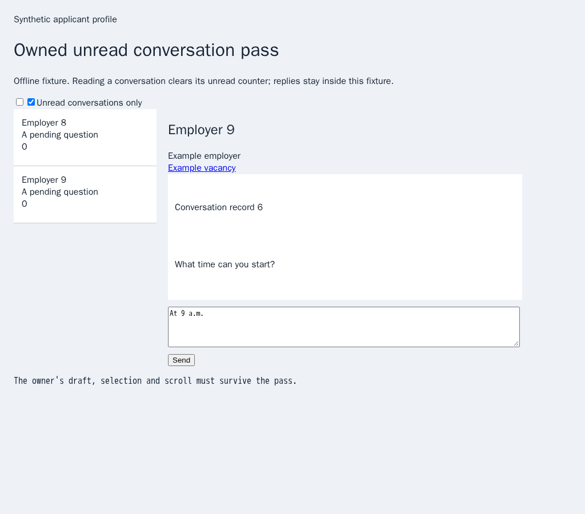
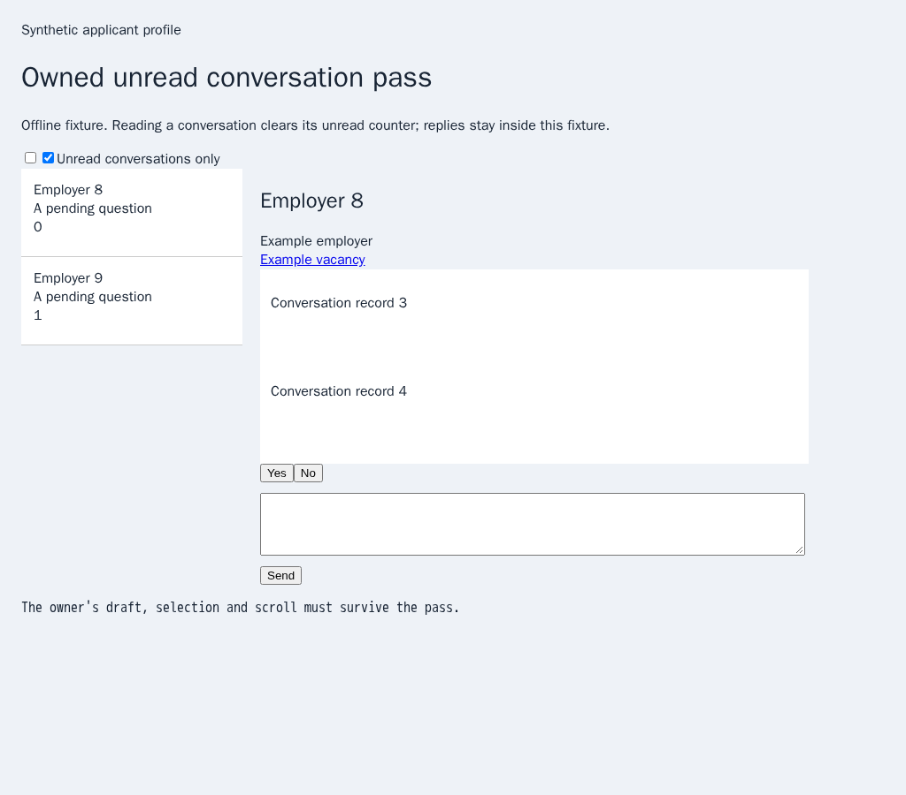

# Leave application-owned bot choices open for review

In CV, open the application batch and enable **Review unread chats alongside applications**. Give the chat worker a separate browser slot. In the routed fixture, chat 8 offers Yes and No for a question with an approved Yes answer. The published parent `20179f6c` clicked Yes, confirmed one outgoing message and moved to chat 9. The application-owned scheduler reused standalone automatic choice mode. [Pinned C14 and C15](https://github.com/konard/hh-job-application-automation/blob/fa0991b8c2d0896fb3b4be6c69947f0590094b15/docs/requirements/forms-and-chats.md#L228) · [PR #57](https://github.com/link-foundation/meta-sovereign/pull/57).

The application-owned run leaves chat 8 open with both provider choices and an empty composer. The next unread chat stays unread. Later checks read only the held chat until the owner responds or the chat no longer needs a reply. The separate application slot continues through its own confirmation settings. Stop drains the child and closes its chat browser.

Use **Leave bot choices for manual selection** in the standalone shared unread controls for the same behavior, or pass `--answer-chats=true --review-choices=true` on the CLI and `answerChats: true, reviewChoices: true` in either Lino encoding. The existing standalone option-selection default remains available. The shared receipt distinguishes an offered choice awaiting the owner from a native option still loading. A manual-choice pass creates no send reservation.

## Reproduction

```sh
npm run build:web
RUN_BROWSER_E2E=1 E2E_EXECUTABLE_PATH=/opt/google/chrome/chrome \
  APPLICATION_SCREENSHOTS=docs/screenshots/issue-56-application-chat-choices \
  npm run test:e2e:job-application-chat-choices
```

The before fixture ran the same native application regression with `APPLICATION_CHAT_CHOICES_BEFORE=1` and the published parent modules and bundle. It asserts the one synthetic selection and advancement to chat 9. The fixed native regression asserts zero chat sends, a held choice on chat 8, an independent application delivery, and actual child exit. The standalone case uses the production Questions view and checks the manual-choice receipt.





Two focused regressions failed against the published parent. Node and Deno each passed 88 focused checks, and the browser shard contract passed 12 checks. The Chromium scenarios verify the application and standalone flows. Cached WebKit checks that both flows refuse without verified background focus and preserve the chat state. A separate Playwright MCP run at 390 pixels verified the standalone choice receipt, one visit, zero sends and no horizontal overflow. [Phone screenshot](../../screenshots/issue-56-application-chat-choices/mcp-manual-choice-phone.png).

[Logs](data/application-chat-choices.tar.gz) and [SHA-256 manifest](data/application-chat-choices.tar.sha256.json) record the parent and fixed runs.

Authenticated HeadHunter acceptance remains open. [Acceptance inventory](reference-feature-inventory.md).
