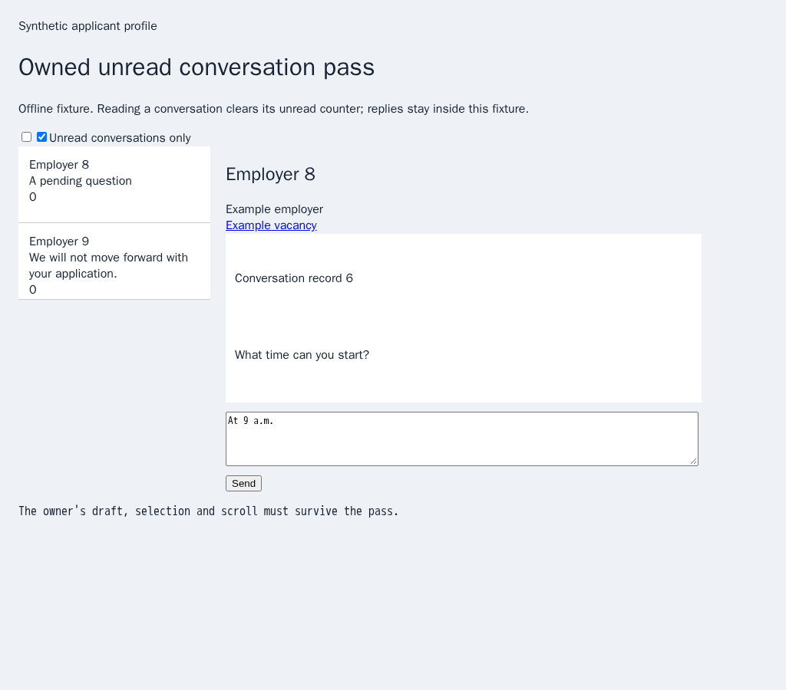

# Unread HeadHunter rejections before application chat review

HH10 and the pinned HeadHunter application workflow require the chat worker
to clear unread rejections before opening the first question that needs an
answer. The worker uses the existing **Process unread HeadHunter chats**
option, its owned browser slot and the saved polling interval. [Pinned
requirement](https://github.com/konard/hh-job-application-automation/blob/fa0991b8c2d0896fb3b4be6c69947f0590094b15/docs/requirements/forms-and-chats.md)
· [Pinned native iteration](https://github.com/konard/hh-job-application-automation/blob/fa0991b8c2d0896fb3b4be6c69947f0590094b15/src/answer-chats.mjs#L655-L713)

## Reproduce

Use an isolated HeadHunter chat fixture with unread question 8 above unread
rejection 9. Start the application batch with chat processing enabled and
follow the batch in CV Sync. The published parent opened chat 8 and held
its draft while chat 9 stayed unread. On the corrected pass, the worker
opened chat 9 first, then held chat 8 with the same draft. The fixture
recorded one confirmed application and zero chat sends.

| Published parent | Rejection-first pass |
| --- | --- |
|  |  |

The worker prioritizes incoming, unread rows with recognizable rejection
previews. At activation it checks the exact native row, unread count,
direction and preview again. It advances after the complete archived
conversation and a fresh native snapshot confirm a passive rejection.
Drafts, choices, unresolved requests, links, and incomplete or changed
history stay in review. The saved decision records whether the rejection
needed a reply. The provider controls its unread counter when the
conversation opens.

## Verification

- `npm run test:e2e:job-application-chat-rejections` runs the targeted routed
  Chromium reproduction and the native preview-change guard.
- The mandatory application chat choice group verifies that the same worker
  clears a rejection before holding an approved native choice. A third
  ordinary unread chat stays available for the owner. Fixed-size browser
  groups retain both recruiter wait checks in the application rejection
  and limit restoration groups.
- Focused Node and Deno tests verify admission, archived turn safety,
  owner drafts, changed snapshots, conditional replies, links, and
  preservation of the existing opt-in notice reply policies.
- Playwright inspected the CV Sync review at 390×950 with no horizontal
  overflow or page exceptions. The same worker recorded visits 9 and 8,
  preserved the owner's existing draft, and stopped with zero sends.
  [Phone screenshot](../../screenshots/issue-56-application-chat-rejections/mcp-application-chats-phone.png)

Authenticated HeadHunter acceptance, the standalone rejection sweep and
the remaining recruiter reply workflow are still open under HH10.

[Evidence archive](data/application-chat-rejections.tar.gz) ·
[File hashes](data/application-chat-rejections.tar.sha256.json)
