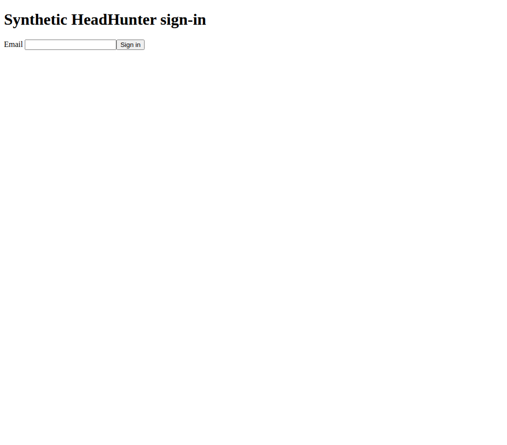
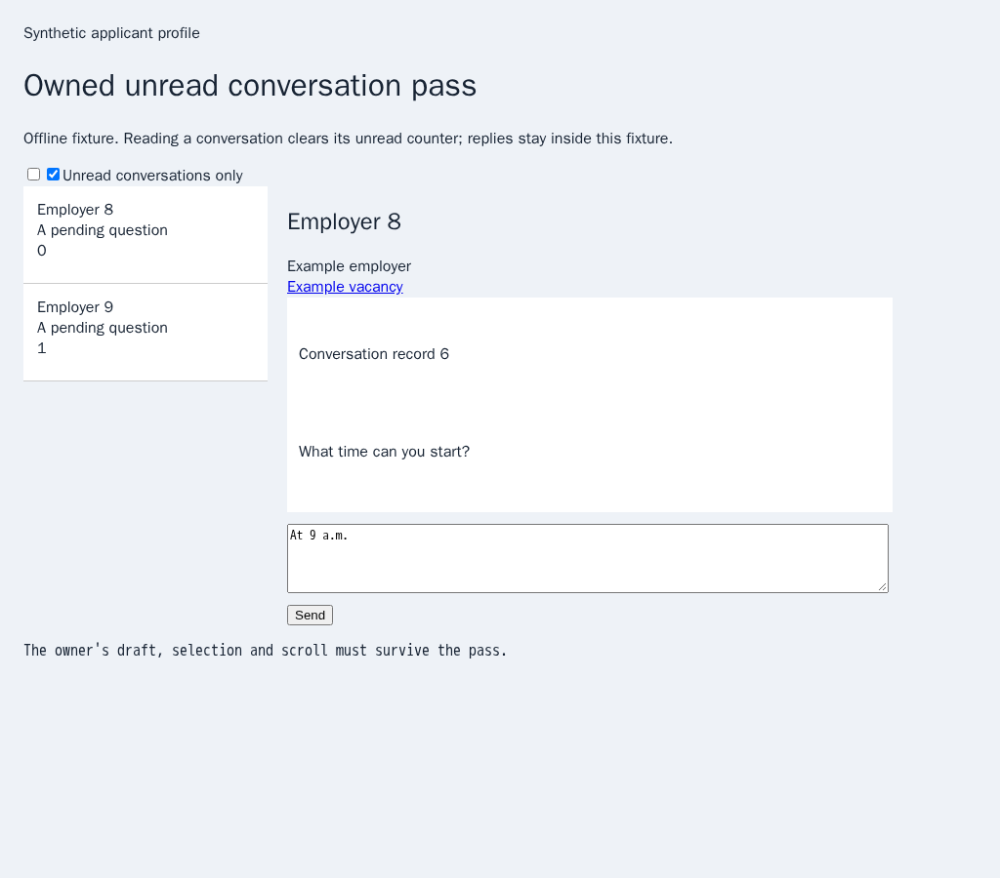

# Reuse HeadHunter sign-in in the application chat slot

In CV, start a batch with **Review unread chats alongside applications** enabled. In the routed regression, the application browser is already signed in and the separate chat browser opens signed out. The published parent `14e707af` reports `login-required`, while the application advances to its own send confirmation. The chat browser had also been resolving its profile from the default store directory instead of the active workspace. [Pinned C2 requirement](https://github.com/konard/hh-job-application-automation/blob/fa0991b8c2d0896fb3b4be6c69947f0590094b15/docs/requirements/forms-and-chats.md#L216) · [PR #57](https://github.com/link-foundation/meta-sovereign/pull/57).

The batch now resolves the chat profile in its workspace. If the chat slot shows an untouched HeadHunter sign-in, the worker waits briefly for the current batch's signed-in application page. It copies scoped secure cookies directly into the separate browser context and checks that the provider's chat list opens. An already signed-in chat slot keeps its account. A verification challenge, entered sign-in text, a changed application, or a stopped batch prevents a new handoff. Logs record only the confirmed reuse event and chat slot. Browser profiles retain their normal session persistence.

## Reproduction

```sh
npm run build:web
RUN_BROWSER_E2E=1 E2E_EXECUTABLE_PATH=/opt/google/chrome/chrome \
  APPLICATION_SCREENSHOTS=docs/screenshots/issue-56-application-chat-session \
  node experiments/issue-56/application-chat-session-browser.mjs
```

The same experiment with `APPLICATION_CHAT_SESSION_BEFORE=1`, the exact parent application and its rebuilt web bundle confirms the login refusal and independent application activity. The updated Chromium scenario verifies one application delivery after confirmation, a native draft held in chat 8, zero chat sends, chat 9 still unread, and the owned browser and child closed after Stop. The native WebKit scenario verifies session preparation separately, including preservation of entered sign-in text and a visible CAPTCHA. The full WebKit batch fixture stopped earlier with `jobs-application-state`. The GitHub browser group runs the corresponding scenario on each engine. The cookie and provider pages are synthetic.





The focused sender regression failed on the parent. Node and Deno each passed 51 focused checks, including workspace profile isolation, the protected destination cases, cancellation and changed application ownership. The browser registration contract passed all 12 checks. An independent Playwright MCP run at 390 pixels confirmed the held draft, zero chat sends, all four translations and no horizontal overflow. [Phone screenshot](../../screenshots/issue-56-application-chat-session/mcp-application-chats-phone.png) · [Logs](data/application-chat-session.tar.gz) · [SHA-256 manifest](data/application-chat-session.tar.sha256.json).

The parent hosted lint job reached Prettier with zero ESLint errors, then failed on a table row in the acceptance inventory. The archived transcript records the path at line 756 and the exit at line 758. The updated inventory passes the focused formatting check. [Hosted job](https://github.com/link-foundation/meta-sovereign/actions/runs/45313535323/job/138179809191).

Authenticated HeadHunter verification and the remaining HH01 and HH10 requirements stay open. [Acceptance inventory](reference-feature-inventory.md).
