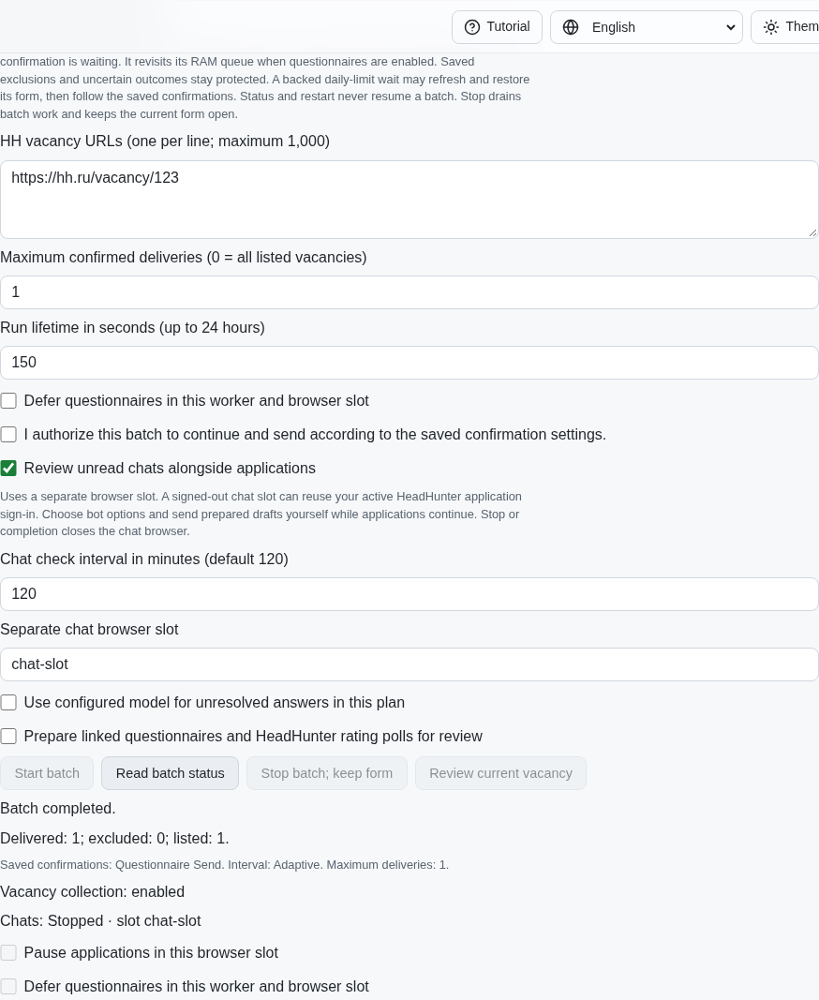
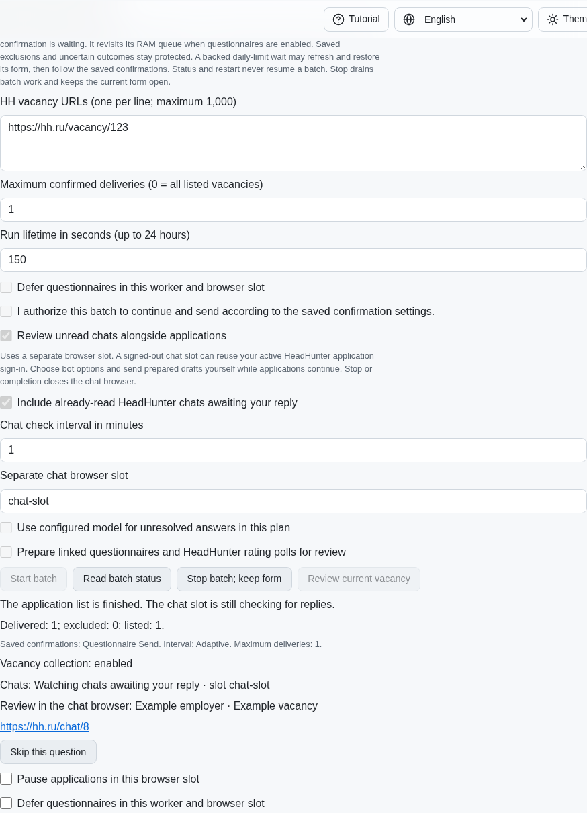

# Pick up waiting HeadHunter chats after application delivery

The pinned HeadHunter workflow opens chats in a separate slot while applications continue. In the optional watch, an incoming last message stays open until the owner replies or skips it. [Pinned C7 requirement](https://github.com/konard/hh-job-application-automation/blob/fa0991b8c2d0896fb3b4be6c69947f0590094b15/docs/requirements/forms-and-chats.md#L221) · [PR #57](https://github.com/link-foundation/meta-sovereign/pull/57).

In CV or Operator, enable the application chat slot and select **Include already-read HeadHunter chats awaiting your reply** before starting a batch. The selected interval defaults to one minute. A confirmed application delivery wakes the chat slot for a fresh scan when it is safe to do so. If a draft is already held, the child finishes that review before returning to the list. Applications can continue in their own slot throughout. When the application list reaches its limit, the same child can finish the pending chat review within the batch's original duration. The ordinary application chat mode still checks unread conversations on its 120-minute default schedule.

The foreground batch command accepts `--process-chats=true --chat-watch-waiting=true`. Use `status` to display the currently held question, then `s` to skip that question. The shared panel has the same exact Skip control. Both Lino formats recover the confirmed Skip receipt after Stop. An unconfirmed application dispatch leaves its delivery state unknown and issues no chat refresh.

## Reproduction

```sh
npm run build:web
RUN_BROWSER_E2E=1 E2E_EXECUTABLE_PATH=/opt/google/chrome/chrome \
  APPLICATION_SCREENSHOTS=docs/screenshots/issue-56-application-chat-waiting \
  node experiments/issue-56/application-chat-waiting-browser.mjs
```

The fixture reveals an already-read chat only when the native form submits. Run with `APPLICATION_CHAT_WAITING_BEFORE=1` against the published parent `0231dbc6`, using the same fixture helpers, to reproduce the difference. The baseline batch completes and closes its chat slot without visiting the newly visible chat. The revised scenario checks the positive provider receipt, the held chat and untouched Send control, then confirms Skip and drains the same child.





The independent Playwright MCP run used a fixture sender and the production interface and route stack. It confirmed one delivery, one refresh, the exact Skip and worker closure. It checked English, Hindi, Russian and Chinese and rendered the application receipt at 390 pixels. The browser recorded no page exceptions. The console retained a favicon 404 and cache-write diagnostics during reload. [Phone screenshot](../../screenshots/issue-56-application-chat-waiting/mcp-phone.png).

Node and Deno each passed 53 focused checks, including the browser group registration. Chromium passed both native scenarios in the combined group. The first combined run timed out at Stop in the existing sign-in scenario. The repeat observed the Stop response before checking that the child drained. WebKit refused the waiting watch before making provider changes when it could not verify background focus. [Logs](data/application-chat-waiting.tar.gz) · [SHA-256 manifest](data/application-chat-waiting.tar.sha256.json).

Tracking for HH10 remains open for full authenticated provider verification and the rest of the pinned workflows. [Acceptance inventory](reference-feature-inventory.md).
