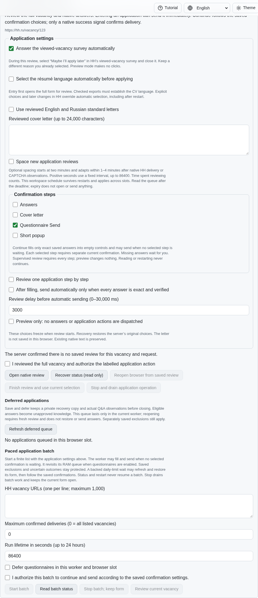
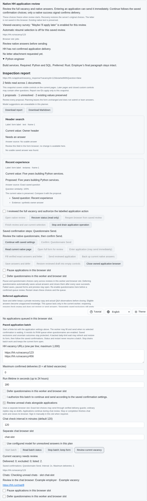
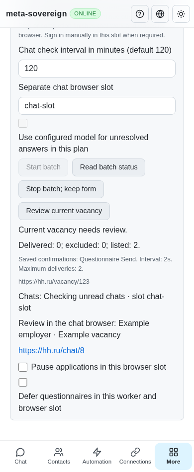

# Application-owned independent chat review

The pinned forms-and-chats workflow C14 starts automatic chat work from an
application owner and stops it when that owner ends. Previously batch options
discarded chat intent, and the shared application panel offered no corresponding
control. Reproduce this with
`python -B experiments/issue-56/application-chats-before.py`: the focused
intent assertion fails against exact parent `933b23fb`, then the script restores
the drafted source in `finally`. The before screenshot uses that parent's
production UI bundle.

An explicit `vacancies application-batch --process-chats` now creates a real
private child. Its authenticated bounded loopback Lino channel supervises the
parent-owned unread service; the parent retains the single canonical store
writer. `--chats-interval-minutes` defaults to 120 (accepted range 1–120),
`--chat-browser-slot` defaults to `chat-slot` and must differ from the application
slot. `--chat-model-draft` remains a separate default-off choice. The existing
owned unread service runs the actual interval; the child observes its status
and emits changed held-review titles and URLs. The browser opens only after
confirmed batch admission, uses its own persistent slot and keeps the default
visible-window policy. Browser-commander selects its local control port rather
than reserving the reference script's fixed port 9340.

The existing sequential unread flow retains exact-answer and bot-option guards,
draft-only ordinary chat replies, review holds and focus protection. The
application-owned worker leaves native bot choices for manual selection.
[Choice review verification](application-chat-choices.md). A held chat
does not pause the independent application owner. Startup/login/focus/child
failures produce refused receipts while applications remain usable. Stop,
completion, expiry and service shutdown abort and await admitted work, close
the chat context, stop the model if owned, close the channel and await actual
child exit. Preview, repeated Start, status and recovery never create a child.
Saved legacy batches keep their original option signatures. New terminal
receipts retain the actual pass and held review without persisting an active
child or a live PID.

`job-application-chats.test.js` and `job-application-chats-controls.test.js`
pass 12 focused checks under each of Node, Bun and Deno. They cover actual child
PIDs and exit, separate slots, independent application progress, failed startup,
unexpected child exit, blocked startup/closure draining, expiry, shutdown,
preview/recovery, strict settings, CLI admission, both production Lino
encodings and all four localized controls. The existing mandatory native batch
browser group now registers `verifyNativeApplicationChats`; five registration
checks pass.

One isolated native Chromium check uses two synthetic provider browsers and the
real child: a saved exact answer becomes the held chat draft, no chat text is
sent and the next unread chat remains untouched. A separately confirmed native
application delivery advances to the next vacancy while retaining the same
chat PID and hold. Stop closes the chat context and the PID no longer exists.
The check reloads English, Russian, Hindi and Chinese and verifies a 390-pixel
layout. Independent Playwright MCP inspection repeats the actual child and
production UI controls with four-language reloads and a phone screenshot. It
reports zero page exceptions and zero chat sends; its console contains favicon
404s and browser cache-write errors, retained without claiming a clean console.
Its fixture server confirms all owned resources closed.

The [evidence archive](data/application-chats.tar.gz) and
[hash manifest](data/application-chats.tar.sha256.json) preserve commands,
parent failures, runtime/native/MCP results, source snapshots and screenshots.
The hosted checks must still pass against the published commit. Synthetic
fixtures establish these lifecycle and UI behaviors; they do not establish live
provider parity, every HH10 criterion or the other 60 unchecked inventory rows.
Those remain required in [PR #57](https://github.com/link-foundation/meta-sovereign/pull/57).
