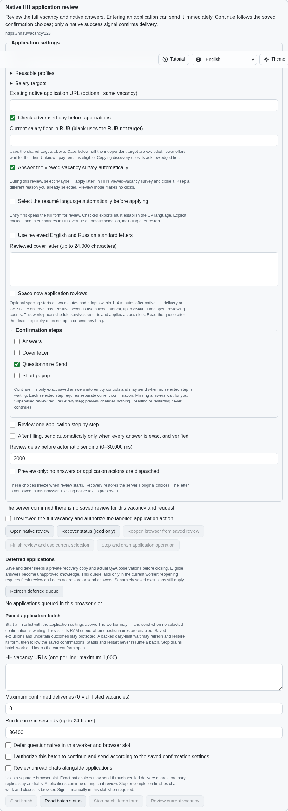
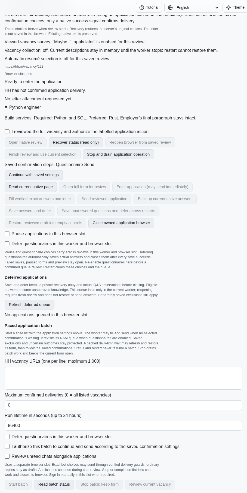
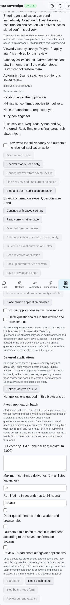

# Optional persistent vacancy collection

PR: https://github.com/link-foundation/meta-sovereign/pull/57

The pinned [vacancy insights contract](https://github.com/konard/hh-job-application-automation/blob/fa0991b8c2d0896fb3b4be6c69947f0590094b15/src/vacancy-insights.mjs)
and its README require complete vacancy context in the current run even when
collection is disabled. The published application worker always wrote the shared
vacancy cache. It also wrote the description into its application journal, so
disabling only the cache would still have retained the complete description.
The existing test mode also suppresses provider mutations and cannot substitute
for this independent collection preference.

Applications now accept `collectVacancies: false` through both Lino encodings,
the CLI's `--no-collect-vacancies=true`, and the shared four-language interface.
Collection remains enabled by default. An omitted setting retains the previous
canonical options and signatures; an explicit choice is validated, frozen into
batch settings and checked against returned receipts. Single and batch receipts
show the saved choice rather than the current checkbox value.

When disabled, full validated text, HTML, skills and native metadata remain in
RAM for the current worker. Forms, recruiter-chat salary planning and external
assignment planning share that context without a second provider read. An
unreadable native salary remains unknown. The journal stores `vacancy: null`;
confirmed applications do not update saved vacancy metadata. Existing saved
descriptions remain byte-for-byte unchanged. A refused journal acknowledgement
restores the acknowledged live record without writing its context to disk.

The RAM map is scoped to the actual workspace store and owner. It refuses more
than 1,000 URLs or 64 MiB of conservatively measured JSON text instead of silently
persisting or evicting context. Those are explicit bounds, not a claim of local
stress testing. Closing an owned browser keeps context available to other work
in this run; stopping the worker clears its entries. Offline status and a newly
started worker cannot recover a disabled description. The interface explains
this restart limit in English, Russian, Hindi and Chinese.

This setting governs the application run. A separate explicit Collect/refresh
operation still saves a description and supersedes RAM only after its write is
acknowledged. Existing caches and actual form-answer draft backups retain their
own behavior; this is not a global deletion or privacy setting.

## Reproduction and verification

```sh
node --max-old-space-size=384 experiments/issue-56/application-collection-parent.mjs
node --max-old-space-size=384 --test --test-concurrency=1 js/tests/application-collection.test.js js/tests/application-collection-controls.test.js
node --max-old-space-size=384 experiments/issue-56/application-collection-native.mjs
```

The first command loads the exact published production parent `6c90c3f5` into
the current regression tests without replacing working files. Seven tests fail
and two controls pass. The separate native before check uses the unchanged
`d48a6179` panel/state modules and fails because the collection checkbox is absent;
the archive verifies those two modules equal the published parent bytes.

All 15 focused checks pass after the change. Nineteen compatibility checks also
pass, including finite CLI batches, existing context controls and native-group
registration. Tests cover both wire encodings, frozen batch choices, malformed
flags before opening storage, legacy signatures, workspace isolation, failed
acknowledgements, unknown salary, explicit collection and real planner context.
One mocked provider confirmation verifies that delivery cannot alter the prior
cache while collection is disabled.

The finite native browser scenario captures the full final employer paragraph,
enters one real fixture form, preserves an actual owner answer, performs no
submission, checks four locales and phone fit, and closes all three owned
provider pages. RAM reuse avoids another browser; closed offline status has no
description. The scenario joins the existing feedback browser CI group for
both engines. Full runtime and browser matrices run in hosted CI.

Independent Playwright MCP verifies the full description, four locales,
desktop/phone fit, unchanged acknowledged cache fingerprint, an empty journal
description and three closed provider pages with zero clicks or page exceptions.
Its control server also reports successful cleanup. Its console log retains a
missing favicon and browser cache-write errors; a clean-console claim is not
made.





## Retained investigation and remaining requirements

Early native attempts incorrectly inspected the original fixture store instead
of the server's wrapped store, assumed reload recovered a released request, and
assumed a close receipt had already discarded live context. These fixture and
expectation errors remain in the evidence. The final check uses actual runtime
storage and distinguishes live close receipts from offline recovery.

The first independent MCP attempt used a browser fetch blocked by cross-origin
rules. The second inspected a mocked `put` hook bypassed by acknowledged causal
writes. The corrected independent check queries actual stored rows and compares
their complete cache fingerprint before and after. Both earlier fixtures drained;
their refused results are preserved rather than counted as passing checks.

The source-bound archive `data/application-collection.tar.gz` includes exact
parent and reference bytes, source changes, scripts, logs, screenshots and a
per-file SHA-256 manifest. Exact-source hosted validation remains required.
HH03 is unfinished: collection preferences alone do not implement all insight,
comparison and alias behavior, and fixtures do not prove live provider operation.
No inventory row is accepted by this unit. The inventory remains **88 verified /
30 unfinished**; PR57 stays draft and unmerged.
