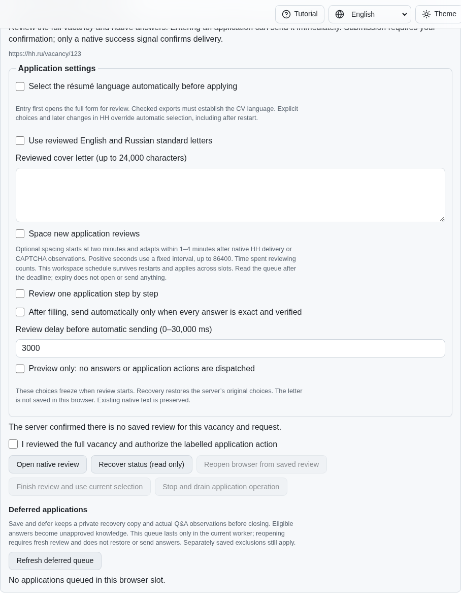
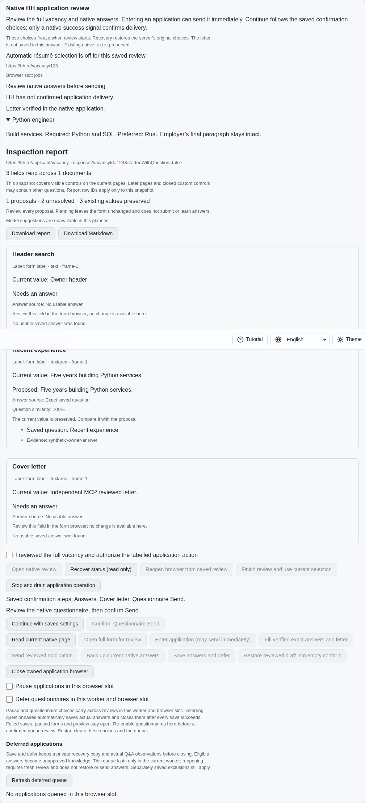
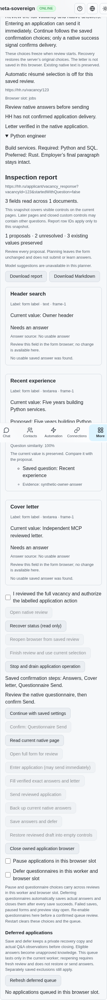

# Independently configured native application confirmations

PR: https://github.com/link-foundation/meta-sovereign/pull/57

Issue #56 requires the full HH reference workflow through CLI, API and UI.
The pinned HH README, lines 368–398, describes independently selected
`answers`, `cover-letter`, `send` (default) and `popup` confirmations, including
`none`. A cover-letter-only response does not require questionnaire Send
confirmation. The exact-answer exception applies only after automatic filling
of all questions, with the visible values still matching exactly.

On published parent `6ad826b0`, supervised review and separate manual actions
already existed, but independently selected pauses and continuation did not.
The finite service regression fails because the continuation operation is
absent; the native regression captures the missing control and fails on its
absence. Run either reproduction from the repository root:

```sh
PYTHONDONTWRITEBYTECODE=1 python3 experiments/issue-56/application-confirmations-before.py
PYTHONDONTWRITEBYTECODE=1 python3 experiments/issue-56/application-confirmations-before.py --native
```

Both probes restore the actual sources and bundle and close their fixtures.
The original missing behavior is an implementation gap, rather than a provider
failure. No live account, application or provider request was used.

## Behavior and boundaries

Confirmation choices freeze with the original review signature. Omitted choices
retain the default questionnaire Send pause without changing legacy journal
signatures. Supervised review requires all four choices and disables the exact
exception. CLI accepts `--confirm=answers,cover-letter,send,popup` or `none`;
`continue` follows the saved choices, while `confirm-answers`, `confirm-letter`,
`confirm-send` and `confirm-popup` authorize only the current displayed step.
The existing manual actions remain available.

The bounded continuation opens a full form through the existing guarded
navigation, fills eligible exact answers only in empty native controls,
attaches a separately requested letter and stops at each selected confirmation.
Missing answers always wait for the owner, including with `none`. File and
unsupported controls, open/ambiguous CV choices, incomplete inspection,
changed native values or document, pauses, verification, provider holds and
uncertain dispatch reservations cannot become permission to send.

A confirmation is bound to the current request, revision, document and report.
Status and UI reload do not perform work or reuse the UI confirmation checkbox.
An explicit new native read, close or worker restart removes continuation
and autofill authority. Sending without the default pause under the exact
exception additionally requires this continuation's own empty-field autofill,
all answers still matching, the existing review delay and fresh dispatch guards.
Already matching owner answers retain the Send pause. Only native HH delivery
can produce a completed continuation receipt.

Both Lino encodings carry the production operation and validated receipts.
Four-language settings explain that Continue may send when no configured step
is waiting. Phone layout retains the same interaction and delivery states.
Preview remains free of application effects.

## Verification

- 63 focused Node tests pass, including existing supervised, ownership and
  recovery checks; a further fixture URL regression passes independently.
- 34 focused Deno tests pass for the new service, control and guard cases.
- Native Chromium checks three independent confirmations, one Send, zero entry
  clicks, reload without replay, four languages and phone layout.
- Independent Playwright MCP repeats those boundaries through the actual UI and
  production Lino routes: three confirmations, one Send, zero entry clicks,
  four languages, phone layout and closed resources with no page errors.
- The first MCP run exposed a fixture-only strict URL comparison. Guarded full
  form navigation includes `startedWithQuestion=false`; the evidence reader
  now reuses the existing validated form locator. Its regression also rejects
  foreign and duplicate-vacancy URLs. The first native locale check confused
  ordinary English `application.` with a translation key; the assertion now
  requires a key character after the dot. Neither correction weakens action,
  delivery or locale assertions.

Before the change:



After the separate answer and letter confirmations, still waiting for Send:





The checksummed `data/application-confirmations.tar.gz` retains source snapshots,
parent failures, tests, native/MCP receipts and screenshots. Hosted checks must
be read for the commit which publishes this unit; parent CI is separate evidence.

HH08 remains incomplete. This explicit single-review continuation is a
prerequisite for full paced batches and automatic RAM-queue revisits. All 81
original incomplete inventory rows and their remaining acceptance criteria
remain required. PR #57 stays draft and unmerged.
