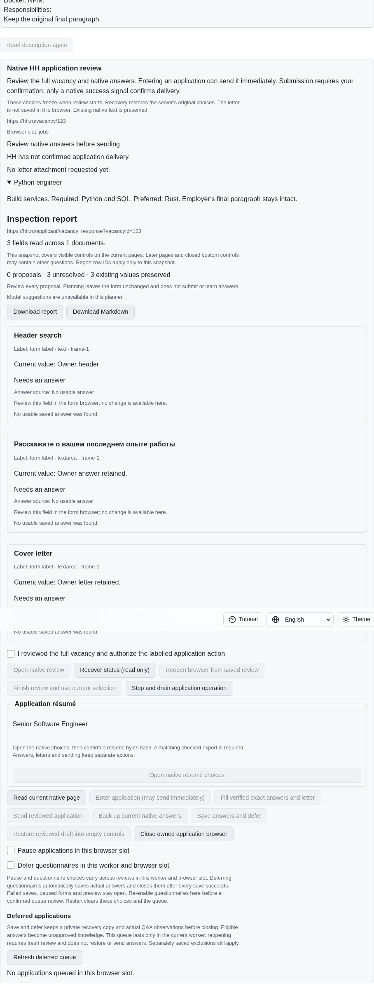
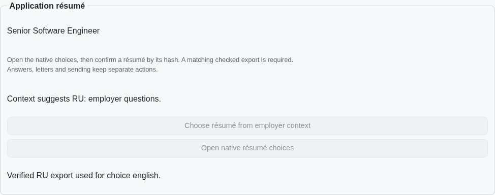
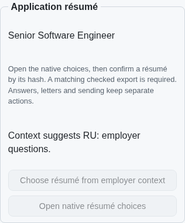

# Confirmed résumé choice from employer context

PR: https://github.com/link-foundation/meta-sovereign/pull/57

An explicitly confirmed application action derives a language from employer
questions and the frozen full vacancy, then selects an available native résumé
with matching checked export evidence. Dollar pay takes precedence, followed by
question language, full description and finally the title. Owner answers, cover
letters, unrelated header controls and résumé titles do not determine language.
Unknown or unreadable context refuses before any menu or choice effect.

This is a prerequisite for HH06. Automatic selection before entry that can send
immediately, persistent same-document owner overrides, language-aware standard
letters, authenticated parity and all 81 original unchecked inventory rows remain
required. The PR remains draft and unmerged.

## Reference and boundaries

The HH reference README and résumé/letter implementations were read at commit
`fa0991b8c2d0896fb3b4be6c69947f0590094b15`. README lines 105–124 require choosing
before sending, avoiding an already correct chooser, retaining manual changes
and using the same language for standard letters. Our original implementation
adds the explicit confirmed operation without claiming the unfinished automatic
policy. It reuses the existing review controls and spacing, following the product
vision's restrained, shared controls and truthful capability states.

The current bounded heuristic recognizes Russian/Cyrillic and sufficiently clear
English text. USD, USDT, USDC, dollar wording, numeric dollar amounts and a bare
dollar sign in a compensation question prefer English. Shell variables,
substitutions and templates are excluded. This heuristic is not a multilingual
language detector. Incomplete native question coverage remains unreadable.

The operation uses the same owned document and synchronous guards as manual
résumé selection. A closed chooser whose unique current title already matches
checked export evidence needs no menu click. Otherwise it opens once, intersects
actual enabled options with same-slot hash/title/export proofs and prefers a
checked matching option, then the latest verified candidate. It verifies the
native result and closes an open menu. Missing, ambiguous or corrupt evidence
never authorizes a guessed choice. Answers, letters and submission reservations
remain unchanged; preview makes no native effect. A fresh receipt consumes even
an already-correct confirmation. Read-only recovery never replays selection.

Collected salary is preserved inside the existing frozen vacancy snapshot for
recovery. Language decisions and export proofs are response-only; no new journal
property or automatic policy is introduced. Default-off
`MS_JOBS_APPLICATION_DEBUG=1` diagnostics expose only phases, reason codes and
language enums, without application content.

## Reproduction and verification

Exact published parent `326acade6133ce6c14c50a96dba4e60abba22c5a` rejects the new
confirmed action with `jobs-application-input`; its native browser lacks the
contextual choice control. Both bounded reproductions restore production sources
and drain their fixtures:

```sh
PYTHONDONTWRITEBYTECODE=1 python3 experiments/issue-56/application-context-before.py
PYTHONDONTWRITEBYTECODE=1 python3 experiments/issue-56/application-context-before.py --native
node --max-old-space-size=384 --test --test-concurrency=1 js/tests/job-application-context.test.js js/tests/job-application-context-controls.test.js js/tests/job-application-resume.test.js js/tests/job-application-resume-controls.test.js
deno test --allow-all --no-check --v8-flags=--max-old-space-size=384 js/tests/job-application-context.test.js js/tests/job-application-context-controls.test.js
RUN_BROWSER_E2E=1 E2E_BROWSER=chromium E2E_EXECUTABLE_PATH=/opt/google/chrome/chrome node --max-old-space-size=384 experiments/issue-56/application-resume-native.mjs
```

The regression covers actual checked files, title/language disagreement, employer
precedence, read-only preview, repeated already-correct choices, missing native
options, corrupted files, asynchronous context changes, frozen salary recovery,
both Lino encodings, foreground CLI and four UI languages. The extended existing
browser scenario uses synthetic owned routes and never the user's server or an
authenticated provider. Broad runtime and browser matrices remain hosted.

Initial browser probes and their diagnostics are retained alongside the final
results. The first exposed an already-correct confirmation retaining its old
revision. Another exposed a coverage change when the native CV menu opened.
The generic form inspector correctly reports the chooser's unlabelled native CV
radios as partial coverage. Context inspection now accepts that one reason only
when every unlabelled field is an exact known CV radio in the owned main frame;
unknown radios, incomplete employer questions and every other partial reason
still refuse. The generic inspector retains its existing safeguards. Neither
initial failure is presented as successful verification.

Final results: 32 focused Node cases, 17 new Deno cases, and 44 recovery,
ownership, session and dictionary cases pass. One extended native Chromium
scenario and one independent Playwright MCP scenario preserve owner answers and
letters, verify the Russian export despite its English title, consume renewed
confirmation, skip an already correct chooser, recover read-only in four locales
and send zero applications. Both fixtures and the MCP browser drain completely.
The screenshots below come from those synthetic owned native pages.

## Visual evidence

Exact parent has no employer-context choice:



Confirmed selection reports employer language and verified export evidence:



The shared controls at 390 CSS pixels:



Source snapshots, pinned reference text, finite parent failures, final validation
logs and screenshots are preserved in `data/application-context.tar.gz`, with a
per-file manifest in `data/application-context.tar.sha256.json`. Exact published
head CI is required separately; local results do not establish a hosted pass.
