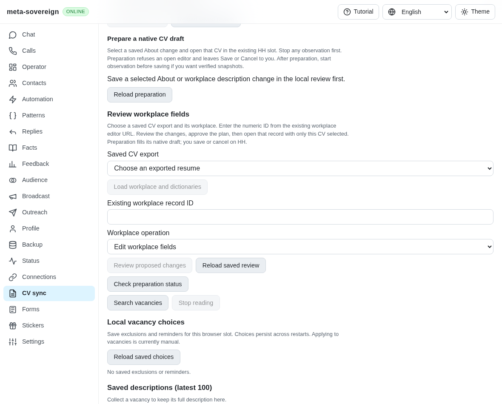
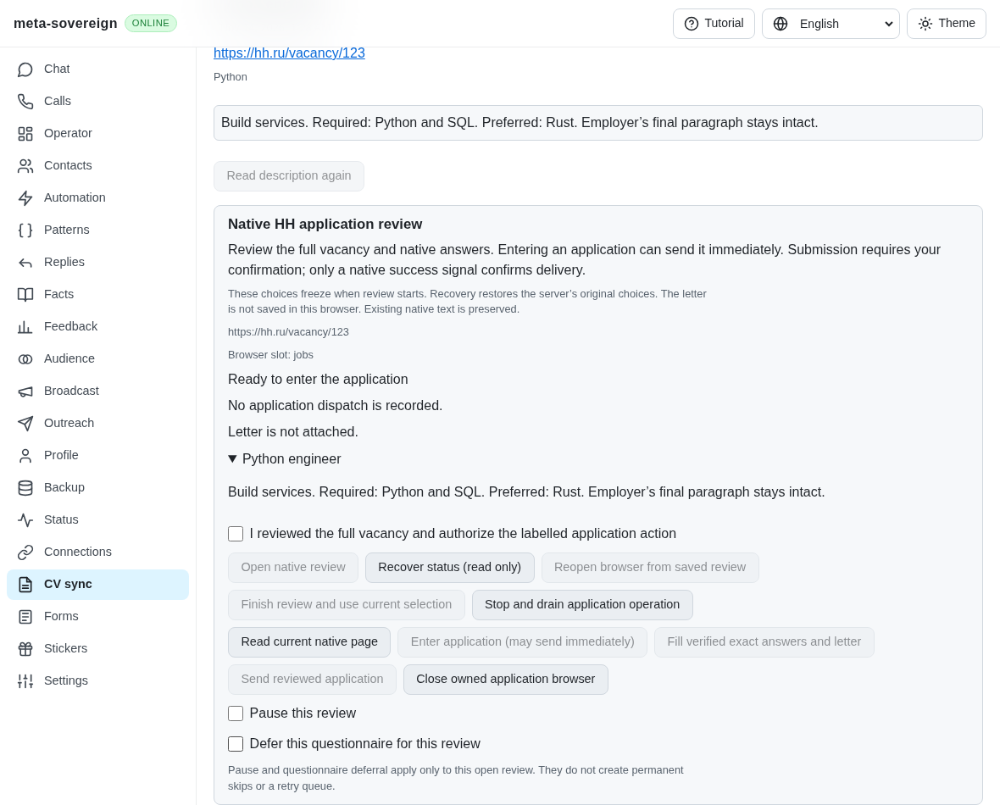
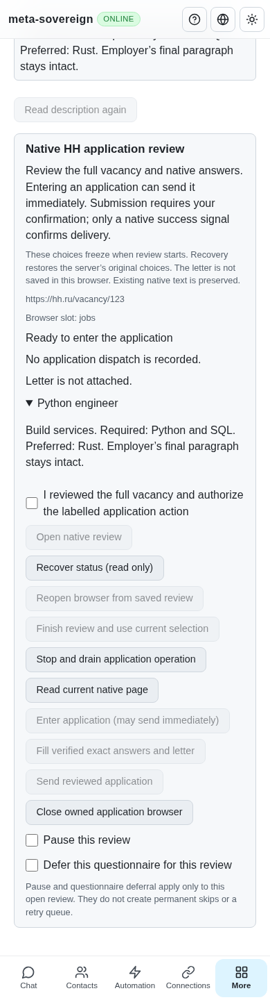
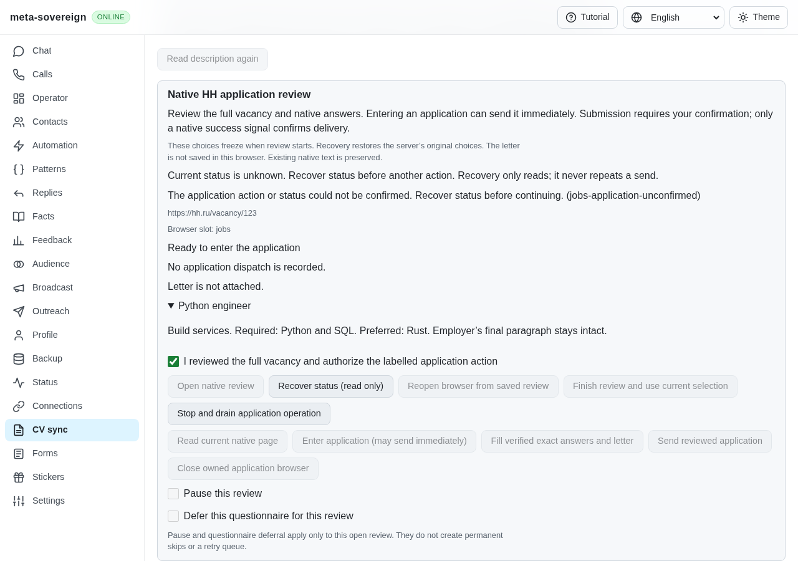
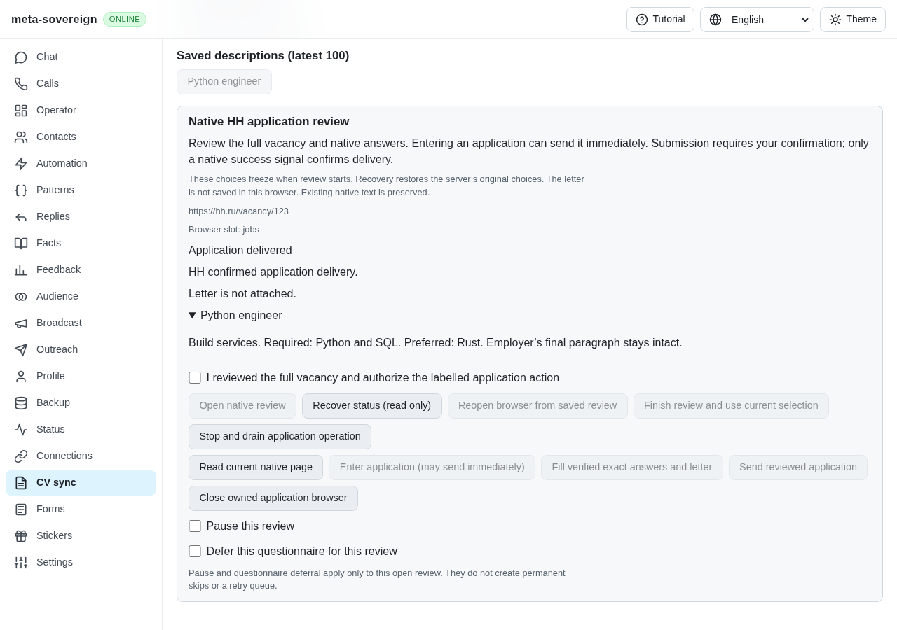

# Native application controls and recovery

[PR #57](https://github.com/link-foundation/meta-sovereign/pull/57) adds a native
HH application review card to CV sync in English, Russian, Hindi and Chinese.
The issue and HH06–HH08 remain unfinished. Deferred retry queues, complete
session policies, recovered native forms and other original inventory criteria
still require implementation and verification. `applicationReview` advertises
the available owned executor; the broader `apply` capability remains false.

## Reproduction and behavior

The exact published `81d55350` UI has vacancy search/collection and no application
controls. `python3 -B experiments/issue-56/application-panel-before.py` temporarily
serves that published bundle, verifies the missing card and captures its screen;
it restores every current bundle byte in `finally`.

With a connected native-browser server, collect or select a saved HH vacancy
and choose its browser slot. Review the optional cover letter, preview mode,
exact-only automatic submission and review delay before opening the review.
The native vacancy's full collected description, field plan, verified letter
and delivery evidence appear together. Entering an application is explicitly
labelled as potentially sending immediately. Entry, filling and submission each
require a fresh confirmation. A receipt or mode change clears that confirmation.
Other vacancy browser operations remain blocked while the review owns its slot.

An absent or failed status response cannot enable another action. The browser
stores only the pending URL, slot and request ID, before issuing its first POST.
It never persists the letter or options locally. Reload recovery uses GET only;
an unreceived mutation stays unknown until a matching validated receipt arrives.
There is no automatic POST retry or offline mutation fallback. The server keeps
the original options and pre-dispatch reservations. A durable journal cannot
claim an active browser: only the live service can report `active: true`.

Stop drains outstanding work before status recovery. Closing clears the local
pending identity only after acknowledged closure. A confirmed inactive preview
with no reserved entry/submission and no delivery can begin a new request with
new settings. Delivered or uncertain attempts cannot use that restart path.
Pause and questionnaire deferral currently affect this review only; their labels
state that no permanent skip or deferred retry queue is created.

## Focused verification

- 43 Node checks pass across the application service, interfaces, ownership,
  browser controller and existing vacancy search/controls. Seven controller
  cases cover lost replies, stale selection reads, malformed/foreign receipts,
  unavailable storage, synchronous failures, drained Stop, forged journal
  liveness and unissued preview restart. Existing four-language rendering and
  dictionary parity checks pass.
- The isolated native Chromium UI scenario uses the production page commander
  against intercepted synthetic HH HTML. It records exactly one entry and one
  submission. A real entry response is dropped after dispatch; reload recovers
  the native questionnaire without another POST. The letter and exact answer
  are verified, an unrelated header input is preserved, a positive HH marker
  confirms delivery, and every owned browser closes with no page errors.
- Independent Playwright MCP verifies preview restart, acknowledged pause/resume,
  reversible deferral, renewed confirmation, verified filling, positive delivery
  and blocked delivered restart. Its initial checkbox probe incorrectly assumed
  synchronous server acknowledgement; the final probe clicks then waits for the
  acknowledged state. No production timeout or policy was weakened. All owned
  resources close. The fixture makes no authenticated provider requests.
- Changed JavaScript passes lint, formatting and secret checks. Existing hosted
  browser registration now includes this UI scenario; full browser/runtime
  matrices remain on CI. Exact published-head checks are required separately.

The earlier draft SSR rendering failure came from the old test state omitting
the new application state. Its fixture now supplies the same explicit unknown
state as the hook; offline controls stay disabled in all four locales. Earlier
draft failures and final logs are retained together, rather than replacing the
failed evidence with a success claim.

The [checksummed archive](data/application-controls.tar.gz) and
[manifest](data/application-controls.tar.sha256.json) preserve changed sources,
the exact published bundle, reproduction logs, independent MCP results and
screenshots. The separate security audit passes on `81d55350`, including the
previous negative URL probe correction. Its main workflow is still running;
that result does not establish CI success for these new controls.

## Before and after

Published UI, before the application card:

Native vacancy review and explicit application controls:

The same card at 390 CSS pixels, with wrapping controls and no horizontal overflow:

An unreceived entry response keeps actions disabled until read-only recovery:

Only native positive delivery evidence produces the delivered receipt:

