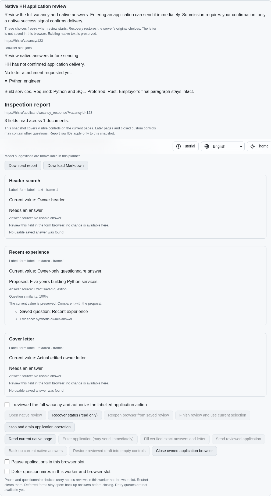
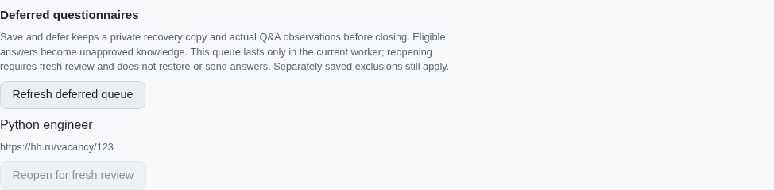
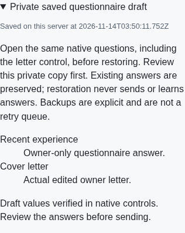

# Backed questionnaire deferral

This records the explicit deferral prerequisite. The subsequent
[automatic-policy unit](application-automatic-deferral.md) adds preservation and
closure when questionnaire mode is enabled; paced revisits remain unfinished.

[PR #57](https://github.com/link-foundation/meta-sovereign/pull/57) adds an
explicit Save answers and defer action. It acknowledges the complete actual
native draft, private Q&A observations and eligible unapproved answer learning
before closing the owned questionnaire. A bounded per-slot RAM queue can reopen
it for fresh review. HH08 and the original issue remain unfinished: automatic
mode-driven deferral, generic-error five-hour retries, ordinary queue pacing,
the supervised one-application preset and other unchecked criteria remain required.

## Reproduction

Published `5e622049` has explicit draft backup but no backed deferral operation,
queue or reopening control. Enter an isolated native questionnaire, edit the
actual answer and optional letter, then refresh the inspection. The published
panel has no Save answers and defer button. Closing and reopening requires
separate manual recovery and does not retain a deferred queue.

`python3 -B experiments/issue-56/application-deferral-before.py` reproduces the
missing operation against that exact parent. `--native` reproduces the HTTP 404
through production browser routing; `--mcp` starts the isolated published UI
fixture. Every replaced source byte is restored in `finally`. These synthetic
fixtures use production native inspection and controls without authenticated
provider access or real applications.

## Preservation and reopening

Deferral requires fresh owned identity, revision and confirmation. It first
captures every supported actual native answer and edited letter in the existing
private recovery draft. A separate private observation retains full control
values and semantic Q&A pairs. Eligible answers enter the existing shared
knowledge writer as unapproved observations, subject to HH-scoped canonical
corrections, privacy, placeholder, salary, assignment and contraction rules.
Ordinary backup and restoration still do not learn answers.

Every checkpoint must acknowledge successfully, including the final knowledge
flush. Native guards recheck owner values after slow checkpoints. Stale controls,
unsupported or sensitive fields, failed storage or changed owner values retain
the live form and refuse queue admission. Failed learning may leave unapproved
observations in memory; this is not claimed as a multi-record transaction.
Live unsent questionnaires and letter forms no longer close on an idle deadline.
Explicit Close, Stop and worker shutdown still drain owned resources; unentered
vacancy reviews retain their ordinary idle cleanup.

Queue entries contain identities, title and reason, without actual answers. They
exist only in this worker and browser slot, are bounded at 1,000, and never become
durable skipped/deferred vacancy choices. UI reload reads the worker queue;
worker restart forgets it while preserving the private draft. Browser intent
continues to contain only URL, slot and request ID.

Separately confirmed reopening checks the current queue identity, saved vacancy
exclusions, browser ownership and durable submission reservations. It reuses the
acknowledged native form location and original options, retaining worker policies.
A successful fresh review removes the queue entry. Failed opening retains it;
lost replies recover through read-only status rather than replay. Reopening does
not enter, fill, restore or submit. Restoration and submission retain separate
fresh confirmation boundaries, and uncertain submission remains reserved.

CLI commands `defer`, `queue` and `retry`, both Lino HTTP formats and all four
localized CV surfaces expose the same operations. After reload, the queue remains
available without a selected vacancy, and each reopening needs renewed confirmation.

## Verification

All 83 focused application service, ownership, recovery, draft, policy, CLI,
controller, HTTP and locale-render tests pass with concurrency one. The 14
affected control cases also pass after shared fixture consolidation; all 21 new
deferral cases pass sequentially under Deno. Six finite put/flush
failures verify that the actual answers stay open past idle; late owner edits,
HH-scoped corrections, failed reopening, exclusions, retained modes and restart
reservations are covered. All 27 shared form-learning and prefilling checks and 25 dictionary checks
preserve existing behavior. Exact command results are retained in the archive.

The affected native Chromium scenarios verify real entry/submission compatibility,
guards, lost-response recovery, draft restoration, retained policies and the new
deferral. Independent Playwright MCP verifies actual backed answers, owned browser
closure, queue recovery after UI reload, review-only reopening, separately
confirmed restoration and the 390-pixel surface without page errors or overflow.
All owned contexts, browsers and fixture servers close. Initial draft failures,
including a stale built bundle and duplicate test setup, are retained with the
corrected results. The duplication limit remains unchanged.

Every hosted check for parent `5e622049` passes. Full runtime/browser matrices and
resource-intensive builds remain hosted; this unit requires its own exact-head CI.

The [archive](data/application-deferrals.tar.gz) and
[manifest](data/application-deferrals.tar.sha256.json) preserve source snapshots,
exact-parent files, bounded probes, logs and screenshot hashes.

Before, actual values have no backed deferral or queue:

After, the owned form closes only after acknowledged preservation; reopening
remains disabled until confirmed:

Fresh reopening leaves empty controls. Separate restoration recovers the actual
owner answer and edited letter on the narrow surface:

