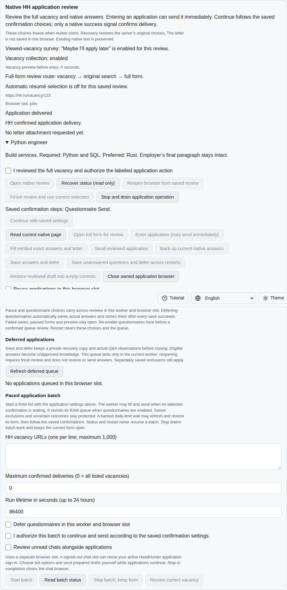
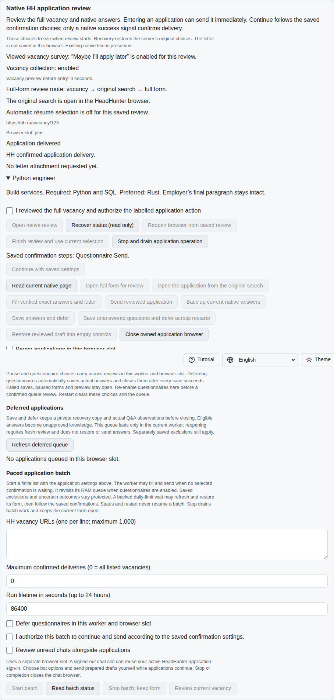

# Return to the original HeadHunter search after delivery

In CV Sync, select a collected vacancy and use the original search route or
enter the original search URL. Open the application, review the native form and
confirm **Send**. Wait for the native delivery receipt. The owned browser then
returns to the same search, including the original filters and page. The review
keeps its confirmed receipt even if the search omits the delivered vacancy.
The same result applies after sending a separate letter from the vacancy-page
fallback. The CLI and both Lino encodings use the same frozen route settings.

The worker records delivery before requesting navigation. An open draft, a
verification check, a changed document or an unresolved cover letter can keep the
browser in review. Reading or recovering a receipt does not dispatch another
navigation or send. This implements the post-delivery return in the pinned
HeadHunter requirement RUN3. Authenticated behavior and the remaining application
routes stay open in HH06. [Pinned application requirements](https://github.com/konard/hh-job-application-automation/blob/fa0991b8c2d0896fb3b4be6c69947f0590094b15/docs/requirements/README.md#run-the-application-run)

## Reproduction

The parent `1079a7bea2` stays at the `/applicant/vacancy_response` page after a
confirmed send. Two focused tests and the production browser flow reproduce the
missing return against the published source and bundle. The current fixture
contains another search result while the delivered vacancy is filtered out.

```sh
node --test --test-concurrency=1 js/tests/application-search-route.test.js js/tests/application-search-route-controls.test.js
RUN_BROWSER_E2E=1 node experiments/issue-56/application-delivered-return-browser.mjs
```

Node passed 63 focused checks and Deno passed 50. Chromium observed one native
application send and two exact search visits. The vacancy-page fallback separately
confirmed one native letter send and returned to the same pinned search. An
independent Playwright window at 390 CSS pixels retained the receipt and search
status after reload and a read, with no horizontal overflow or page exceptions.
It logged one missing fixture favicon. Both browser runs closed their owned
resources. These checks used a local HeadHunter fixture.

| Parent after confirmed delivery                                                                            | Current receipt after return                                                                               |
| ---------------------------------------------------------------------------------------------------------- | ---------------------------------------------------------------------------------------------------------- |
|  |  |

[Native response](../../screenshots/application-delivered-return/native-before.png) ·
[Native search](../../screenshots/application-delivered-return/native-after.png) ·
[Source and logs](data/application-delivered-return.tar.gz) ·
[SHA-256 manifest](data/application-delivered-return.json)
