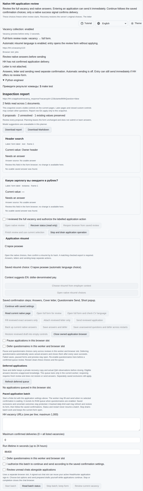
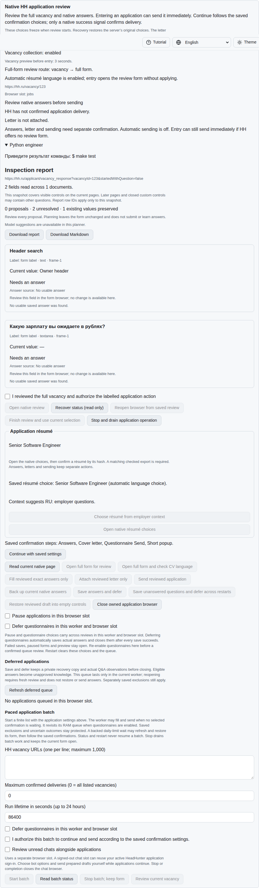

# Keep dollar-pay evidence within the employer field

In a supervised HeadHunter application, use a vacancy description containing
`$ make test`, a ruble salary and a separate Russian salary question. Start full
form review with automatic CV language enabled. At `6db892aa`, the application
combined the separate fields and displayed dollar-denominated pay. The native
form kept the checked English CV. The parent unit test reported `en/dollar-pay`
and Chromium recorded zero changes to the initially selected CV.

Dollar-pay detection now evaluates each employer question, the vacancy salary
and the description separately. A question's group, label and description still
form one unit. A question with compensation in `$` in its own description still
sets English, even without a numeric amount. The language fallback continues
to evaluate all readable employer questions before the vacancy description.

```sh
node --test --test-concurrency=1 js/tests/job-application-context.test.js
deno test -A --no-check js/tests/job-application-context.test.js
RUN_BROWSER_E2E=1 node experiments/issue-56/application-language-native.mjs
```

Node and Deno each passed 13 checks. Chromium chose the checked Russian export,
applied its paired letter, switched to English for an explicit USD question and
retained the owner's answer and edited letter across the subsequent correction.
Four locales recovered read-only. The provider fixture observed three CV
choices, zero entry clicks and zero sends. Independent Playwright inspection at
390 × 844 showed the Russian context, a disabled Send button and drained owned
windows. The local fixture returned 404 for `/favicon.ico` with no page exceptions.





The test covers this part of the pinned HH A14 language policy. Authenticated
workflow coverage remains open under HH02 and HH06.
[Pinned HH language policy](https://github.com/konard/hh-job-application-automation/blob/fa0991b8c2d0896fb3b4be6c69947f0590094b15/README.md#L105-L124) · [Regression logs](data/application-dollar-context.tar.gz) · [File hashes](data/application-dollar-context.tar.sha256.json) · [PR #57](https://github.com/link-foundation/meta-sovereign/pull/57)
