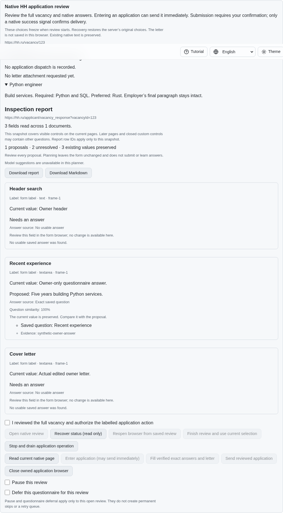
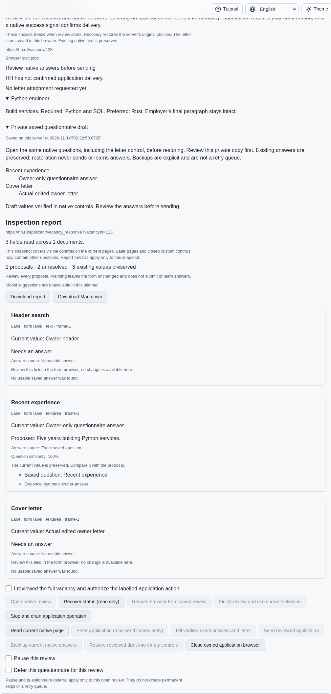

# Preserve and explicitly restore native questionnaire drafts

[PR #57](https://github.com/link-foundation/meta-sovereign/pull/57) adds a
prerequisite for HH06/HH08: private backups of actual native answers and the
owner's edited letter. Automatic deferral, retry queues, popup recovery and the
remaining original criteria are still unfinished.

## Reproduction

On published `4f482c34`, enter the synthetic native full-form application, edit
its answer and optional letter, close the owned browser and explicitly reopen
the saved review. The questionnaire URL survives, but both owner values are
lost. There is no backup control. The new Node regression fails against that
parent and the native HTTP scenario returns 404 for the missing backup route.
Independent Playwright MCP confirms the absent control and empty reopened form.

Run `python3 -B experiments/issue-56/application-draft-before.py` for the focused
parent failure, or add `--native` for its intercepted native Chromium scenario.
The wrapper restores every replaced source byte in `finally`; `--mcp` starts an
isolated parent fixture for the matching UI probe. These are synthetic forms,
not authenticated HH provider verification.

## Behavior and guards

Explicit Backup captures the current values from a freshly reviewed bound form,
including an edited letter and supported native choices. It records the complete
supported questionnaire, independently of proposed answers or learned knowledge.
The acknowledged private journal retains it across browser/service restart.
Failed put/flush acknowledgements preserve the previous backup and live owner
form. Incomplete, paginated, unsafe or unsupported captures refuse as a whole;
passwords, files and custom widgets cannot become partial claimed backups.

Reopening and status recovery only read. The owner opens any optional letter
control, reviews the saved values and separately confirms Restore. Every field's
question, position, options and native group must match. Different populated
owner values refuse the entire write set. Restoration uses owned element targets,
whole-document comparison before each write, native readback and existing
uncertain/partial receipts. An unchanged form structure is compared separately
from its changing answers; normal submission keeps its full value-bearing guard.
Replaced targets and late edits outside the application also refuse writes.

The journal checkpoints restoration intent before writing. Pre-write failures
record refusal when acknowledged; uncertain writes stop before the next field.
Backups remain available. Restore never learns answers, enters an application or
sends it, even with automatic exact-answer sending enabled. Dispatch reservations
and the existing zero-effect preview remain enforced. Browser local intent stores
only vacancy, slot and request identity, never the private draft.

CLI `backup`/`restore`, text and binary Lino routes and four-language browser
controls share these operations. Browser confirmations reset after every receipt
and reload. Saved values render as escaped text in a closed disclosure by default.

## Verification

- All 66 focused draft, service, ownership, recovery, interface, session and
  shared-prefill cases pass with concurrency one. Thirteen draft cases include
  native checkbox/select/complete-radio restoration, changed options, owner
  edits, failed storage, late document changes and uncertain first writes.
- Four existing dictionary checks pass. The interface tests render all five
  restoration states in all four locales and verify escaped private content.
- The isolated production Chromium scenario backs up and restores two actual
  owner values, preserves the unrelated header and existing answer knowledge,
  performs zero recovered entries or submissions, and closes all owned browsers
  with no page errors. It is registered in the existing hosted application group.
- Independent Playwright MCP verifies backup, Close → Recover → Reopen, renewed
  confirmation after reload, read-only reopening, explicit restoration and
  identity-only local intent. Its isolated page has no page errors and closes.
- Scoped lint, formatting, secret and diff checks pass; duplication is 6.49%
  against the unchanged 6.5% limit. Full matrices remain hosted.

The [checksummed archive](data/application-drafts.tar.gz) and
[manifest](data/application-drafts.tar.sha256.json) preserve source snapshots,
parent files, probes, results and screenshot hashes, including the first draft's
native structure/value-guard failure and the corrected pass.

Published review has actual owner values but no backup:

After explicit recovery and restoration, the private copy and actual values agree:

This adds explicit backup and restore only. The pinned HH guide's automatic
backup before leaving a failed questionnaire, five-hour RAM-only deferral,
run-wide mode changes/signals and supervised one-application preset still require
implementation and verification. PR57 remains draft and unmerged.
