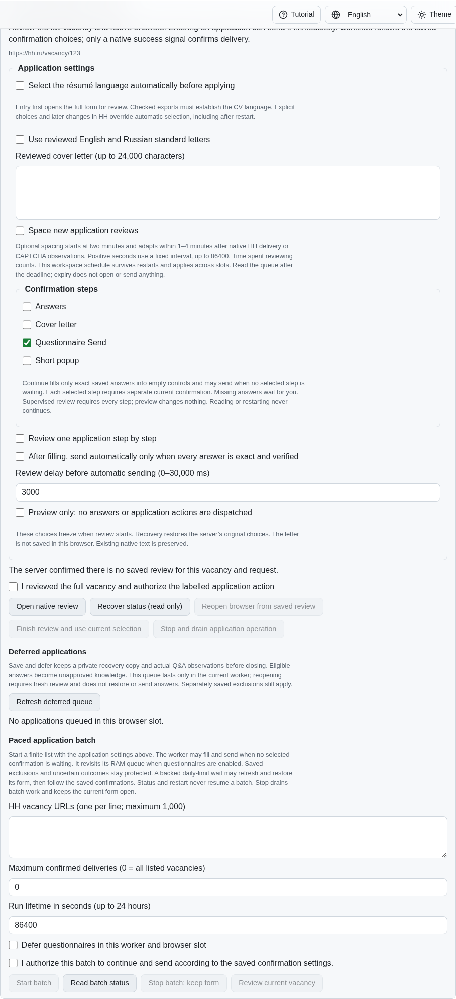
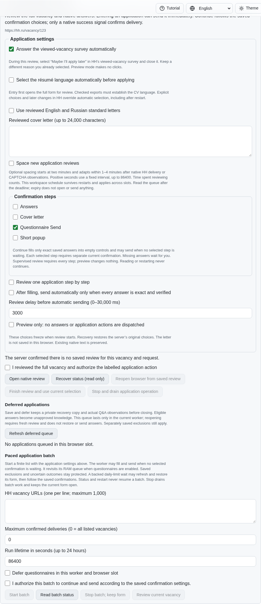
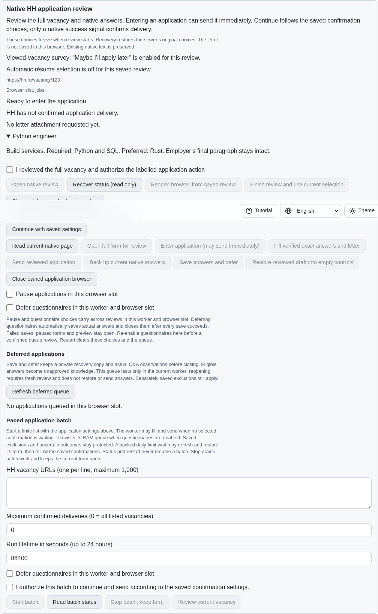
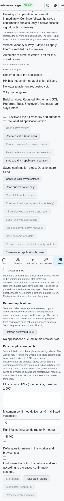

# Configurable viewed-vacancy survey policy

An explicitly opened HH application review now observes the dedicated native
“viewed but not applied” survey, including while review waits. With the default
setting, it selects “Maybe I'll apply later” and closes that survey. A different
owner-selected reason is preserved. Preview and the explicit opt-out install no
observer and perform no survey actions.

The behavior was studied in the HH reference README and `src/vacancy-feedback.mjs`
at pinned commit `fa0991b8c2d0896fb3b4be6c69947f0590094b15`, already preserved in
`data/reference-snapshots.tar.gz`. The implementation is original. This unit
covers owned application-review browsers, including finite batches. Read-only
discovery browsers do not acquire this effect. CLI configuration compatibility
is covered by [the configuration follow-up](application-configuration.md).
Native viewed-card exclusion and authenticated provider parity remain required
parts of the original incomplete inventory.

## Behavior and implementation

`--no-auto-answer-viewed-vacancy` disables the policy for foreground single and
batch CLI reviews. Both Lino encodings carry the boolean
`autoAnswerViewedVacancy`. The four-language application settings expose the
same choice, and the review receipt shows its frozen policy without asserting
that a particular survey was successfully submitted. Changing draft settings
does not change an already opened review.

The serializable observer is installed before the first owned navigation and
works after native reload. It accepts only the expected vacancy or its exact
native response route in the top-level document. A unique visible dedicated
dialog, native reason radio and enabled button-type close control are required.
Owner reasons in the same native form are preserved, even when outside the
dialog. Verification, login and daily-limit boundaries refuse action before
question values are read. The synchronous close guard repeats after selection,
so a late challenge or changed submit-type close control prevents dismissal.
Challenge answers, employer question values and page HTML are never read.

Mutation delivery is coalesced without a polling interval. Each dialog is
reserved before synchronous native handlers run; ambiguous, hidden and unsafe
controls refuse. Closing the review disconnects the observer before draining
the browser. Status, saved-receipt reads and workspace reload do not install an
observer or recreate a worker. Optional default-off application tracing records
only whether the configured observer was installed.

Absent settings retain the byte-for-byte canonical signatures of acknowledged
legacy single reviews and batches. They use the default only when execution is
explicitly opened. Explicit true/false values are frozen and validated in saved
options and public receipts; malformed public settings are refused.

## Reproduction and focused verification

On published parent `8007a002e94eafaccc5f45c5de2b8073a264d6bf`, open the native
application fixture and reveal the dedicated survey while the review waits.
There is no configurable policy or observer. Run the actual-parent probes:

```sh
python3 -B experiments/issue-56/application-feedback-before.py
python3 -B experiments/issue-56/application-feedback-before.py --service
```

The native probe captures the missing control and fails with
`Viewed-vacancy survey policy must be configurable`. Eight of nine new service
and control cases fail on the actual parent. The isolated watcher unit passes
because its new, unintegrated module is retained by the probe; this is not parent
integration evidence. Both probes restore sources and drain fixtures.

```sh
node --max-old-space-size=384 --test --test-concurrency=1 \
  js/tests/job-application-feedback.test.js \
  js/tests/job-application-feedback-controls.test.js \
  js/tests/job-application-language.test.js \
  js/tests/job-application-batch.test.js \
  js/tests/job-application-batch-controls.test.js \
  js/tests/cli-help-imports.test.js
DENO_V8_FLAGS=--max-old-space-size=384 deno test --allow-all --no-check \
  js/tests/job-application-feedback.test.js \
  js/tests/job-application-feedback-controls.test.js
python3 -B experiments/issue-56/application-feedback-native.py
```

The focused selection passes 41 Node cases and nine Deno cases. One finite native
Chromium scenario covers automatic, manual and preview modes, owner reasons,
hidden/ambiguous controls, changed close types, daily limits, shared form reasons,
late challenges and native reload. Independent Playwright MCP verifies the real
panel and six protected states. Both verify all four locales, phone layout with
no horizontal overflow, zero application entry/send/challenge reads, recovery
without replay and closed resources. The mandatory existing application-policy
browser entry includes the new scenario and retains every prior scenario,
engine, shard and deadline. Broader runtime/browser checks remain hosted.

Initial fixture failures are retained: missing revision metadata, a recovery
assertion before explicit saved-vacancy reselection, and an MCP assertion that
counted an explicitly requested search as a recovery replay. The corrected MCP
comparison starts after that search finishes. The failed run's resource receipt
still confirms closure and zero provider clicks. Production deadlines were not
changed. The initial duplication gate narrowly exceeded its unchanged 6.5%
threshold. Reusing the existing native-probe bundle/resource helper removes the
new repeated orchestration while preserving every scenario and assertion.

Before:



Settings:



After:



Phone:



## Evidence and remaining requirements

The [checked archive](data/application-feedback.tar.gz) and
[per-file hashes](data/application-feedback.tar.sha256.json) preserve changed
sources, actual-parent snapshots/failures, focused and browser results, screenshots
and hosted metadata. Recreate them with
`python3 -B experiments/issue-56/collect-application-feedback.py`.

Published parent `8007a002` has four successful companion workflows. Checks
`43635159024` remains unfinished and Chromium shard 3 job `132572456753` fails:
log lines 2222–2244 show the batch review confirmation checkbox disabled for its
unchanged ten-second deadline. The complete 2,330-line job log and artifact
summary are retained. The active batch now marks the shared workspace busy,
which also disables its own application controls; a separate focused correction
is required. This is not an aggregate passing claim. Every exact-head check
remains required after publication. HH05, HH08 and all 81 original incomplete
inventory rows stay unfinished. Work continues in
[PR #57](https://github.com/link-foundation/meta-sovereign/pull/57), which remains
draft and unmerged.
