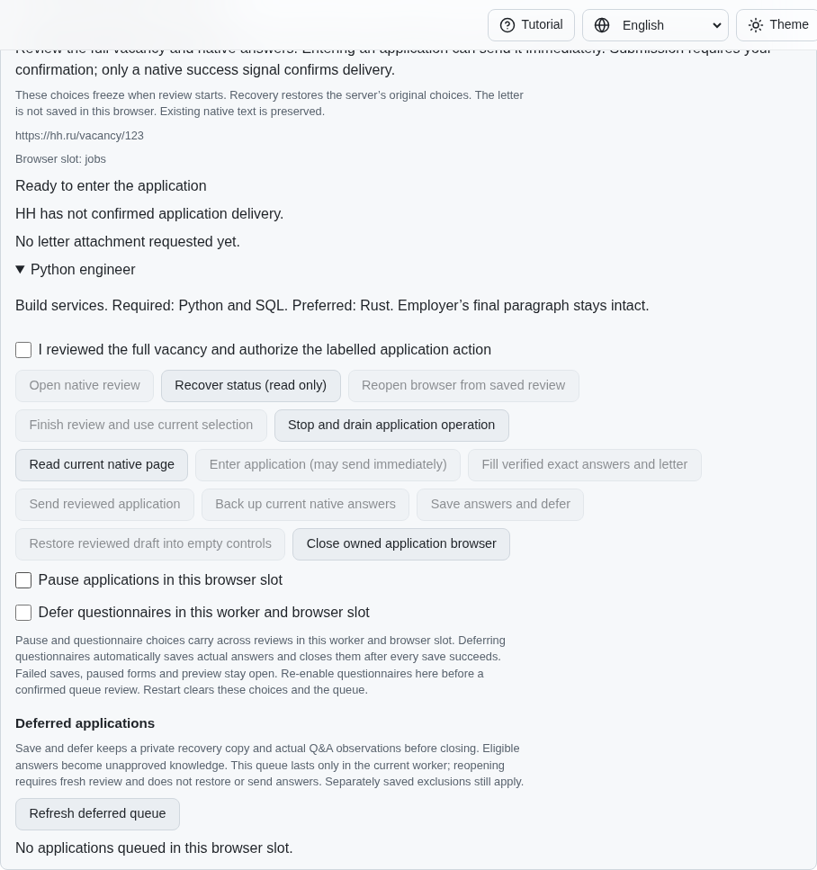
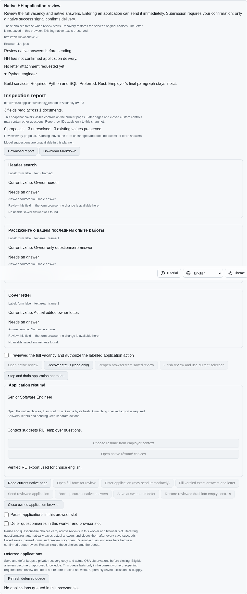
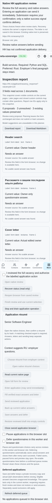

# Review the native full form before entering an application

PR: https://github.com/link-foundation/meta-sovereign/pull/57

The separately confirmed `form` action navigates to the verified vacancy's native
HH full form before any entry control is clicked. A native entry control can send
the default CV immediately. The new action permits reviewing employer questions
and the native résumé first, using the existing checked-export résumé controls.
It performs no entry, answer, letter or send operation.

This is another HH06 prerequisite. Automatic language selection, durable owner
résumé overrides, standard-letter language, authenticated provider parity and all
81 original unchecked inventory rows remain required. The PR stays draft and
unmerged.

## Reference and implementation

The pinned HH reference at `fa0991b8c2d0896fb3b4be6c69947f0590094b15`
requires checking the résumé before sending (README lines 105–124). Its vacancy
workflow (lines 915–920) opens the full response URL because Apply can send a
default CV immediately. Its response workflow checks the CV before the letter.
These behaviors were studied; no reference implementation was copied.

The destination is constructed from the validated original vacancy ID and origin,
never an owner-supplied destination or the entry element's href. The actual entry
element, complete native page snapshot and current document are checked in the
same synchronous browser turn as navigation. Existing live forms, questions,
reservations, holds, pauses, stale receipts and automatic requests refuse the
action. Preview has zero effects. Native status is read after navigation; an
unconfirmed result remains unconfirmed and is never automatically replayed.

The acknowledged form URL reuses existing recovery storage. Frozen vacancy
context and existing delivery reservations remain intact. CLI `form`, both Lino
encodings and four translated browser controls share the operation. Controls use
the same spacing, confirmation and disabled-state rules as other native actions.
No new storage schema or JSON route is introduced.

## Reproduction and checks

Exact parent `6899b33b04535da1650c150d3a95993b91d793cd` rejects the service action
with `jobs-application-confirmation`, and its native browser lacks the full-form
review control. Both bounded reproductions restore source files and drain owned
fixtures:

```sh
PYTHONDONTWRITEBYTECODE=1 python3 experiments/issue-56/application-fullform-before.py
PYTHONDONTWRITEBYTECODE=1 python3 experiments/issue-56/application-fullform-before.py --native
node --max-old-space-size=384 --test --test-concurrency=1 js/tests/job-application-fullform.test.js js/tests/job-application-fullform-controls.test.js
deno test --allow-all --no-check --v8-flags=--max-old-space-size=384 js/tests/job-application-fullform.test.js js/tests/job-application-fullform-controls.test.js
RUN_BROWSER_E2E=1 E2E_BROWSER=chromium E2E_EXECUTABLE_PATH=/opt/google/chrome/chrome node --max-old-space-size=384 experiments/issue-56/application-resume-native.mjs
```

The focused cases cover confirmation, preview, pauses, stale revisions, changed
and disabled native targets, owner forms, lost public responses, recovery,
foreign-origin refusal, both encodings, CLI and four UI languages. One existing
native scenario additionally checks a real late DOM change, owner values,
checked résumé selection and read-only locale reloads. An independent Playwright
MCP fixture uses isolated synthetic native pages, separate from the user's server.
The broad runtime and browser matrices remain hosted.

Final results: 11 focused Node checks, 11 new Deno checks and 53 existing
résumé/context/recovery/dictionary checks pass. One native Chromium case and one
independent Playwright MCP case verify no entry or send clicks, preserved owner
values, four-locale read-only recovery, and completely drained fixtures. The
native case also refuses three unsafe résumé targets.

The first native probe exposed a read starting after navigation destroyed its old
execution context. The action now waits for DOM content at the exact bound native
form before reading status; it never retries navigation. That failed probe and
its default-off synthetic read diagnostics remain in the evidence. The first MCP
probe reported `ECONNRESET` while reading a synthetic owner control. Fixture-only owner requests now close
their connection rather than reuse an idle socket; the precise reset timing is
unmeasured and no provider action is retried.
The failed MCP result and its drained server log are also preserved.

Published parent CI has a separate macOS Deno source-pull CLI timeout at 15 seconds
(job `132403292910`, run `43579541371`). Its complete 11,248-line job log is retained;
lines 5756–5763 locate the test and lines 11201–11215 report the timeout. These
observations do not establish its root cause or count as passing CI.

## Visual evidence

The exact parent lacks the separately confirmed full-form action:



Native full-form résumé and answer review after navigation:



The same shared controls at 390 CSS pixels:



Checksummed source, reference, reproduction, validation and screenshot evidence
is retained in `data/application-fullform.tar.gz` and its per-file manifest
`data/application-fullform.tar.sha256.json`. Exact published-head CI is recorded
separately; local verification does not establish a hosted pass.
