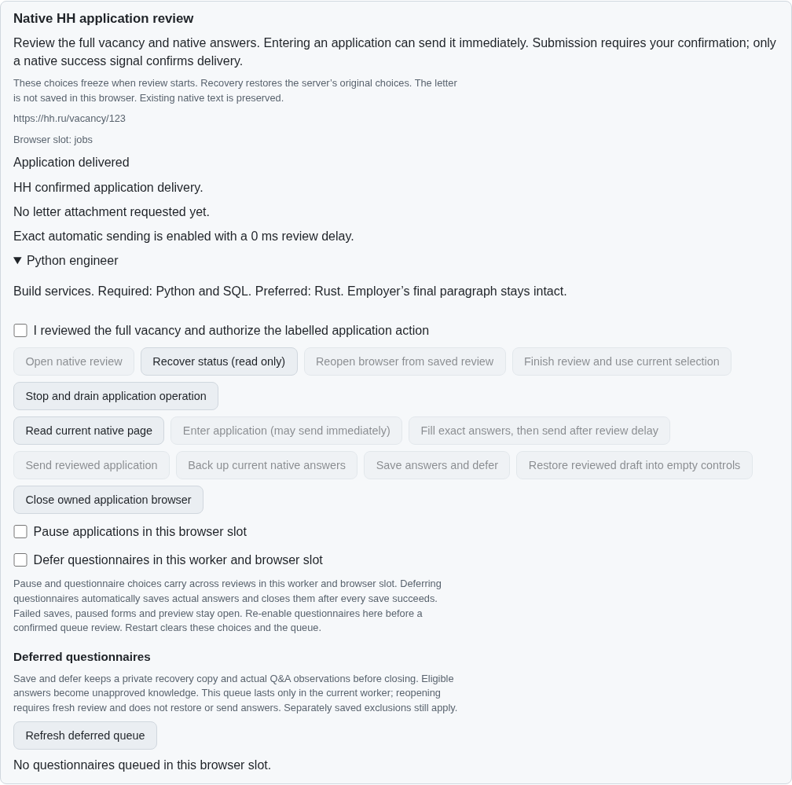
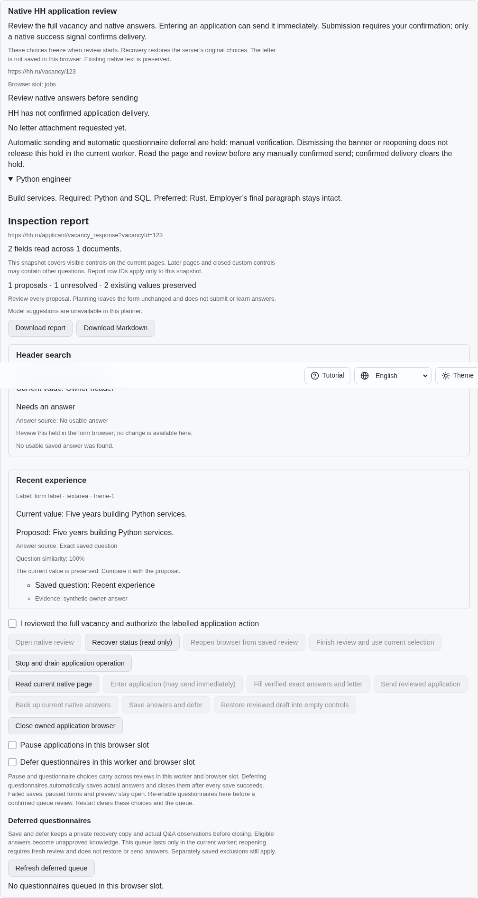
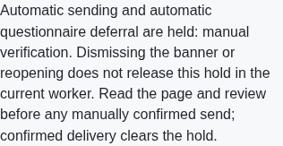

# Native application error and verification holds

This is a prerequisite for HH08 in [PR57](https://github.com/link-foundation/meta-sovereign/pull/57). HH08 and the 81 original unchecked inventory rows remain unfinished. In particular, this unit does not implement five-hour generic-error retries, paced queue revisits, the supervised one-application preset or recruiter-panel handling.

The pinned HH guide, `fa0991b8c2d0896fb3b4be6c69947f0590094b15`, README lines 290–303, distinguishes generic submission retry from manual validation/limit/verification holds. Dismissing an error must not grant automatic sending permission. The product vision also requires retained drafts and separate truthful uncertain and confirmed delivery states. We learned those behaviors without importing reference code.

## Reproduction and correction

On exact published parent `c4a40d2c`, enable exact automatic sending, enter the synthetic native questionnaire, show a verification banner and read it. Dismiss the banner, read again and choose prefill. Both the focused Node regression and actual Chromium send once (`1 !== 0`), although the earlier verification required manual action. Independent Playwright MCP reproduces the same send and captures the before image.

Native inspection now classifies visible `data-qa-popup-error-code` markers and application-form alerts. The exact documented Russian and English generic messages, or code `unknown`, produce a generic-error class; other native application error markers require manual validation. Hidden markers and unrelated page alerts are ignored. Native dispatch checks errors synchronously with its existing document/form guard.

A worker-owned map retains the observed hold per vacancy and browser slot. Banner dismissal, explicit browser close/reopen, read-only recovery and failed journal acknowledgement retain it. It is not an exclusion or durable journal setting; stopping/restarting the worker clears it. Fresh positive native delivery clears it. Existing acknowledged entry/submission reservations remain durable and are never cleared by an error or dismissed banner.

While held, exact prefill may populate reviewed answers after fresh confirmation but cannot send automatically. Automatic questionnaire deferral also keeps the live form open; idle cleanup retains held error pages even if their form controls disappear. A manually confirmed action still passes the ordinary native guards, policies, letter checks and dispatch reservation. Four-language controls disclose the hold and label prefill without promising automatic sending. The optional existing `MS_JOBS_APPLICATION_DEBUG=1` trace reports hold transitions by reason only, without answers or vacancy contents.

## Focused verification

- Exact-parent Node and native Chromium regressions fail with one unintended send. Each wrapper restores source bytes and drains fixtures before current-source checks.
- All 110 focused application tests pass with concurrency one, including 15 new service/interface cases. Coverage includes dismissal, close/reopen, browser-slot isolation, failed storage, worker restart, late guards, review delay, idle cleanup, uncertain submission, both actual Lino routes, CLI, receipt validation and lost-response recovery.
- The 15 new cases pass under Deno; all 25 dictionary checks pass. Full runtime/browser matrices remain hosted.
- One native Chromium scenario checks real exact answers, six error variants, hidden/unrelated decoys, matching-snapshot dispatch refusal, held automatic deferral and one separately confirmed successful submission. All owned browsers close with no page errors.
- Independent MCP verifies the before/after browser flow, retained hold through actual locale reloads, phone width, no send before separate manual confirmation and delivery clearance. The initial unchanged-state probe raced prefill; its failure is retained, and the corrected driver waits for the actual response and ready controls. Inspection of the intermediate driver also found that its init script reset locale on reload; the final driver preserves and checks each selected locale.

The final MCP run also verifies the existing automatic backed-deferral flow through the same shared owned-browser setup. It restores two actual owner values after queue reopening and sends nothing. The shared helper preserves selected locales and is composed with either driver using `python experiments/issue-56/compose-application-mcp.py application-holds-mcp.mjs` (or `application-deferral-mcp.mjs`).

Focused commands are `node --test --test-concurrency=1 js/tests/job-application-holds.test.js js/tests/job-application-hold-controls.test.js`, `deno test --allow-all --no-check` with those same two paths, and `node experiments/issue-56/application-holds-native.mjs`. Parent wrappers use `python experiments/issue-56/application-holds-before.py` with optional `--native` or `--mcp`. MCP fixtures opt in with `APPLICATION_REVIEW_FIXTURE=1 APPLICATION_DRAFT_FIXTURE=1 APPLICATION_HOLD_FIXTURE=1`.

Complete output and source snapshots are preserved in the [checksummed evidence bundle](data/application-holds.tar.gz), generated by `PYTHONDONTWRITEBYTECODE=1 python experiments/issue-56/collect-application-holds.py`. Production checks use the existing unchanged duplication threshold; no ignores or test deadlines were relaxed. Hosted exact-head CI remains required before issue completion.

Every hosted check for the exact parent `c4a40d2c` passes, including [main run 43557439839](https://github.com/link-foundation/meta-sovereign/actions/runs/43557439839). This establishes the published baseline; the new hold unit still needs its own hosted checks.

## Visual evidence

Before: dismissing verification and selecting prefill automatically delivers the application.

After: actual exact answers remain visible under a manual hold, with no recorded submission.

Phone: the hold explanation fits the viewport.

