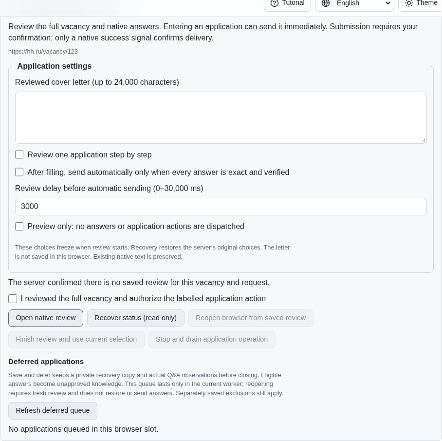
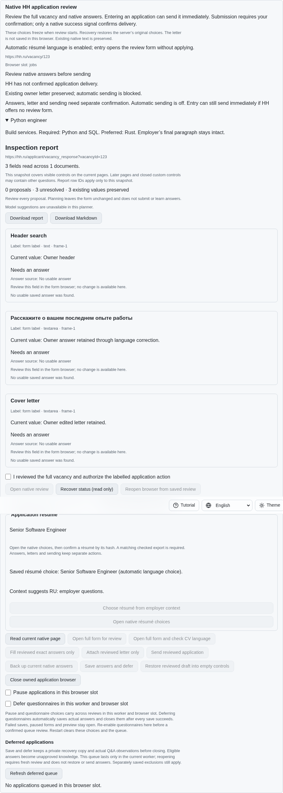
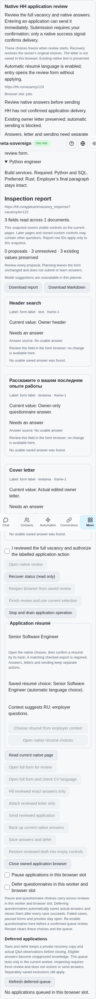

# Default application language and standard letters

PR: https://github.com/link-foundation/meta-sovereign/pull/57

New application reviews default to selecting a CV language from employer questions,
dollar pay and the collected full description. Confirmed entry opens the full native
form before a potentially immediate application button can send a default CV. The
choice uses actual checked export bytes, verifies the native selection, and avoids
opening the menu when the selected CV is already correct. Acknowledged explicit
choices and subsequently observed owner changes override automatic selection across
restart. Reading, status recovery and preview perform no selection or filling.

The pinned HH README at fa0991b8c2d0896fb3b4be6c69947f0590094b15, lines 105–124,
requires this behavior and corrections of unchanged standard letters. The exact
published parent a74dbc735c570a1abdf15ca4eb3af232494bac65 fails the new full-form
regression and lacks its UI control. The finite reproduction scripts restore every
replaced source and close owned fixtures:

```sh
PYTHONDONTWRITEBYTECODE=1 python3 experiments/issue-56/application-language-before.py
PYTHONDONTWRITEBYTECODE=1 python3 experiments/issue-56/application-language-before.py --native
```

Owners may supply both reviewed English and Russian standard letters. A confirmed
letter fill follows the verified CV language; dollar-pay context takes precedence
over Russian questions. A later corrected automatic decision may replace only the
exact unchanged standard text acknowledged in the private journal. A custom or
edited letter remains untouched and blocks automatic sending. Answers remain intact.
Failed acknowledgement removes replacement authority; an owner must read the current
receipt before continuing. Existing document/form guards also protect the synchronous
native letter write. Neither language selection nor letter correction sends an
application. Missing checked evidence refuses before an entry or send click.

CLI adds paired `--standard-letter-en-file` / `--standard-letter-ru-file` and
`--no-auto-select-resume-language`. The same frozen options cross both Lino encodings
and four-language UI controls. Opt-out keeps explicit direct-entry behavior; paired
letters still require full-form verification. Additive schema 17 reserves the new
private settings/checkpoint fields and rejects collisions. Legacy signatures retain
their original options and reservations; recovery cannot silently enable the new
policy. Native sync uses schema 17 consistently; Rust compilation stays assigned to
hosted CI.

Verification: the initial focused group passes 50 Node cases; an additional 68-case
guard group passed 66 initially and exposed two old session fixtures relying on an
implicit direct-entry default. Those fixtures now explicitly opt out; all 19 cases
in the affected session/language files pass. The 17 focused Deno cases pass. One
production Chromium scenario and an independent Playwright MCP scenario verify
Russian selection, English correction after a USD question, preservation of actual
owner edits, four-locale read-only recovery, phone layout, zero entry/send clicks
and closed fixtures with no scenario errors. Initial draft failures, the stale
fixture closure, failed-save stale revision and correction logs remain archived.

The published-parent hosted macOS Node shard failed before tests: a GitHub connection
failure while fetching main, at lines 371–372 of
`application-language-parent-macos-node-132417924355.log`. This establishes a network
failure, not a test result. Exact corrected-head hosted checks remain required.







Checksummed sources, logs, pinned reference and screenshots are retained in
`data/application-language.tar.gz` with its per-file manifest. This completes this
bounded language-policy unit only. Authenticated HH workflow parity, batch pacing,
remaining questionnaire/CV/chat behavior and all 81 original unchecked inventory
rows remain required. PR57 stays draft and unmerged.
