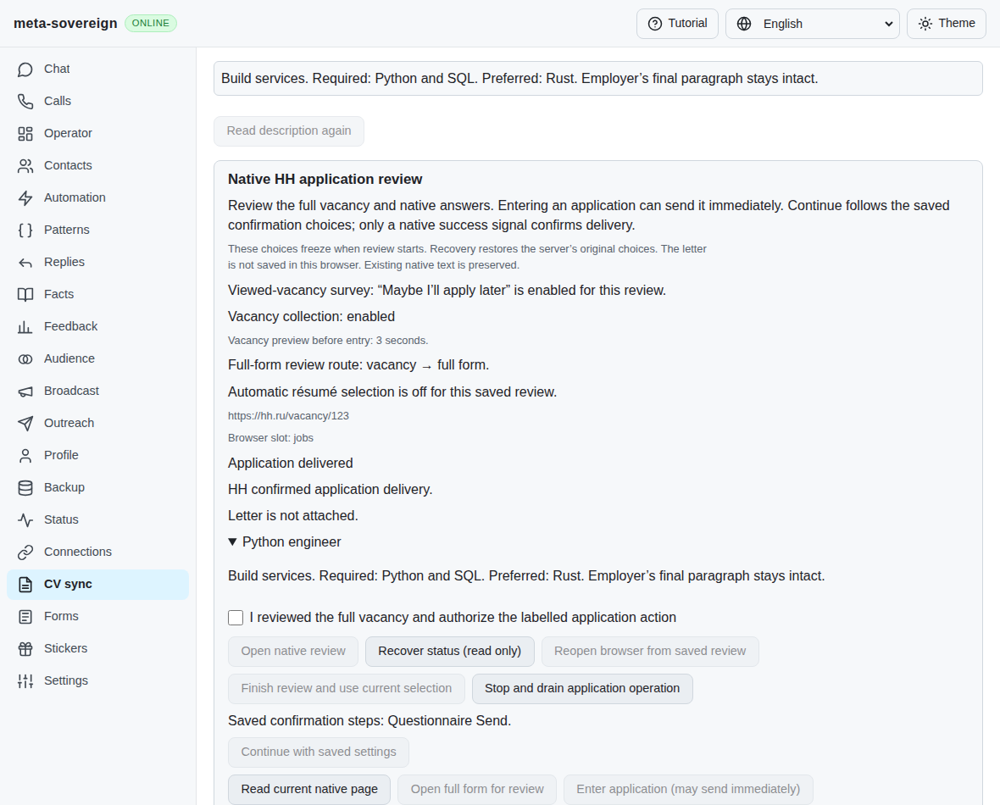
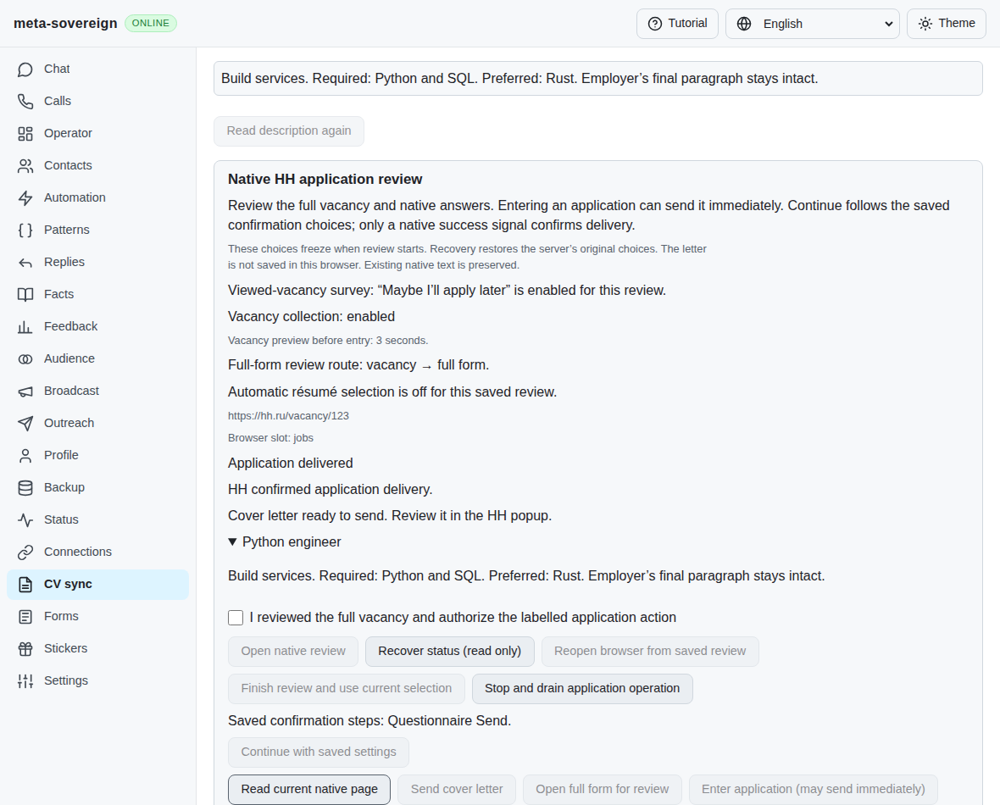

# Attach a separate cover letter after HeadHunter confirms an application

Enter a vacancy with a reviewed cover letter configured in CV Sync. If the
native entry immediately delivers the application and HeadHunter offers a
separate attachment, confirm **Prepare cover letter**. The owned browser opens
the popup and fills an empty field with the configured text. Verify the
letter in the popup, then confirm **Send cover letter**. The CLI uses
`letter-prepare` and `letter-send`. Both Lino encodings use these action names
with the application's current request ID and revision.

Application delivery and cover-letter delivery have separate states. The
attachment requires the exact vacancy, document, popup and current text at
dispatch. A different owner draft stays in the popup. A challenge, daily
limit, ambiguous control or changed document prevents dispatch. Test mode
previews the action without touching HeadHunter.

The send reserves its own outcome in the acknowledged journal before it
clicks. A browser guard that proves it issued no click can release that
reservation. A lost response
keeps it unknown across restarts. The existing application stays confirmed.
Confirmation requires the continued native application marker and the
disappearance of both the popup and attachment offer on the same document
after the witnessed click. Status reads only recover the saved result.

The pinned HeadHunter automation reference documents the separate popup
and the same two disappearance signals after application delivery.
[Reference behavior](https://github.com/konard/hh-job-application-automation/blob/fa0991b8c2d0896fb3b4be6c69947f0590094b15/src/letter-attach.mjs)

## Verification

The parent service regression returned an absent attachment state and
rejected the preparation action. Chromium with the parent web bundle
reproduced an unavailable panel action beside a visible native offer.
The updated fixture executes the production form guard and panel.
It starts with a native submit button disabled until a letter is entered.
Run the focused regression with `node --test --test-concurrency=1
js/tests/job-application-letter-attachment.test.js`. The browser scenario
runs in the existing `js/tests/e2e-job-application-confirmations-browser.mjs`
group.

Node passed 53 focused checks and Deno passed 40. Chromium verified that the
panel reads an owner edit without overwriting it, requires fresh confirmation
when the reviewed text returns, and recovers the separate receipt after reload.
The fixture counted one application entry, zero ordinary form submissions,
one attachment popup and one attachment send.
Independent Playwright MCP confirmed the same counts, fresh confirmation
after reload, no horizontal overflow at 390 pixels and closed fixture
browsers. The final receipt came from the isolated native fixture.

[Source and original test logs](data/application-letter-attachment.tar.gz) ·
[SHA-256 manifest](data/application-letter-attachment.json)

| Parent panel                                                                                                     | Separate send ready for confirmation                                                                       |
| ---------------------------------------------------------------------------------------------------------------- | ---------------------------------------------------------------------------------------------------------- |
|  |  |

The [phone view](../../screenshots/application-letter-attachment/phone.png)
and [confirmed attachment](../../screenshots/application-letter-attachment/after.png)
capture the same isolated workflow. The [paced batch](application-batch-attachment.md)
can also drive this vacancy-page offer. The search-card attachment route and
authenticated HeadHunter evidence remain open in HH06 and HH08.
