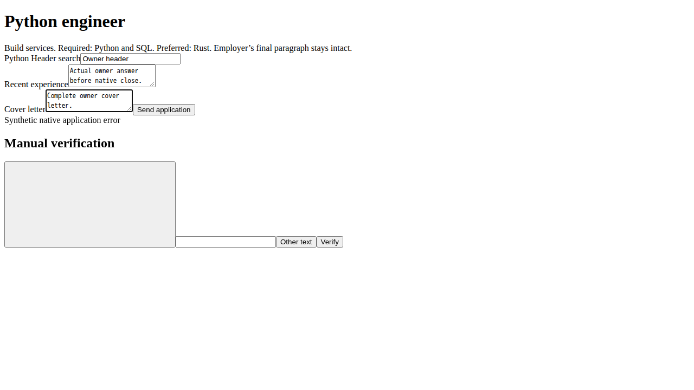
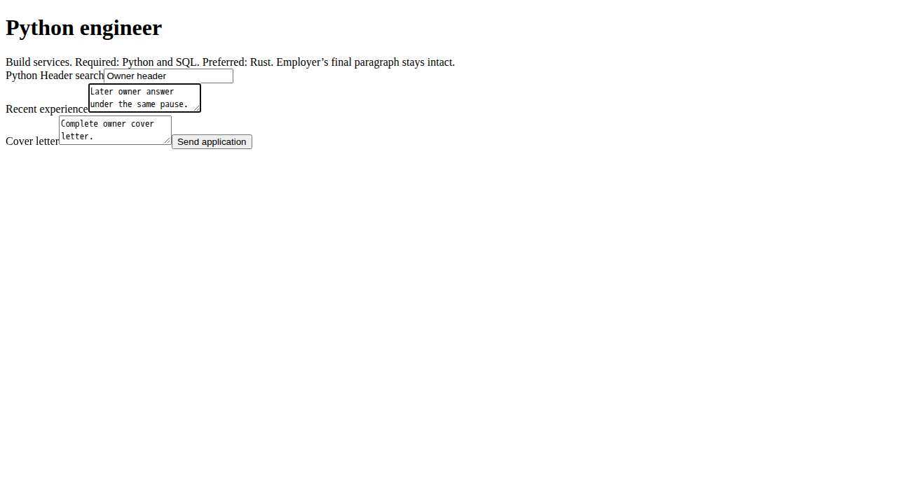

# Backing up an application under a daily-limit CAPTCHA

The daily-limit backup path previously stopped whenever an HH CAPTCHA was
visible. That protected the challenge answer but also prevented preserving an
otherwise separate application form and closing the native dialog during the
existing pause. The exact published parent is `cd2a3337fa7222f924e4b55c60b3503fabd8dacd`.

A narrowly scoped reader now requires the same HH vacancy and document nonce,
one visible native application form, and a separate native CAPTCHA dialog with
one identifiable close button. It reads only that application's supported native
fields and labels. Challenge values, instructions, markup and unrelated page
content remain unread. Nested challenges, external associated controls or label
references, unsupported/incomplete fields and ambiguous closes refuse the action.
Ordinary inspection still stops at the challenge.

The existing preservation path acknowledges the complete actual draft and
letter, private Q&A, and eligible unapproved learning before any close request.
Every awaited checkpoint rechecks the original saved workspace pause and native
form guard. Owner edits, failed storage, expiry, policy changes or stale documents
leave the dialog open. The final native close is synchronously guarded; Send,
renew and CAPTCHA answer controls are never invoked. A remounted dialog may use
the same document's acknowledged pause even after its banner disappears, without
moving the original deadline. After closure the ordinary reader re-establishes
field identities for later backups and separately confirmed restoration.

## Reproduction and verification

Run `PYTHONDONTWRITEBYTECODE=1 python3
experiments/issue-56/application-limit-challenge-before.py`; add `--native` for
the finite browser reproduction. Both exact-parent probes fail with “Coexisting
CAPTCHA prevented the acknowledged daily-limit draft.” The native parent run
skips only the new independent boundary probe so it reaches the original
application failure. All production CI paths include that probe. Both parent
runners restore working sources and the generated bundle after owned fixtures
drain.

The new service regression file has 22 cases. The focused application/form group
passes 73 Node and 73 Deno cases with concurrency one; browser registration passes
five checks. The native Chromium scenario combines 14 boundary refusals with a
real service/UI flow: acknowledge answers and letter, close once, start waiting,
edit the answer, remount the dialog with the banner hidden, close again, preserve
the original deadline, and return to review at expiry. Poisoned DOM getters
verify zero challenge/outside-content reads. Both closes occur after persistence;
there are zero challenge actions and zero sends. Contexts and servers drain.

Run `RUN_BROWSER_E2E=1 E2E_BROWSER=chromium node
experiments/issue-56/application-limit-challenge-native.mjs` against a freshly
built test bundle for this focused scenario. `--boundaries` selects only the
14 native refusal checks. The scenario is added once to the existing mandatory
four-scenario application-limits group, preserving its engine coverage and
180-second deadline. Broad runtime and browser matrices remain in hosted CI.

An independent Playwright MCP replay observed the later answer, full letter,
unchanged deadline and two closes, with zero challenge actions/sends. Its first
attempt edited during wait admission; the existing changed-form refusal kept the
dialog open. The corrected replay waits for admitted waiting before editing.
The MCP screenshot includes the fixture's tutorial overlay; the native captures
below show the unoccluded form. All observations, including the initial refusal,
are retained in the [checksummed archive](data/application-limit-challenge.tar.gz).

Before on the published parent (synthetic owner values and challenge):

After two acknowledged captures and native closes, with the later owner answer:

This is a partial HH06/HH08 extension in
[PR #57](https://github.com/link-foundation/meta-sovereign/pull/57). The pause is
still workspace scoped, not authenticated-account scoped. Live-provider parity,
automatic paced batches and all 81 original incomplete inventory rows remain
required. The PR stays draft and unmerged. The parent main workflow
`43606682331` failed Windows Deno shard 1 at `cli-output.test.js:60` after ten
seconds; the child imported the CLI but never reported ordinary-command readiness
(job log lines 3551–3557, 5181–5195). All eight browser lanes and four companion
workflows passed. The original import delay remains unmeasured; every new head
requires fresh hosted verification.
