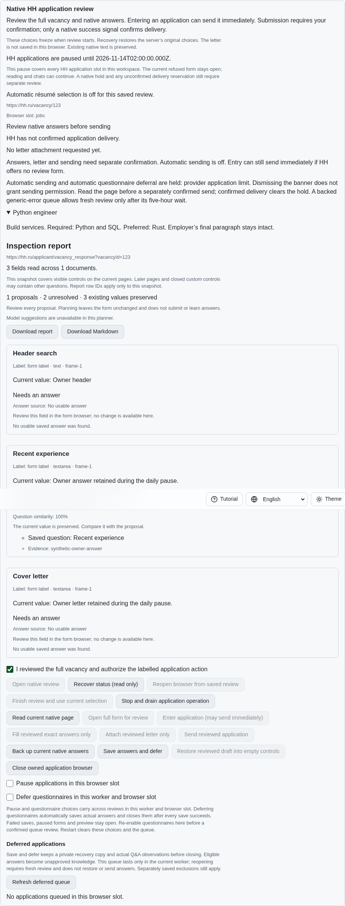
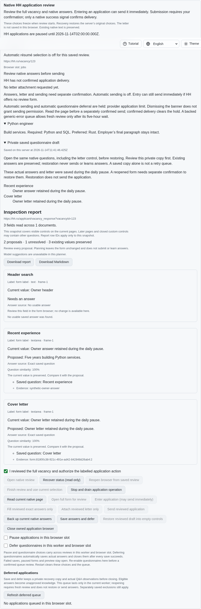
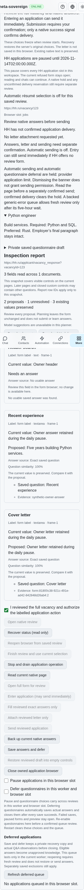

# Actual answers preserved during the HH daily pause

A complete, bound native questionnaire now receives a private recovery draft
when the current form or another HH slot in this workspace starts the daily
pause. The draft contains the actual answer and letter values, its source
document identity and the original pause deadline. The existing Q&A observation
and unapproved learning rules run through the same preservation checkpoints as
questionnaire deferral. The browser stays open, no retry is queued and no delivery
reservation is released. Uncertain delivery remains uncertain.

Unchanged reads reuse the acknowledged draft. Owner edits after banner dismissal
produce a fresh backup. A new empty document after worker recovery cannot replace
the previous document's recovery values before explicit restoration. Read-only
status exposes the saved copy through CLI, both Lino transports and all four UI
languages. The UI identifies the daily-pause origin and explains that restoring
into a reopened form needs separate confirmation and never sends.

Pause, preview, incomplete inspection, CAPTCHA, external navigation and delivered
pages prevent automatic capture. Failed draft, Q&A or learning checkpoints keep
the actual form open; later reads may retry preservation. Edits during a save
invalidate the stale capture. Schema 19 reserves draft provenance and retains
legacy signatures, options and dispatch history. The native sync schema is
updated in the same change; Rust compilation remains a hosted check.

## Reproduction and verification

On exact published parent `74463a7697e4d0553f7ef17418d3ec50b51933bd`, enter a native
review, type an answer and letter, reveal the daily refusal and read the page.
The two-hour admission pause exists, but no automatic draft is saved.
`experiments/issue-56/application-limit-drafts-before.py` selects the actual parent
production sources and reproduces the missing draft. Its `--native` variant
builds the selected SPA, records the problem screenshot and fails at the same
missing-backup assertion. Both restore sources and drain their fixtures.

The final focused group passes 74 Node checks, including generic retry,
questionnaire deferral, migration collisions, CLI/API controls and browser
registration. A smaller relevant Deno group passes 41 checks. An earlier 74-case
compatibility group also covers the original draft and deferral tests. Initial
preview-fixture and static-render fixture errors are retained alongside their
corrections, rather than counted as successful runs.

One focused native Chromium scenario and an independent Playwright MCP run retain
the actual owner values, verify four-language recovery and phone width, and
record one native entry and zero sends. Every fixture and browser context closes.
The final native rerun also verifies the extracted screenshot helper. Full
runtime and browser matrices remain hosted checks for the published head.

## Published-parent CI corrections

Checks run `43589378945`, created 2026-11-14 at 11:18:20 UTC for exact parent
`74463a76`, fails two independent gates. The preserved workflow-contract job log
`application-limits-contracts-132430848151.log`, line 634, reports
`job-application-policies combines 5 native scenarios`. The limit scenario now
has its own registered group, with every existing scenario retained once and
the same engines, shards and deadlines. All five registration checks pass locally.

The complete lint job log `application-limits-lint-132430848248.log` reports
44,431 duplicated lines out of 683,514 at line 15459 and exits unsuccessfully at
line 15464. The true percentage exceeds 6.5% despite the rounded display. Shared
preservation-policy guards, screenshot setup, migration collision verification
and successful CLI receipt checks remove repeated code. The threshold and
exclusions are unchanged. Final scoped lint, formatting, secret checks, Rust
formatting and the duplication gate are recorded in the checksummed evidence
bundle `data/application-limit-drafts.tar.gz`. The other four parent workflows
pass. The corrected head still requires its own hosted verification.

## Requirements still active

This unit does not complete HH06, HH08 or issue #56. Automatic expiry refresh and
restoration, CAPTCHA priority and dismissal, independently authenticated account
binding, paced batches, provider parity and all 81 unchecked inventory rows remain
unfinished. No daily-pause timer refreshes the browser or grants sending consent.

Work continues in [PR #57](https://github.com/link-foundation/meta-sovereign/pull/57),
which remains draft and unmerged until every original requirement is verified.
