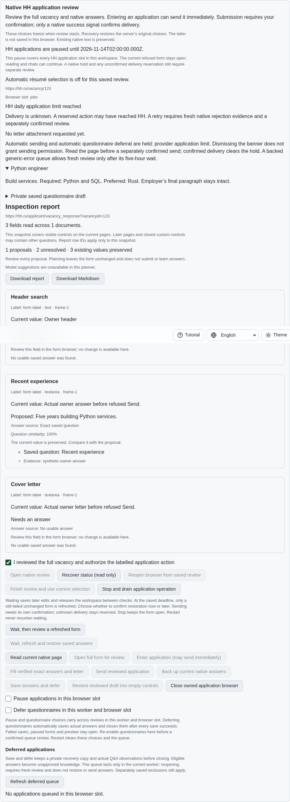
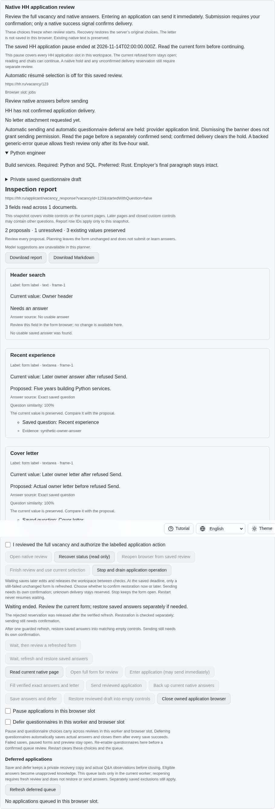

# Recovery after a witnessed daily application refusal

On published parent `6b1e9dea102610dc8d50190147d5dd8fcd5c1152`, an automation-issued
Send followed by HH's native daily-limit refusal preserves the actual draft but
leaves submission reserved as unknown delivery. The prior wait-and-restore
control therefore refuses even this witnessed failed submission. A finite
service regression and the native Chromium scenario reproduce the refusal
against that exact parent; the screenshot below shows the disabled restoration
choice after one issued Send.

The action now retains a worker witness only when the guarded dispatch confirms
that it was issued and its settled same-document form shows the native daily
refusal. After complete actual draft preservation, it acknowledges an immutable
private rejection record and a digest-bound journal pointer. The proof retains
the original request, frozen settings, reservation revision, action, document,
draft and deadline. Later owner edits can replace the backed draft without
rewriting that original evidence. Failed writes or flushes keep the original
reservation and live form; a later explicit read may finish saving the proof.

An explicitly confirmed wait-and-restore can release only that known rejected
submission after the original pause and a verified fresh form. Ordinary waiting
still requires separate later restoration consent. Reopening a saved review is
read-only; it never resumes waiting or releases the reservation. An explicit
restoration on a freshly reopened matching form rechecks the same evidence and
the current shared pause. The entry history remains saved. Restoration uses the
existing empty-control and owner-policy guards, and sending requires a new
confirmation. Unknown dispatch replies, changed documents, old/manual markers
and later markers following an unresolved settled action remain reserved.

CLI, text Lino, binary Lino and the four-language application panel share the
same service. Public receipts expose only `recorded` or `released`, without the
private proof ID or digest. Legacy receipts and journals remain valid. The
existing private rejection namespace and optional journal field need no schema
rewrite. Default-off diagnostics contain phase/action metadata only.

The focused checks cover actual later explicit sending, lost replies, changed
documents, immutable-proof tampering, failed proof/release acknowledgements,
restart, newer shared pauses, owner-mode changes, Stop, native verification and
delivery changes, failed immediate entry, both wire encodings and foreground
CLI. The finite native scenario and independent Playwright MCP flow each issue
one refused Send, preserve later answers and letter, perform one verified
refresh, restore those values and issue zero automatic resends. Both cover four
locales, phone layout and owned resource drainage. Screenshots and checksummed
source/log evidence are retained with this case study. The new mandatory
browser entry preserves every previous scenario and all existing engine,
shard and timeout budgets.

Final focused validation passes **105 Node tests and 41 Deno tests**, including
the unchanged waiting and restoration controls. Strict lint, formatting,
secret scanning, whitespace and the unchanged 6.5% duplication gate pass.
A separate regression proves that a concurrent change to the acknowledged
journal digest refuses recovery before refresh. Shared fixture and locale
helpers remove repeated setup without dropping assertions.

The checksummed archive
[`data/application-limit-rejection.tar.gz`](data/application-limit-rejection.tar.gz)
retains the exact-parent failures, current sources, focused/native/MCP logs,
screenshots and original failed CI job logs. Its adjacent manifest verifies
every archived file. These local passes require their own exact-head hosted
checks after publication.

Reproduce the parent with
`PYTHONDONTWRITEBYTECODE=1 python3 experiments/issue-56/application-limit-rejection-before.py`
and `--native`. Run the focused regression with
`node --test --test-concurrency=1 js/tests/job-application-limit-rejection.test.js js/tests/job-application-limit-rejection-controls.test.js`.
The native helper builds an isolated fixture and restores the repository bundle
after closing resources. Its `--mcp` option serves the separately owned fixture;
the shared MCP wait probe uses `restore=1&rejection=1` in its control URL.

This repairs one daily-refusal recovery gap. Full paced batches, automatic RAM
queue revisits, authenticated account scope, independent confirmation policies
and all 81 original incomplete inventory rows remain required in
[PR #57](https://github.com/link-foundation/meta-sovereign/pull/57). The PR remains
draft and unmerged; local fixture passes do not establish issue completion.

Published commits `d81c2f75` and `6ad826b0` are covered by successful [Checks run 43621364660](https://github.com/link-foundation/meta-sovereign/actions/runs/43621364660) and all four companion workflows on exact SHA `6ad826b0e1951e0623654647f6882187e66b857f`. Both native browser engines and every runtime/OS test pair pass. The subsequent confirmation archive retains the exact-head metadata; all original incomplete requirements remain required.
