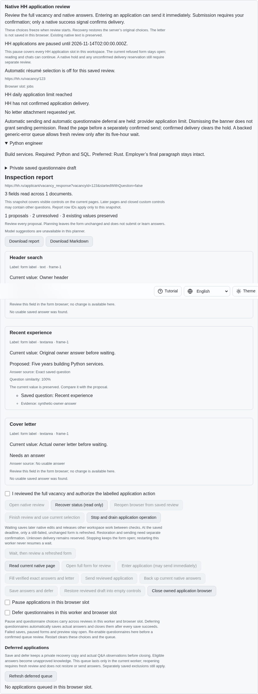
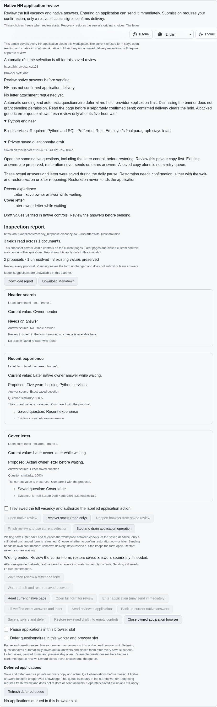
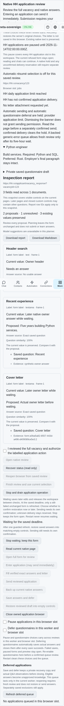

# Confirmed restoration after the daily deadline

The daily-limit wait now offers an explicit **wait, refresh and restore** action
through the foreground CLI, both Lino encodings and four-language application
controls. This consent permits restoration after the wait's single guarded
refresh. Ordinary waiting retains its separate later restoration action. Neither
choice sends an application or releases an uncertain delivery reservation.

Later owner answers and the actual letter remain backed up during the wait. At
the original deadline, only the unchanged, still-failed native document can be
refreshed. The new document is inspected again; restoration reuses the existing
acknowledged draft, matching-question and protected empty-control writes. When
necessary, the native letter control is revealed through the existing guarded
action. Owner edits, changed questions, CAPTCHA, policy changes and failed save
acknowledgements refuse writes. A dismissed error ends waiting without refresh
or restoration. Stop and shutdown drain issued work; status, reload, repeated
wait IDs and worker restart never arm a new operation. Consent cannot be
escalated by repeating a wait ID.

The additive receipt reports `restoreDraft` and the `restoring` phase. Legacy
receipts remain valid. The wait remains finite worker memory; the existing pause
and actual recovery drafts remain durable. Native schema 19 is unchanged.

## Reproduction and verification

On published parent `e2bc1bd91057e3ee4507e09f86251da756dbb8eb`, enter a native
questionnaire, type an answer and letter, reveal a daily-limit refusal and read
the form. The existing waiting action refreshes into review, but offers no
consent for automatic restoration. `application-limit-restore-before.py` runs
the minimal service regression against the actual parent. Its `--native` variant
builds the parent's SPA and captures the missing action. Both fail with
`Confirmed expiry restoration is missing.`, restore sources and drain fixtures.

The final focused group passes 52 Node checks and 47 Deno checks. Coverage
includes later actual answers and letters, repeated identifiers, malformed
consent, uncertain delivery, changed owner values/questions, CAPTCHA, dismissed
errors, failed put/flush, policy interruption, Stop, shutdown without recovery
replay, CLI, text/binary Lino and four-language controls. The existing native
limits group passes both scenarios, including ordinary separately confirmed
restoration. A new mandatory browser group preserves all prior scenarios,
engines, shard counts and deadlines.

Fifty additional shared language, ownership, session and translation checks pass.

The production Chromium restoration scenario and an independent Playwright MCP
flow each preserve later answers and the letter through one expiry refresh.
Both verify four locales, phone width, one entry, zero sends and closed owned
resources. The native scenario also retains three synchronous changed-DOM
refresh refusals. Screenshots below show the actual synthetic native fixture;
no authenticated HH account was used.

Development failures remain preserved: a failure-reporting locator originally
masked the expected parent assertion; the diagnostic read is now bounded and
optional. A new rejected-admission assertion needed a fresh revision before its
next action. Initial duplicated control setup exceeded the unchanged 6.5%
duplication limit; parameterized coverage retains all six transport/CLI cases.
Scoped formatting, lint, secret checks and the original duplication gate pass.

## Hosted evidence and unfinished criteria

The original macOS WebKit résumé timeout remains unproven. Parent `cac7f7d3`
run `43591479049`, failed job `132437782294`, reports the 30-second input wait
at job-log lines 1000–1001. Later run `43594980663` for `c6a4834d` passes that
résumé group at job-log lines 1003–1008, then is superseded and cancelled at line 1156. That pass does not establish the original cause. The full cancelled-run
log download is partial because GitHub reports missing job `132448452348`;
the complete WebKit job and explicit download error are retained separately.

Diagnostic head `e2bc1bd9` started run `43596139531` at 2026-11-14 12:42:34 UTC.
Its four companion workflows pass; main checks were still running when this
unit was prepared. Every exact-head gate remains required. Resource-intensive
builds and full matrices stay in hosted CI.

`data/application-limit-restore.tar.gz` and its SHA-256 manifest preserve source
snapshots, parent and development failures, focused results, native/MCP evidence,
screenshots and the separate hosted failure/cancellation evidence.

This partial extension supersedes the missing restoration-consent gap in the
earlier waiting snapshot. HH06, HH08 and all 81 original unchecked inventory
rows remain required. Authenticated account scope, daily-limit/CAPTCHA priority
and dismissal, paced batches/revisits, complete provider parity and every other
original criterion are unfinished. Work continues in
[PR #57](https://github.com/link-foundation/meta-sovereign/pull/57), which stays
draft and unmerged.
