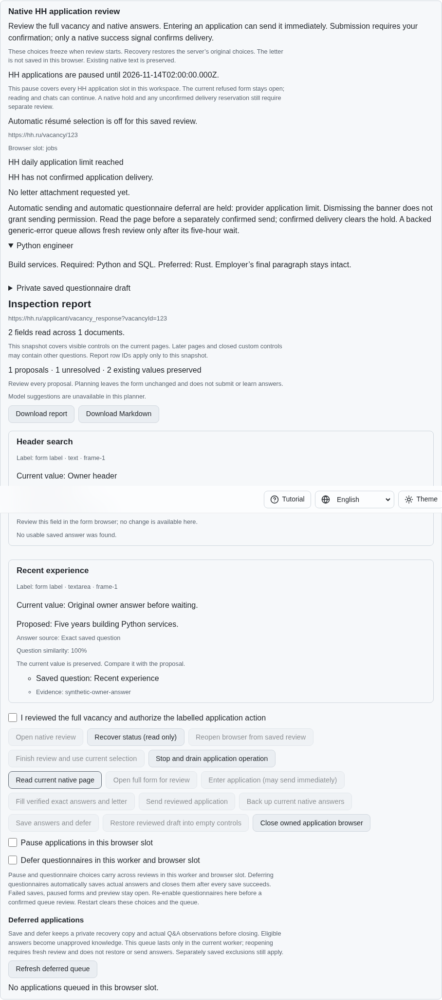
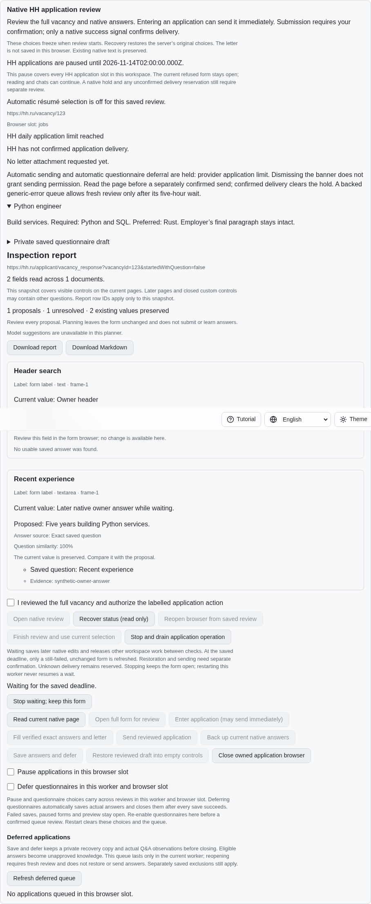
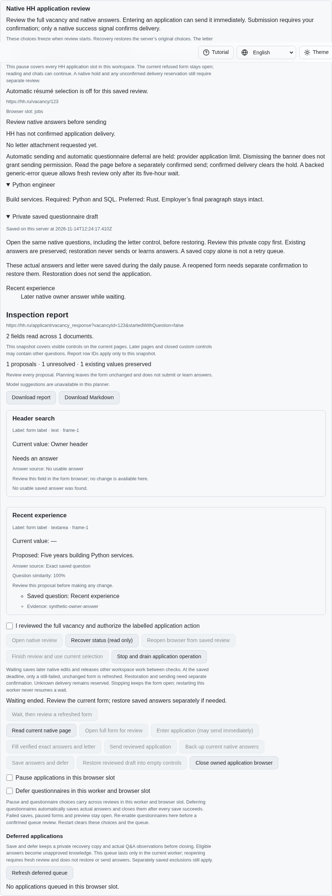
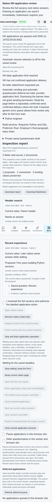

# Confirmed waiting for the original daily deadline

This snapshot describes ordinary waiting. The later
[confirmed expiry-restoration unit](application-limit-restore.md) adds a separate
wait-and-restore choice while preserving this behavior.

An owner can now confirm a finite worker wait through the foreground CLI, either
Lino transport or the four-language application controls. Waiting preserves later
actual native answers through the existing acknowledged draft/Q&A checkpoints.
The workspace writer is released between checks. Stop drains the wait and keeps
the form open; shutdown drains before closing. Status, reload and worker restart
never resume waiting or replay a completed refresh.

At the original saved deadline, a still-failed form receives one guarded GET of
the same vacancy's full application form. Current native evidence, complete saved
values, document identity, policy version and the actual unique target must still
match. Owner navigation, changed controls or answers, CAPTCHA, delivered pages,
paused policy and failed preservation refuse the refresh. A dismissed banner ends
waiting in review without navigating. Unknown submission reservations remain
reserved. Restoration into the new empty form and sending each require their own
confirmation; no wait operation sends an application.

The wait is worker memory, while the existing pause and recovery draft remain
durable. Its public receipt reports waiting, refreshing, review, stopped or
refused truthfully. A repeated wait ID reads the existing receipt rather than
rearming navigation. No durable schema change accompanies this unit (schema 19).

## Reproduction and checks

On published parent `cac7f7d3fc27370d00407d22ba835e67bc958167`, enter the native
questionnaire, type an answer, reveal the daily-limit refusal and read the form.
The automatic recovery draft exists, but no confirmed waiting control or service
operation exists. `application-limit-wait-before.py` reproduces this against the
actual parent sources. Its `--native` variant builds the parent SPA, captures the
problem and fails at the missing control. Both restore sources and drain their
fixtures. The shared parent runner is also checked against the two earlier limit
admission and draft-preservation regressions.

The focused group passes 54 Node checks and 49 Deno checks, including stop/drain,
writer release, policy changes, deadline stability, lost response recovery,
persistence failures, uncertain delivery, API/CLI controls and browser registration.
A controlled busy writer at an expired deadline verifies the one-second backoff;
expiry cannot create a hot retry loop. Scoped lint, formatting, secret checks and
the unchanged 6.5% duplication gate pass.

The production Chromium wait scenario and an independent Playwright MCP flow
preserve a later native edit, recover status in four languages, fit a phone
viewport, refresh once and restore only after separate confirmation. Both report
one native entry and zero sends, with every owned resource closed. Three actual
DOM changes (owner answer, replaced target and CAPTCHA) refuse synchronous refresh.
The final two-scenario limits group also passes with all existing behavior retained.

Early experiments exposed an actual navigation-read race: the refused form can
already have the destination URL. URL readiness alone inspected the old document
during refresh. The final implementation waits for a newly loaded document with a
different nonce and the same verified vacancy route. A separate fixture bug
discarded the GET query; the fixture now preserves genuine full-form navigation.
A closed draft disclosure required a text-content assertion and an expanded
screenshot. These failed development runs remain in the evidence bundle.

The first restoration regression also found that a historical daily-limit hold
could trigger another backup after refresh, replacing the restoration receipt.
Automatic preservation now requires an active pause or a current visible refusal.
Owner edits during an active pause still receive a fresh backup; completed
restoration retains its acknowledged receipt.

## Exact-parent hosted failure still under investigation

Parent Checks run `43591479049`, created 2026-11-14 at 11:44:49 UTC for `cac7f7d3`,
fails macOS WebKit shard 4 job `132437782294`. Its complete preserved log reports
`page.waitForFunction: Timeout 30000ms exceeded` at line 1000, from
`e2e-job-resumes.mjs:24` (line 1001); line 1173 reports the failed `job-resumes`
group. The other browser shards, runtime lanes and all four other workflows pass.
The original invalid-résumé validation timing remains unresolved. Passing local
daily-limit scenarios does not resolve this separate failure. The full workflow,
failed job and pipeline logs are retained alongside this unit's evidence.

`data/application-limit-wait.tar.gz` and its SHA-256 manifest preserve source
snapshots, parent failures, failed development traces, successful focused checks,
independent MCP receipts, screenshots and the hosted failure logs. Final-head
hosted runtime/browser matrices remain required.

This unit leaves HH06, HH08 and all 81 original unchecked inventory rows open.
Automatic restoration policy, independently authenticated account identity,
CAPTCHA priority/dismissal, paced batches and complete provider parity remain
required. Work continues in [PR #57](https://github.com/link-foundation/meta-sovereign/pull/57),
which stays draft and unmerged until every original criterion is verified.
