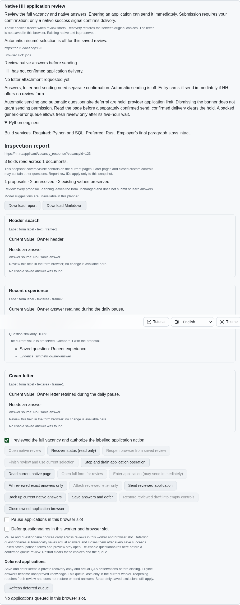
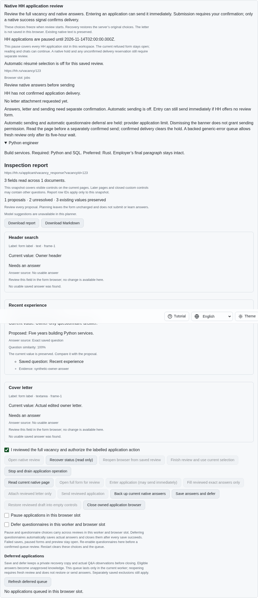
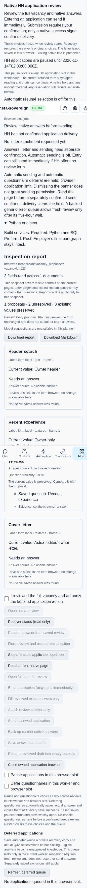

# Durable HH application pause

A visible, bound native `negotiations-limit-exceeded` refusal now starts one
two-hour deadline in private storage. It survives worker restart and browser
banner dismissal. Repeated reads keep the original deadline; an unchanged
failed document cannot start another pause after expiry. A fresh native refusal
can start a new window. Hidden banners, foreign pages and unrelated errors do
not create this pause. A simultaneous limit takes precedence over CAPTCHA.

The current browser layer cannot independently establish which slots share an
HH account. Admission therefore conservatively covers every HH application slot
in this workspace, and every locale explains that scope. This does not establish
authenticated account parity. Application status and queue recovery expose the
deadline without opening or changing a native page. The UI puts it above the
inspection report and keeps read and close available. Native writes and queued
retries are refused while it is active, before releasing a reservation.

A failed save retains the refused native form and a RAM pause. Status labels
the deadline as unsaved until a later acknowledged checkpoint succeeds; the
UI explicitly says that restart recovery has not been established. A failed
document-observation checkpoint also cannot extend the pause in the same worker.
No elapsed deadline clears a native manual hold or an uncertain send reservation.
The additive schema 18 reserves its private namespace and leaves prior intent,
options, answers and delivery reservations unchanged.

## Reproduction and verification

On published parent `8ab11c52cb93950ea5ed5725bbfadac8a77f7384`, open a native
review, observe its visible daily refusal, dismiss the banner and read again.
There is no durable deadline; manually confirmed filling and submission remain
available. `experiments/issue-56/application-limits-before.py` reproduces the
missing service field. Its `--native` variant rebuilds the selected parent SPA,
captures the problem state and fails at the missing-pause assertion. Both restore
production sources and drain their fixtures.

Focused checks cover restart with shared storage and actual Lino log close/reopen,
all-slot admission, queue preservation, late refusal, original/fresh documents,
put/flush failures, corrupt receipts, CLI, both Lino encodings and four locales.
All 45 focused Node cases and 18 Deno cases pass. Existing hold, language and
registry checks retain their previous behavior with the new wait explicitly
tested. A second focused native scenario verifies the shared locale helper still
preserves language selection and owner edits. The focused native Chromium scenario and a
separate Playwright MCP run each preserve actual owner answers and letter text,
recover through all four locales, verify phone width and issue zero sends.
All browser contexts and fixture servers are drained afterward. Rust compilation
and the full runtime/browser matrices remain hosted CI checks for the exact head.

Before, after and phone evidence is committed under `docs/screenshots`:

The checksummed `data/application-limits.tar.gz` bundle retains source snapshots,
focused logs, original failed probes, the selected parent, browser evidence and
hosted-run snapshots. The first native probe used a stale generated bundle and
failed before the intended assertion; the corrected harness and expected parent
failure are retained. The initial lint and regression-assertion corrections are
also retained instead of counted as passes. Final formatting, scoped lint and
secret scanning, Rust formatting and the unchanged 6.5% duplication gate pass.
The final browser invocation explicitly selects the installed Chrome binary; the
initial missing opt-in and absent Playwright-managed binary are not counted as
executed browser checks.

## Requirements still active

This admission unit does not complete HH06 or HH08. Daily-limit-specific automatic
answer/letter backup and expiry refresh/restoration, authenticated account binding,
paced application batches and every unchecked original inventory criterion remain
unfinished. The current native form stays open; it is not claimed to be backed up
or refreshed by this unit. Reference behavior was studied at HH commit
`fa0991b8c2d0896fb3b4be6c69947f0590094b15`; no reference code was copied.

All work continues in [PR #57](https://github.com/link-foundation/meta-sovereign/pull/57),
which remains draft and unmerged until the complete issue is verified.
