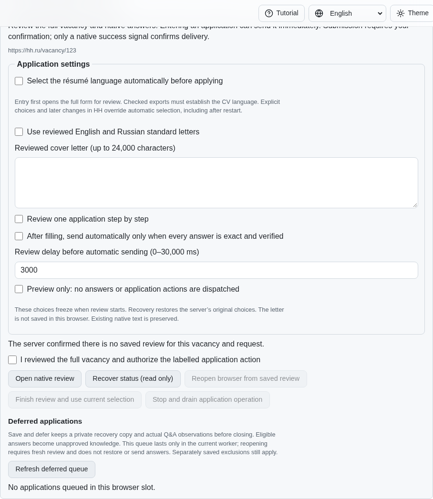
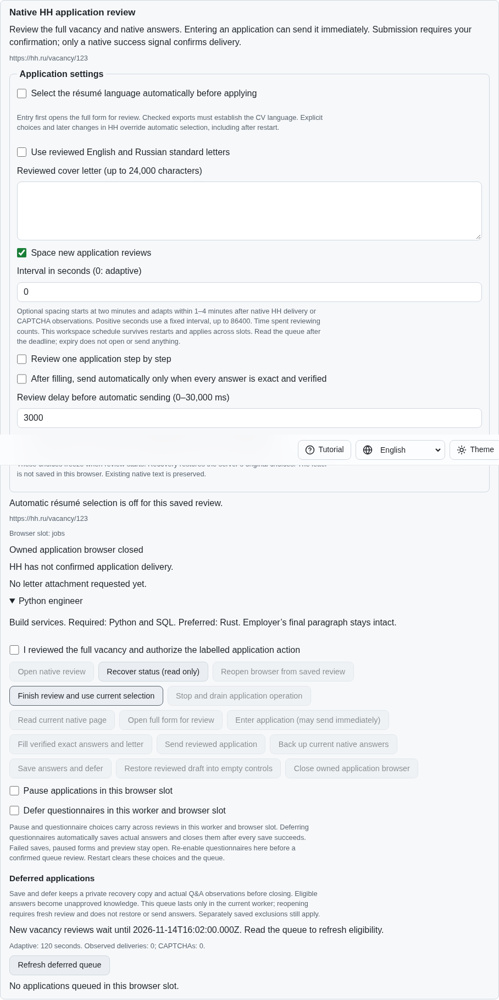
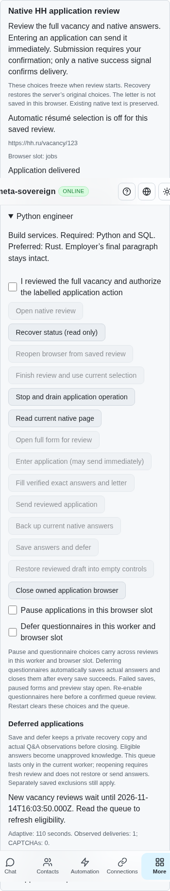

# Optional saved pacing for application reviews

New HH application reviews can opt into a saved workspace interval. In the CLI,
use `--job-application-interval=0` for adaptive timing or a positive integer
number of seconds, up to 86400, for fixed timing. The same optional
`applicationIntervalSeconds` setting crosses text/binary Lino and the application
panel in English, Russian, Hindi and Chinese. Absence preserves legacy review
signatures and behavior. Preview never reserves or changes a pacing cycle, even
while an existing window is active.

Adaptive timing starts at two minutes, stays within one to four minutes and uses
one stable random variation per cycle. A newly observed native confirmed delivery
reduces the base by 10–20 seconds, bounded at one minute. A newly observed native
CAPTCHA document increases it by 10–20 seconds, bounded at four minutes. Challenge
contents are never read by pacing. Repeated reads of the same document do not
increase counters. A challenge suppresses delivery-driven speed-up for five
minutes; repeated observations extend an active hold to at most fifteen minutes
from its first observation. Fixed intervals retain their deadline when feedback
changes the adaptive base and counters.

One private acknowledged record stores the current cycle, stable variation,
feedback counters and bounded document identities. Schema 20 reserves its
namespace without rewriting existing application intent. A failed put or flush
keeps the pending cycle visible as unsaved in this worker and refuses new browser
admission until acknowledged. A fresh daily-limit refusal takes priority. Active
spacing also applies to new review requests omitting the setting or selecting a
different browser slot. Recovery of the same review keeps its original deadline.
Time already spent reviewing counts toward the interval.

Queue reads expose only schedule metadata and counters. They never open or send
an application. The panel disables new ordinary starts while the last read shows
an active window and offers explicit queue refresh after the deadline. Existing
owned review recovery and confirmed queue review retain their guards. Pacing
does not clear CAPTCHA/manual holds or uncertain delivery reservations. Existing
default-off `MS_JOBS_APPLICATION_DEBUG=1` tracing adds payload-free pacing events.

## Reproduction and verification

`application-pacing-before.py` selects published parent `0aa60851`, restores
sources and drains both finite probes. The service probe fails because no pacing
deadline was saved. The native probe captures the parent panel, then fails because
the optional control is absent. The new focused checks pass: Node 44, including
worker policy, limits, session, CLI and browser-registration compatibility; Deno
19 for pacing, controls and namespace migration; four existing migration-registry
checks also pass. They cover restart recovery,
cross-slot and omitted-setting admission, lost responses, failed acknowledgements,
native feedback deduplication, cooldown and timing bounds, preview, four-language
controls and actual text/binary routes. Injected clocks avoid real pacing sleeps.

The initial native Chromium pacing scenario ran with the mandatory worker policy
scenario. Its [follow-up guard correction](application-pacing-guard.md) gives
pacing a separate mandatory entry, retaining every prior scenario, engine,
assertion and deadline.
It verifies adaptive timing, saved queue state, four locales, phone width, explicit
expiry refresh and one manual owner Send in the synthetic native fixture. Only
the resulting native success marker increments delivery feedback; application
automation sends zero times. The original worker policy/deferred review scenario
also passes. Independent Playwright MCP verifies fixed 17-second timing, four
locales, phone width, unchanged browser count across expiry, zero provider clicks
and drained resources. No authenticated HH account was used.

Development evidence retains fixture failures: a mock store needed its existing
flush contract, a repeated read needed the current revision, a preview assertion
used the wrong receipt shape, and browser assertions initially confused retained
closed journals and discovery-browser counts with new application admission.
An additional regression keeps the saved daily-limit refusal ahead of an active
pacing window; preview remains read only. Corrections preserve production guards.
Strict lint identified complexity that
was resolved with shared validation and feedback helpers; no rule was relaxed.

Scoped formatting, strict lint, secrets, whitespace and the unchanged 6.5%
duplication gate pass. `data/application-pacing.tar.gz` and its SHA-256 manifest
retain source, parent, checks and screenshot hashes. Exact-head hosted runtime and
browser matrices remain required and run in CI.

## Unfinished scope

This is single-review admission pacing. A complete automatic paced batch runner,
automatic RAM-queue revisits, authenticated account scope and all 81 original
incomplete inventory rows remain required. It does not complete HH06 or HH08.
Work continues in [PR #57](https://github.com/link-foundation/meta-sovereign/pull/57),
which stays draft and unmerged.
