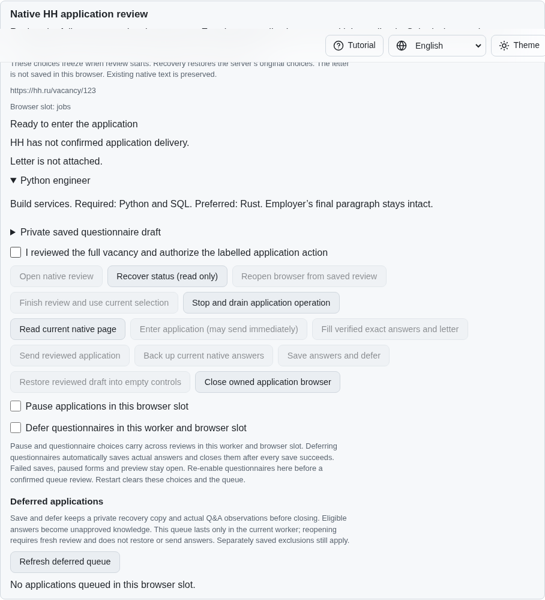
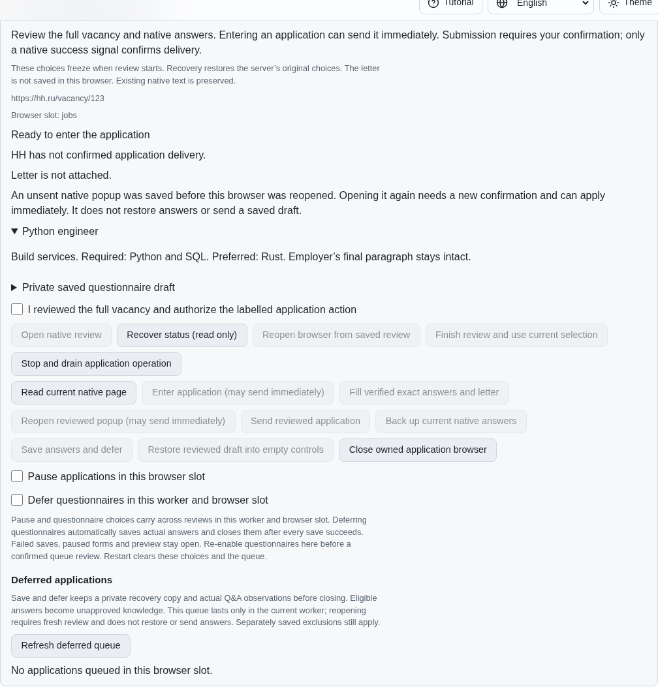
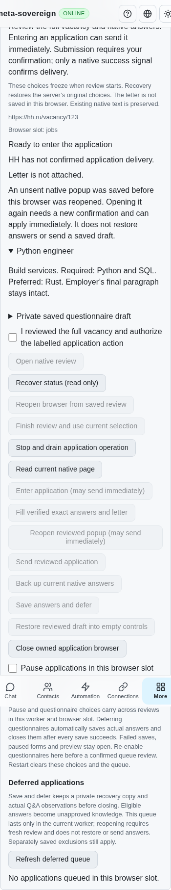
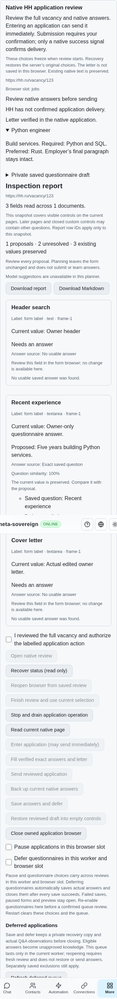

# Recovering a saved native application popup

PR: https://github.com/link-foundation/meta-sovereign/pull/57

An acknowledged, unsent HH popup can now be opened again after browser recovery
with a new owner confirmation. Recovery itself only reads the page. The original
entry reservation remains in place, and neither recovery nor the new entry
restores or sends saved answers. Entry can immediately apply when HH supplies no
form, so the action and its hint say this explicitly.

This completes a popup recovery prerequisite of HH06, not the full requirement.
Live-provider parity, complete résumé selection, paced queue execution and every
original unchecked criterion remain required. All 81 unchecked inventory rows
remain unchecked; PR57 stays draft and unmerged.

## Reproduction and root cause

The pinned HH reference `fa0991b8c2d0896fb3b4be6c69947f0590094b15` describes popup
and full-form applications, saving actual drafts before closure and immediate
delivery on entry. Its draft and résumé modules were read as behavioral sources;
no upstream code was copied or executed.

On published parent `103c8c249f93b6d4968b60decb1a937dd38e511c`, enter a native
popup, edit its questionnaire and letter, read and back up the actual values,
then close the application browser. Recover status and explicitly reopen it.
The fresh vacancy document contains no popup, while the durable entry reservation
correctly prevents the original entry action. The parent cannot reach the popup
again. Removing that reservation would also permit replay after unknown delivery.

The correction records positive unsent popup evidence only after its review is
acknowledged. A new `reenter` action consumes that evidence in the same durable
reservation that precedes native dispatch. A lost dispatch reply stays unknown.
Only a definitive synchronous refusal restores the consumed evidence.

```sh
PYTHONDONTWRITEBYTECODE=1 python3 experiments/issue-56/application-popup-before.py
PYTHONDONTWRITEBYTECODE=1 python3 experiments/issue-56/application-popup-before.py --native
node --max-old-space-size=384 --test --test-concurrency=1 js/tests/job-application-popup.test.js js/tests/job-application-popup-controls.test.js js/tests/migrations-supervised-applications.test.js
DENO_V8_FLAGS=--max-old-space-size=384 deno test --no-check --allow-all js/tests/job-application-popup.test.js js/tests/job-application-popup-controls.test.js js/tests/migrations-supervised-applications.test.js
RUN_BROWSER_E2E=1 E2E_BROWSER=chromium E2E_EXECUTABLE_PATH=/opt/google/chrome/chrome node --max-old-space-size=384 experiments/issue-56/application-popup-native.mjs
PYTHONDONTWRITEBYTECODE=1 python3 experiments/issue-56/native-rich-check.py --session
```

The MCP driver is composed with `compose-application-mcp.py application-popup-mcp.mjs`
and uses the isolated native fixture with `APPLICATION_REVIEW_FIXTURE=1`,
`APPLICATION_DRAFT_FIXTURE=1` and `APPLICATION_POPUP_FIXTURE=1`. It never accesses
an authenticated provider account or the user's application server.

## Verification and limits

- Exact-parent Node and native Chromium checks fail at the missing recovery
  capability. Before and after experiments use fresh native documents and drain
  their browsers. Source substitutions run sequentially and restore the original
  bytes before rebuilding the current bundle.
- All 200 focused application, migration and dictionary checks pass. The 18 new
  Node/Deno cases cover failed checkpoint writes and flushes, stale confirmation,
  pauses, changed pages, legacy and contradictory journals, lost replies, immediate
  delivery, definitive refusal, full-form transitions and zero-effect preview.
- Both real Lino encodings, the foreground command and all four locale dictionaries
  use the same server admission rules. Public receipts reject contradictory
  recovery claims. Unknown submissions and old journals never authorize entry.
- One production Chromium scenario and independent Playwright MCP verify read-only
  recovery, a separately confirmed entry, restoration of actual owner values and
  another confirmed send. Native counters show zero automatic entries, one new
  entry and one submission. All owned fixtures close without page errors.
- Schema 15 reserves the optional private checkpoint without rewriting legacy
  journals. Native and JavaScript negotiation advance together; the unchanged
  durable checkpoint representation remains 13. Seven finite native session
  checks and warnings-denied scoped Clippy pass.

Initial browser drafts tried reopening immediately after explicit closure, which
clears the local recovery identity. They timed out on the correctly disabled
button. The fixture now performs a read-only status recovery first. An initial
full-form draft failed to clear popup evidence during navigation; the regression
now covers that transition. Those failures are retained alongside successful
checks. The first duplication check exceeded the unchanged 6.5% gate; shared
application fixtures remove actual repetition instead of relaxing the gate.

Hosted checks remain necessary for the final commit. The diagnostic-only parent
fix has passed its previously failing Rust job; an earlier supervised commit's
failed check is not counted as passing. Synthetic fixtures do not establish
authenticated HH behavior or complete reference-runner parity.

## Visual evidence

The parent cannot offer a new entry after reopening the vacancy:



The recovered review offers a new entry with a renewed confirmation and the
immediate-delivery warning:



Phone controls retain the same confirmation rule:



Actual saved answers restore without sending:



The source, reference, complete logs, screenshots and checksummed manifest are
preserved in `data/application-popup.tar.gz` and
`data/application-popup.tar.sha256.json`. Previous evidence archives remain intact.
