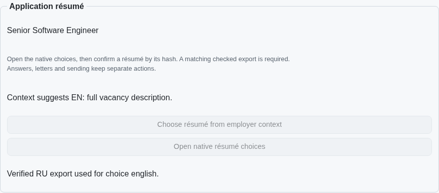
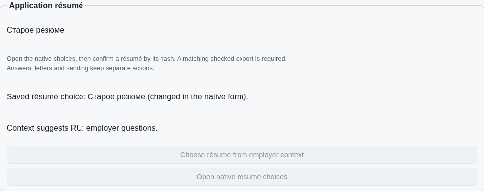
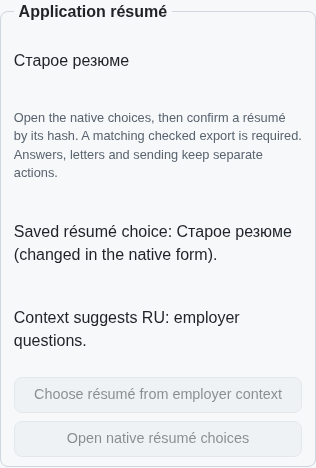

# Acknowledged résumé-choice history

PR: https://github.com/link-foundation/meta-sovereign/pull/57

Verified manual and employer-context CV choices now retain their observed hash,
title and source in the private application journal. A later bound native read
can acknowledge an owner's changed title, without inventing a hash. Inactive
recovery displays saved history and performs no native selection or sending.
The record belongs to one vacancy, request and browser slot.

This is a partial HH06 prerequisite. It does not enforce a durable override against
future automatic language selection. Automatic selection before entry,
language-aware standard letters, authenticated provider verification and all 81
original unchecked inventory criteria remain required. PR57 stays draft.

The pinned HH README (fa0991b8c2d0896fb3b4be6c69947f0590094b15, lines 105–124)
requires retaining language choices and manual changes through worker restart.
The prior implementation returned selection in the immediate response only.
The exact published parent 1e97b9fa fails both the new restart regression and
the visible saved-history check. The bounded reproduction scripts restore source
bytes and drain owned fixtures:

```sh
PYTHONDONTWRITEBYTECODE=1 python3 experiments/issue-56/application-preference-before.py
PYTHONDONTWRITEBYTECODE=1 python3 experiments/issue-56/application-preference-before.py --native
```

The new journal field is acknowledged after native result verification. Failed
persistence restores the latest acknowledged record and never repeats selection.
A stale caller revision still refuses; read-only status supplies the current
revision. Unsafe native observations cannot replace saved history. Legacy rows
without the field remain readable; corrupt identities refuse. Additive schema 16
reserves the field without rewriting old signatures or delivery reservations;
the native session schema is updated consistently.

CLI and both Lino formats share the typed receipt. Four translated controls say
“Saved résumé choice,” including its source, rather than asserting the saved CV
is currently applied. An inactive receipt exposes history without action buttons.
Existing confirmation, owner-answer, letter, preview and uncertain-send guards
remain intact.

Focused validation passes 50 Node and 18 Deno cases, covering restart, failed
acknowledgements, corrupt and legacy rows, isolation, CLI, both wire encodings,
four languages and migration collisions. The initial draft's stale-read failure
and a source-swap overlap during validation are preserved; the final checks ran
serially after all parent source restoration. The initial duplication gate was
just over its unchanged 6.5% threshold; shared no-replay assertions remove repeated
test code, and the seven affected cases pass again on Node and Deno. Native Rust compilation and broad
runtime/browser matrices remain assigned to hosted CI, within the local resource
limit. One extended native Chromium case and an independent Playwright MCP case pass. They verify manual/context/native history, later owner changes, four-locale read-only recovery, preserved answers and letters, zero entry/send clicks and drained owned fixtures. Desktop and 390-pixel images were inspected. The first MCP invocation omitted its synthetic control URL and refused before selection; its error and drained server remain preserved.







Checksummed sources, regressions, logs and images are retained in
`data/application-preference.tar.gz` and its per-file manifest. Exact published-head
CI remains required; focused local passes do not establish issue completion.
