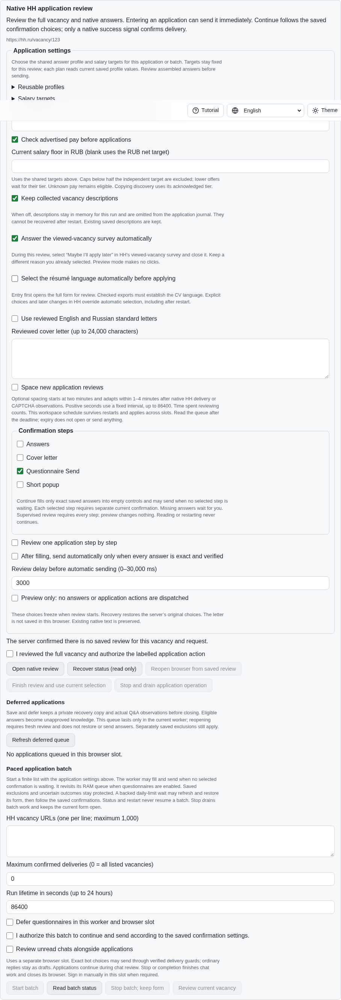
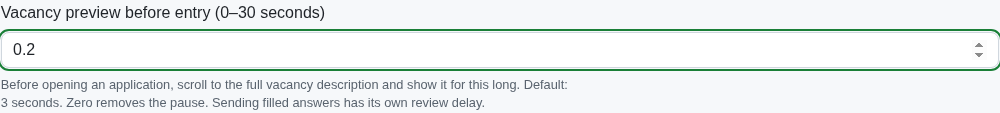
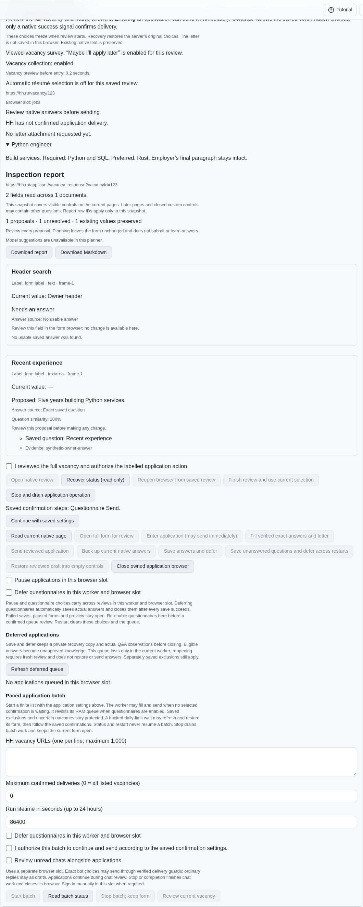

# Preview the complete vacancy before entry

PR: https://github.com/link-foundation/meta-sovereign/pull/57

HH03 and pinned HH requirement R-Z17 require a separate preview of the complete
vacancy description before Apply. The existing `reviewDelayMs` pauses before
submitting filled answers; it did not scroll or pause before entering an
application or navigating to its full form. Status inspection also cannot
substitute for the configured execution pause.

Both entry paths now verify the reviewed native document and its complete
description, scroll the uniquely visible description into view and wait three
seconds by default. `vacancyPreviewSeconds` accepts finite values from zero to
thirty, including decimals. Zero removes the pause. CLI precedence is explicit
`--vacancy-preview-seconds`, `VACANCY_PREVIEW_SECONDS`, selected/current `.lenv`,
then the default. Text/binary Lino and four-language shared controls freeze the
same option in single reviews and batches and show it after read-only recovery.

After the wait, the operation rechecks Stop, native document identity, CAPTCHA,
questions, entry availability, salary admission and the complete description.
Refusal leaves the entry and submission reservations unissued. Existing target,
native pre-dispatch, delivery and filled-answer review guards remain. Test mode,
status and recovery do not scroll, wait or replay entry. The default-off
`application-vacancy-preview` trace contains only the configured delay.

Schema 25 reserves the optional field without rewriting legacy journal or batch
signatures, actual answers or attempted-delivery records. Legacy absence uses
the execution default; unexpected existing fields refuse migration. The native
sync schema and all four migration guides match the registered migration.

Reproduce with finite owned fixtures:

```sh
node --test --test-concurrency=1 js/tests/application-preview.test.js js/tests/application-preview-controls.test.js js/tests/migrations-application-preview.test.js
node experiments/issue-56/application-preview-parent.mjs
node experiments/issue-56/application-preview-browser.mjs
```

The parent loader selects the exact published `d21b7f97ee0ff9e5cf16ba7055f2a60048843b06`
entry, option, receipt, batch, CLI and panel modules. Twenty-five assertions fail,
with four independent controls passing and no cancelled tests. The controls
include the new isolated commander adapter, not proof that the old entry path
already called it. The final relevant selection passes 107 tests with concurrency
one and a bounded Node heap. The browser registration check retains every
scenario exactly once, at most four per group, both mandatory engines and all
existing hosted deadlines. The new native scenario joins the feedback group.

The isolated actual Chromium fixture verifies five refused native-description
substitutions, a real scroll from below the viewport, zero effects during the
100 ms configured pause, exactly one subsequent entry and zero submissions.
Four-language recovery and phone width retain the receipt. Independent
Playwright MCP uses 200 ms, recovers the saved setting before entry and after
four locale reloads, and records one native entry, zero submissions and all
owned application browsers closed. The server and its driver drain afterward.
These fixtures do not use an authenticated provider account.

An initial native run exposed the adapter's incorrect Playwright-style evaluate
signature; the actual Commander requires `{ fn, args }`. The corrected adapter
has a dedicated contract regression. The first migration dry-run expectation
also missed the memory store's scan accounting; one shared namespace scan now
checks review and batch collisions, with the actual two-row count asserted.
The first MCP screenshots retained an already-open tutorial; the repeat starts
at a blank document before installing its initial preferences. Both diagnostics
and the corrected images are retained. The repeated MCP run reports no page
exceptions, but its console still records the fixture favicon 404 and browser
cache-write failures on reload. Their cause is not established here. The owned
server was started without an interactive stdin; its existing stdin drain was
invoked through the local Node inspector, which was then disconnected. Its
actual cleanup receipt and successful process exit are preserved.

Scoped formatting, lint, secrets, source/document limits and whitespace checks
pass. The unchanged 6.5% duplication gate reports 6.499712%. Shared foreground
fixtures, locale rendering and published-bundle routing remove repeated setup;
no scenario or refusal assertion is removed.







Source-bound [evidence](data/application-preview.tar.gz) and its
[manifest](data/application-preview.tar.sha256.json) preserve exact parent/current
sources, initial failures, final checks, native/MCP receipts, console observations
and reviewed screenshots. Full runtime/browser/platform validation stays in
hosted CI. HH03 still requires its complete cache/configuration/insight audit and
the pinned option to bypass vacancy-page Apply. This unit does not accept HH03
or any other unfinished row: **88/118 verified; all thirty unfinished criteria
remain required in this draft, unmerged PR**.
