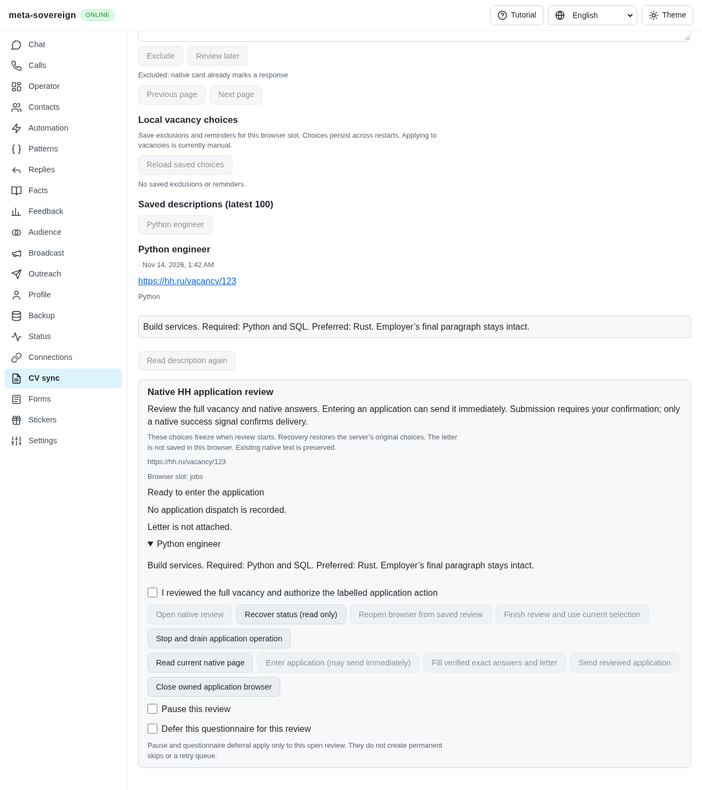
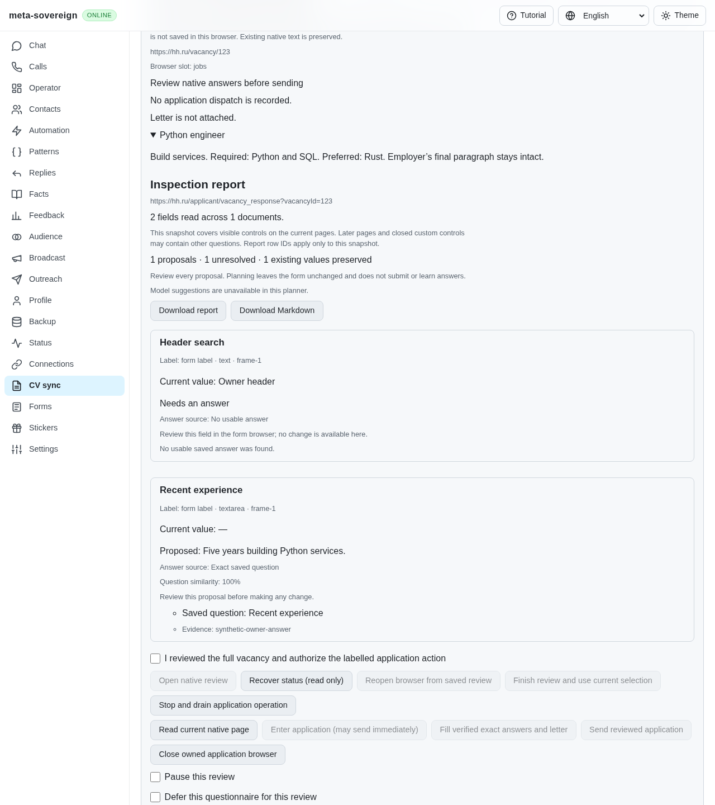

# Reopen an acknowledged native questionnaire

[PR #57](https://github.com/link-foundation/meta-sovereign/pull/57) corrects a
recoverable full-form application being reopened at the vacancy instead of its
acknowledged HH questionnaire. This verifies one recovery path; issue 56 and
HH06–HH08 remain unfinished.

## Reproduction and cause

On published `e1c10104`, enter the synthetic native application, close its owned
browser, recover the saved status and explicitly reopen that review. The service
navigates to the original vacancy. Its durable entry reservation correctly
refuses another entry, leaving a `ready` receipt without a usable questionnaire.
The old service fixture retained its mock document across browser openings and
therefore concealed this real fresh-document failure.

`python3 -B experiments/issue-56/application-recovery-before.py` runs the new
regression against those exact three production files and restores the current
bytes in `finally`. Adding `--native` reproduces the same `ready` versus `review`
failure through the production commander and intercepted native HH HTML. The
independent MCP probe also captures the blocked published UI. No authenticated
provider is used.

## Corrected recovery

Only a freshly inspected, bound native review can checkpoint its full-form URL.
That URL must have the original vacancy's exact HH origin, no credentials, the
native questionnaire path and exactly one matching vacancy ID. Invalid saved
locations refuse before browser launch. Failed puts or flushes restore the
acknowledged location while retaining a dispatch reservation that was already
durable. Older journals without a location stay readable and cannot invent a
questionnaire or release an uncertain reservation.

Explicit reopening navigates to the acknowledged form, reads its actual current
document and prepares a fresh answer review. The server retains the original
letter and settings. Reopening performs no entry, prefilling or submission;
subsequent writes still require explicit confirmation. An uncertain submission
remains reserved after recovery. Popup state and unsaved native owner answers
are not reconstructed from this URL.

## Verification

- Six recovery cases cover fresh documents, seven malformed/foreign locations,
  failed put/flush checkpoints, uncertain submissions and legacy journals.
  All 33 focused recovery/ownership/service/interface/browser-controller cases
  and four hosted browser registry checks pass with concurrency one.
- The actual-parent Node and native cases fail on `ready` versus `review`.
  The corrected native Chromium case records one original entry, zero recovered
  entries, zero automatic submissions and one explicitly confirmed submission.
  The original reviewed letter and exact answer are verified; all owned pages
  close with no page errors.
- Independent Playwright MCP verifies Close → Recover → Reopen, blocked duplicate
  entry, renewed confirmation, read-only reload, verified letter and positive
  delivery. Its owned fixture browsers close and report no page errors.
- The new native recovery scenario is registered in the existing hosted
  application browser group for both engines. Full matrices and exact-head
  verification remain on GitHub CI.
- Scoped lint, formatting, secrets and diff checks pass. Duplication is 6.47%
  against the unchanged 6.5% gate. Existing default-off application tracing now
  reports whether an opening chose the vacancy or questionnaire, without its URL.

The [archive](data/application-recovery.tar.gz) and its
[manifest](data/application-recovery.tar.sha256.json) preserve source snapshots,
exact parent files, logs, independent MCP results and screenshot hashes.

Published reopening lands at the vacancy with entry reserved and disabled:

The corrected reopening returns to the actual questionnaire for fresh review:

Deferred retry queues, complete session policies, native popup recovery,
authenticated-provider verification and every other unchecked original
inventory criterion remain required. PR57 stays draft and unmerged.
