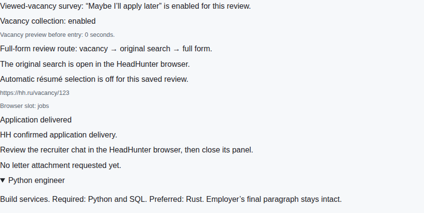
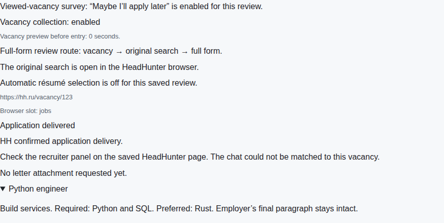

# Verify the embedded recruiter chat after delivery

In CV Sync, start a paced HeadHunter batch using the original search route and
follow its vacancy. After HeadHunter confirms delivery, the worker verifies the
live vacancy link inside the visible recruiter panel. The application receipt
remains confirmed while a missing, changed or ambiguous link asks the owner to
check the HeadHunter browser. The run holds the browser and its draft until the
owner dismisses the panel.

## Reproduction and verification

The published parent `65efaa1f` treated the visible panel as a verified recruiter
chat when the header linked to vacancy `789` after delivery for vacancy `123`.
Restart the fixture with the parent sources and bundle, send the reviewed
application, then change the embedded header link. The regression times out
waiting for CV Sync to show the unverified state.

The corrected worker checks the exact provider origin and the one visible chat
frame inside the native panel. The browser test changes the original frame's
link with a matching decoy elsewhere on the page, restores the link, and then
moves the decoy into the panel. It checks that an outside frame cannot supply the
vacancy binding, two visible candidates remain ambiguous even without a second
header, and hiding the decoy recovers the real match. The application is sent once and the native draft
survives. There are no letter sends or page releases before dismissal. Node
passed 86 focused checks and Deno passed 73.

Independent Playwright reproduced the warning at 390 CSS pixels after reload,
then verified recovery when the correct link returned. Delivery stayed confirmed,
the native draft was unchanged and the fixture counted one Send across the run.
It recorded no page exceptions, a missing favicon and a cache-write error. The
browser and fixture server closed successfully.

```sh
node --test --test-concurrency=1 js/tests/job-application-recruiter-panel.test.js js/tests/browser-choices.test.js
RUN_BROWSER_E2E=1 node experiments/issue-56/application-recruiter-panel-browser.mjs
```

For the failing run, extract the archive below and use its `parent-modules`
directory as `APPLICATION_RECRUITER_PANEL_PARENT`. Set
`APPLICATION_RECRUITER_PANEL_PARENT_WEB` to the local file produced by
`git show 65efaa1f:js/src/web/app.min.js`. Add
`E2E_RECRUITER_PANEL_BINDING_PARENT=1` to the browser command.

| Before · wrong vacancy shown as ready                                                                                                                       | After · CV Sync asks the owner to check the panel                                                                                                           |
| ----------------------------------------------------------------------------------------------------------------------------------------------------------- | ----------------------------------------------------------------------------------------------------------------------------------------------------------- |
|  |  |

[Matched native panel](../../screenshots/application-recruiter-panel-binding/application-recruiter-panel-native.png) ·
[Matched phone review](../../screenshots/application-recruiter-panel-binding/application-recruiter-panel-phone.png) ·
[Source and logs](data/application-recruiter-panel-binding.tar.gz) ·
[SHA-256 manifest](data/application-recruiter-panel-binding.json)

This checks the vacancy binding under RUN4 and B29. Recruiter reply handling,
owner-answer learning, terminal dismissal, and authenticated acceptance remain
open under HH08 and HH10. [Pinned HeadHunter requirements](https://github.com/konard/hh-job-application-automation/blob/fa0991b8c2d0896fb3b4be6c69947f0590094b15/docs/requirements/README.md#run-the-application-run)
