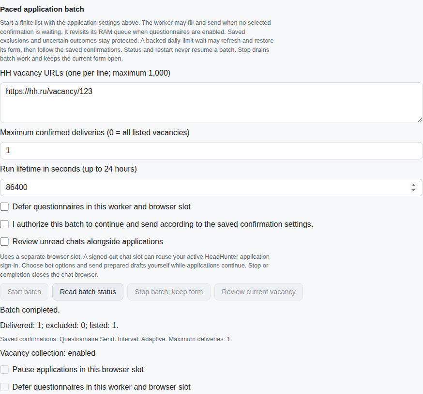
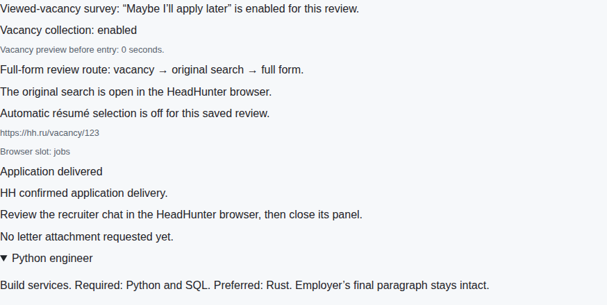

# Wait for a delayed HeadHunter recruiter panel

In CV Sync, choose the original search route and start a paced batch with a
delivery cap of one. Follow the current vacancy. Confirm **Send** in CV Sync or
send the reviewed application in the HeadHunter browser. After HeadHunter
confirms delivery, the worker returns to the original filtered search and gives
its recruiter panel up to ten seconds to appear. The confirmed receipt counts
toward the cap immediately. An open panel holds the run until the owner closes it.
Stop ends the wait and leaves the current HeadHunter browser open.

## Reproduction and verification

The published parent `fa9de74b` detects a panel that is already visible, then
closes the owned browser at the cap if the first check sees no panel. The
Chromium fixture restores that revision's source and web bundle and injects the
native recruiter frame four seconds after the second visit to the exact search.
On the parent, the tab is already closed when the fixture checks for it.

The paced batch now waits on the bound search document after saving confirmed
delivery. CV Sync uses the batch's acknowledged vacancy revision to refresh the
already-followed receipt by status. The refresh also picks up a Send clicked
directly by the owner in HeadHunter. A changed vacancy, slot or request cannot
trigger the refresh. The browser checks cover each send entry point, exactly one
native application dispatch, exactly two visits to the saved search, recovery
after reload, the unchanged recruiter draft and batch completion after dismissal.
Node passed 74 focused checks and Deno passed 61. They cover Stop and expiry of
the wait when no panel opens. Independent Playwright confirmed the delivery,
unchanged draft and one Send before and after a reload at 390 CSS pixels. It
recorded no page exceptions, a missing fixture favicon and one cache-write error.
All fixture resources closed.

```sh
node --test --test-concurrency=1 js/tests/job-application-recruiter-panel.test.js js/tests/job-application-session.test.js
RUN_BROWSER_E2E=1 node experiments/issue-56/application-recruiter-panel-browser.mjs
RUN_BROWSER_E2E=1 E2E_RECRUITER_PANEL_MANUAL_SEND=1 node experiments/issue-56/application-recruiter-panel-browser.mjs
```

For the failing run, extract the archive below and use its `parent-modules`
directory as `APPLICATION_RECRUITER_PANEL_PARENT`. Set
`APPLICATION_RECRUITER_PANEL_PARENT_WEB` to the local file produced by
`git show fa9de74b:js/src/web/app.min.js`. The automatic Send command then
reproduces the premature closure using the published source and bundle.

| Parent closes the browser before the panel appears                                                                                            | CV Sync shows the confirmed delivery and delayed panel                                                                                           |
| --------------------------------------------------------------------------------------------------------------------------------------------- | ------------------------------------------------------------------------------------------------------------------------------------------------ |
|  |  |

[Native recruiter frame](../../screenshots/application-recruiter-panel-delay/application-recruiter-panel-native.png) ·
[Phone review](../../screenshots/application-recruiter-panel-delay/application-recruiter-panel-phone.png) ·
[Source and logs](data/application-recruiter-panel-delay.tar.gz) ·
[SHA-256 manifest](data/application-recruiter-panel-delay.json)

This evidence covers the delayed manual handoff under RUN4 and B29. Matching and
processing recruiter replies, learning owner answers, terminal dismissal and
authenticated acceptance remain open under HH08 and HH10. [Pinned HeadHunter requirements](https://github.com/konard/hh-job-application-automation/blob/fa0991b8c2d0896fb3b4be6c69947f0590094b15/docs/requirements/README.md#run-the-application-run)
