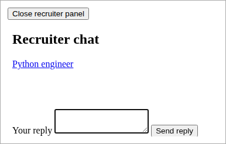
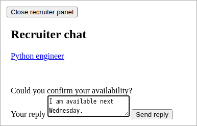

# Review saved-answer drafts in the HeadHunter recruiter panel

Start a paced application batch from its original search and confirm delivery
of the current application. When the recruiter panel asks a question, the
worker can fill an empty composer with a complete saved-answer draft and reveal
the incoming message. The owner can edit, clear or send the draft in
HeadHunter. The batch stays at the current vacancy during review.

## Reproduction and verification

The fixture saves “Can you confirm your availability?” with an approved answer.
The provider asks “Could you confirm your availability?” The shared planner
classifies this match as approximate and requires review. On published parent
`0bc3277d`, after the owner clears the composer and returns to the matching
vacancy, the reply stays blank and the latest question is below the visible
message list.

The regression keeps the owner's existing draft, changes the panel header to
another vacancy, clears the composer, and verifies the wrong panel receives
zero writes. Returning the header to the delivered vacancy produces one native
draft event and reveals the question. The provider receives zero chat sends.
The worker checks the current browser document, message, native draft, saved
answer and application mode before preparing the text. An owner-cleared draft
stays empty for that question during the active review.

The focused Node and Deno checks each passed 26 tests. Independent Playwright
recovered the same native draft from CV Sync at 390 CSS pixels after reload.
It recorded one draft write, zero recruiter sends, one application, zero page
exceptions and release of the owned browser after the owner dismissed the
panel.

```sh
RUN_BROWSER_E2E=1 E2E_RECRUITER_PANEL_PREPARE_REPLY=1 E2E_RECRUITER_PANEL_SKIP_BINDING=1 E2E_RECRUITER_PANEL_IMMEDIATE=1 node experiments/issue-56/application-recruiter-panel-browser.mjs
```

To replay the parent, extract the evidence archive and set
`APPLICATION_RECRUITER_PANEL_PARENT` to its `parent-modules` directory. Set
`APPLICATION_RECRUITER_PANEL_PARENT_WEB` to the local JavaScript bundle saved
from `git show 0bc3277d:js/src/web/app.min.js`.

| Before · Empty reply and question below the fold                                                                                  | After · Reviewable draft and revealed question                                                                                                               |
| --------------------------------------------------------------------------------------------------------------------------------- | ------------------------------------------------------------------------------------------------------------------------------------------------------------ |
|  |  |

[Source and logs](data/application-recruiter-panel-draft.tar.gz) ·
[SHA-256 manifest](data/application-recruiter-panel-draft.json)

This covers reviewable free-text drafts in the pinned B29 workflow. Automatic
exact and accepted-summary replies, terminal dismissal and authenticated
provider acceptance remain open under HH08 and HH10.
[Pinned HeadHunter requirements](https://github.com/konard/hh-job-application-automation/blob/fa0991b8c2d0896fb3b4be6c69947f0590094b15/docs/requirements/README.md#run-the-application-run)
