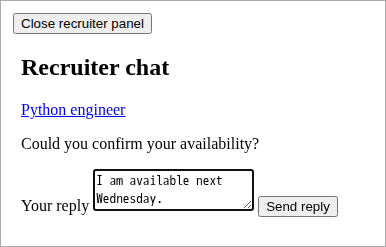
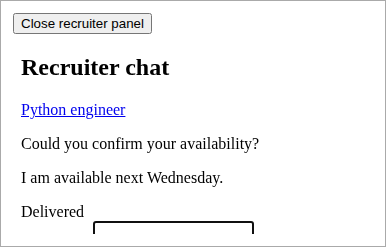
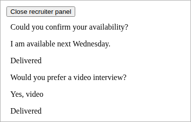
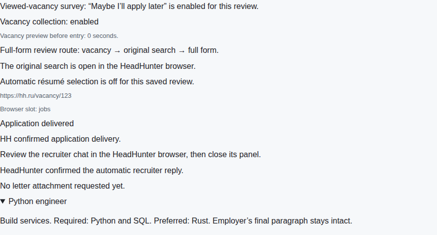

# Send approved exact answers in the HeadHunter recruiter panel

In CV Sync, enable **Send approved word-for-word recruiter answers
automatically** before starting the application or paced batch. The CLI
exposes the same setting as `--auto-send-exact-answers=true` and Lino uses
`autoSendExactAnswers`. The setting defaults off. Supervised review and test
mode suppress it.

After an application is confirmed, an owned recruiter panel can send an
approved answer when the incoming question matches the saved wording and the
whole current turn is bound to that vacancy. A native choice must exactly
match the saved answer and identify one button. An existing owner draft,
quiet hours, or a workspace chat opt-out stops automatic dispatch. The shared
Questions outbox reserves the question before a click and records only a
distinct outgoing provider message as a positive receipt. A send with an
uncertain outcome remains reserved, and CV Sync keeps application delivery and
recruiter reply delivery visible as separate states.

## Reproduction and verification

Save the fixture answer “I am available next Wednesday.” for “Could you
confirm your availability?”. Submit the application and clear the existing
native draft when the owned recruiter panel opens. Published parent `9f011361`
puts the answer in the native composer and leaves the chat without an outgoing
message or receipt. With the opt-in, the updated Chromium fixture verifies
one delivered text reply with its native message ID. A native button with an
extra period and an exact native button under a chat opt-out stay untouched.
After the opt-out is removed, the exact button produces one distinct native
reply and receipt. One application is delivered in the scenario. The shared
path verifies the exact original search, preserves outstanding owner text, and
allows the owner to close the panel.

The focused Node and Deno suites each passed 87 checks. A separate Playwright
MCP replay verified the option defaults off, an owner draft blocks sending,
and CV Sync restores the same receipt at 390 px without horizontal overflow
or another provider send. Closing the panel completed the paced batch and
released the browser connection.

```sh
RUN_BROWSER_E2E=1 E2E_RECRUITER_PANEL_EXACT_REPLY=1 E2E_RECRUITER_PANEL_IMMEDIATE=1 E2E_RECRUITER_PANEL_SKIP_BINDING=1 node experiments/issue-56/application-recruiter-panel-browser.mjs
```

Extract the evidence archive to reproduce the parent. Set
`APPLICATION_RECRUITER_PANEL_PARENT` to the extracted `parent-modules`
directory and `APPLICATION_RECRUITER_PANEL_PARENT_WEB` to the bundle saved
with `git show 9f011361:js/src/web/app.min.js`.

| Before · Saved wording stays in the native composer                                                                                         | After · Native message and positive receipt                                                                                                      |
| ------------------------------------------------------------------------------------------------------------------------------------------- | ------------------------------------------------------------------------------------------------------------------------------------------------ |
|  |  |

| Exact native choice                                                                                                                          | Confirmed recruiter reply in CV Sync                                                                                                                    |
| -------------------------------------------------------------------------------------------------------------------------------------------- | ------------------------------------------------------------------------------------------------------------------------------------------------------- |
|  |  |

[CV Sync at 390 px](../../screenshots/application-recruiter-panel-exact/application-recruiter-panel-exact-phone.png)

[Source and logs](data/application-recruiter-panel-exact.tar.gz) ·
[SHA-256 manifest](data/application-recruiter-panel-exact.json)

Accepted-summary replies, terminal dismissal and authenticated provider
acceptance remain open under HH08 and HH10.
[Pinned HeadHunter requirements](https://github.com/konard/hh-job-application-automation/blob/fa0991b8c2d0896fb3b4be6c69947f0590094b15/docs/requirements/README.md#run-the-application-run)
