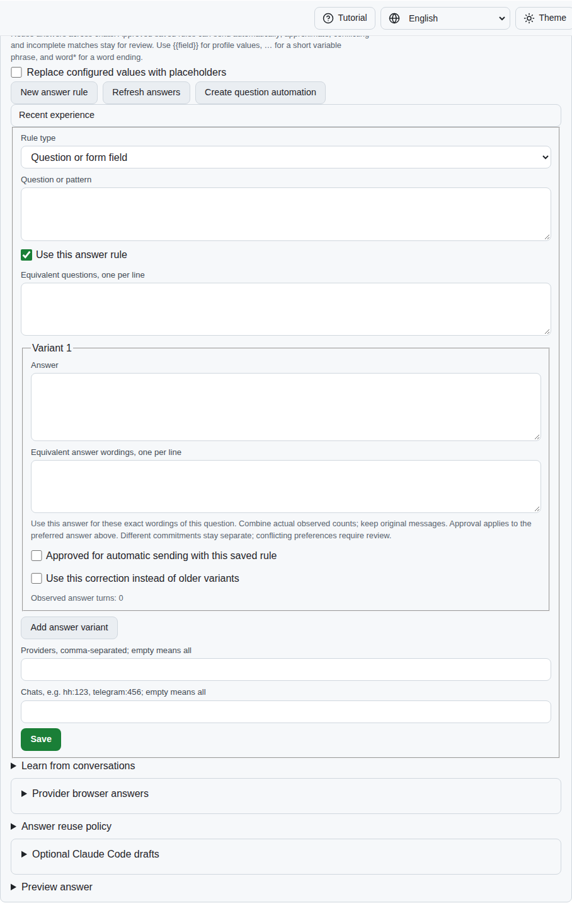
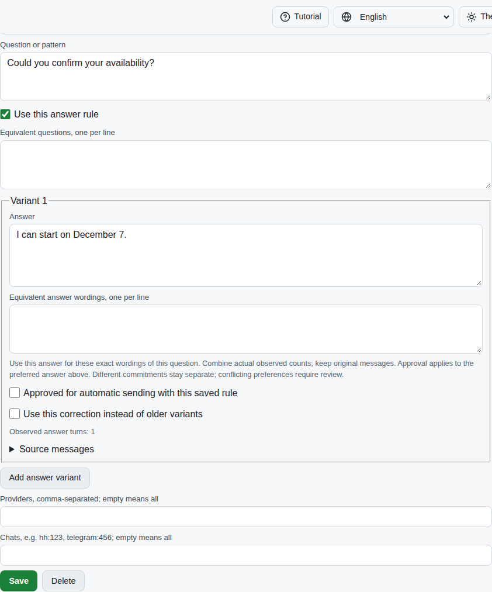

# Learn from confirmed replies in the HeadHunter recruiter panel

Start a paced application batch with the original search route. Send the
reviewed application, wait for the recruiter panel, and reply in HeadHunter.
Chat saves the messages from the vacancy-bound panel under the same HeadHunter
conversation ID used for native import. A dated reply becomes an answer proposal
after HeadHunter confirms delivery. Questions keeps the proposal unapproved
and links it to the original reply.

## Reproduction and verification

On the published parent `13f0308e`, deliver the fixture application and send a
native answer to the recruiter question. HeadHunter displays the delivered
message. Opening Questions shows that no answer proposal was saved.

The regression opens the same routed panel and uses its native reply button. Its
outgoing bubble first enters Chat as pending. Questions has no new proposal
until the browser sees the provider's delivered state. The worker reads back the
durably acknowledged rows before learning. It excludes a frame showing a
different vacancy and leaves the existing application receipt and next owner
draft intact. The fixture counts one application Send and one owner reply.
Node and Deno each passed 40 focused checks.

Independent Playwright verified the unapproved proposal at 390 CSS pixels
before and after reload, with one recruiter reply, one application Send and one
observed turn. It recorded no page exceptions, a missing fixture favicon and a
cache-write error. Dismissing the panel completed the batch and released its
browser. The Playwright browser and fixture server also closed.

```sh
node --test --test-concurrency=1 js/tests/job-application-recruiter-panel.test.js js/tests/question-unread-history-learning.test.js
RUN_BROWSER_E2E=1 E2E_RECRUITER_PANEL_LEARN_REPLY=1 node experiments/issue-56/application-recruiter-panel-browser.mjs
```

For the failing run, extract the archive below and use its `parent-modules`
directory as `APPLICATION_RECRUITER_PANEL_PARENT`. Set
`APPLICATION_RECRUITER_PANEL_PARENT_WEB` to the local file produced by
`git show 13f0308e:js/src/web/app.min.js`. Add
`E2E_RECRUITER_PANEL_LEARNING_PARENT=1` to the browser command.

| Before · Questions lacks the owner reply                                                                                                            | After · The proposal is available for review                                                                                                           |
| --------------------------------------------------------------------------------------------------------------------------------------------------- | ------------------------------------------------------------------------------------------------------------------------------------------------------ |
|  |  |

[Native delivered reply](../../screenshots/application-recruiter-panel-learning/application-recruiter-panel-owner-reply-native.png) ·
[Source and logs](data/application-recruiter-panel-learning.tar.gz) ·
[SHA-256 manifest](data/application-recruiter-panel-learning.json)

This exercises owner-answer learning while the original search panel remains
open under B29. Drafting and safe automatic replies, terminal dismissal, capture
when a panel closes immediately, and authenticated acceptance remain open under
HH08 and HH10. [Pinned HeadHunter requirements](https://github.com/konard/hh-job-application-automation/blob/fa0991b8c2d0896fb3b4be6c69947f0590094b15/docs/requirements/README.md#run-the-application-run)
