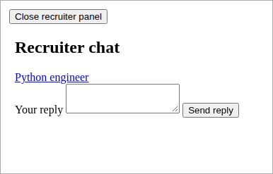
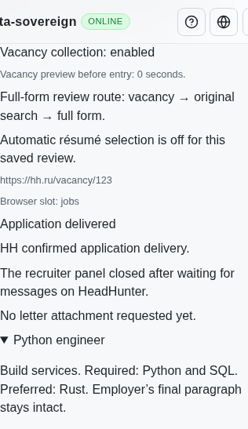

# Wait for messages in the HeadHunter recruiter panel

A confirmed application can open a recruiter panel when the batch returns to
its filtered search. A verified panel waits 20 seconds for the first recruiter
message and 15 seconds after a provider-confirmed reply. New recruiter
questions hold the batch for review. Loading, a draft, unconfirmed outgoing
messages and ambiguous panel state also keep the panel open. The wait resets
when the verified conversation or its run policy changes.

When a quiet interval expires, the worker rechecks the same vacancy, provider
window, composer and message history before using the single native close
control. The batch resumes after it observes the panel disappear. CV Sync
shows the closure separately from the application receipt. Supervised reviews
continue to require the owner’s action, and No-questionnaires mode retains its
separate dismissal policy.

## Reproduce and verify

Confirm an application from its original filtered search. Leave the recruiter
panel empty. Published parent `bfb893bd` still holds the batch after the first
wait expires. The same Chromium regression now verifies one close, one
confirmed application and zero recruiter replies. The second scenario confirms
two owner replies and verifies that an uncertain send, a later question and
the owner's draft hold the panel. After the last confirmed reply and a fresh
quiet interval, the batch closes the panel once with no extra reply.

Node and Deno each passed 34 focused checks. Both Lino encodings recover the
separate receipt. Independent Playwright verifies the first-message case after
a reload at 390 px with no horizontal overflow. The browser checks use routed
HeadHunter fixtures and an injected clock.

The independent browser logged a missing local favicon and an HTTP cache-write
error. The page reported no JavaScript exceptions and recovered the receipt.

```sh
RUN_BROWSER_E2E=1 E2E_RECRUITER_PANEL_QUIET=first E2E_RECRUITER_PANEL_IMMEDIATE=1 node experiments/issue-56/application-recruiter-panel-browser.mjs
RUN_BROWSER_E2E=1 E2E_RECRUITER_PANEL_QUIET=next E2E_RECRUITER_PANEL_IMMEDIATE=1 node experiments/issue-56/application-recruiter-panel-browser.mjs
```

To replay the parent, extract the source archive and set
`APPLICATION_RECRUITER_PANEL_PARENT` to its `parent-modules` directory. Save
`git show bfb893bd:js/src/web/app.min.js` to a file and point
`APPLICATION_RECRUITER_PANEL_PARENT_WEB` to it.

| Before                                                                                                                 | After                                                                                                                                               |
| ---------------------------------------------------------------------------------------------------------------------- | --------------------------------------------------------------------------------------------------------------------------------------------------- |
|  |  |

[Receipt after two confirmed replies](../../screenshots/application-recruiter-panel-quiet/next-after.png) ·
[Source and logs](data/application-recruiter-panel-quiet.tar.gz) ·
[SHA-256 manifest](data/application-recruiter-panel-quiet.json)

HH08 and HH10 remain unfinished. Authenticated provider verification and
exact-head hosted checks remain pending. [Pinned first and next waits](https://github.com/konard/hh-job-application-automation/blob/fa0991b8c2d0896fb3b4be6c69947f0590094b15/src/instant-chat.mjs#L189-L219)
