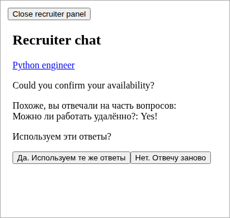
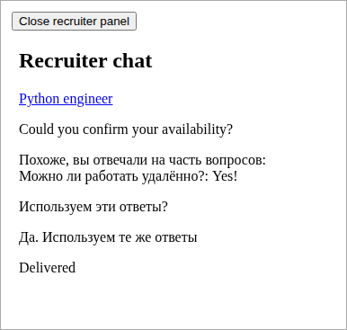

# Decide whether to reuse earlier HeadHunter answers

HeadHunter can show a summary of earlier answers with two native choices.
Enable automatic reuse separately in CV Sync, the Questions unread review
controls, or with `--auto-reuse-answers=true` in the corresponding CLI flow.
The option starts off. An application in supervised or preview mode leaves the
choice to the owner.

The planner selects the affirmative choice when every displayed answer matches
an approved exact saved answer. It selects the negative choice when at least one
approved exact answer differs, even if an additional answer is unknown. With
only matching and unknown answers, the choice stays open. The text comparison
accepts ordinary capitalization, terminal punctuation, and equivalent English
or Russian yes and no. Offers containing an unfamiliar instruction, links,
duplicate choices or uncertain ownership stay open for review.

A send requires the same vacancy and pending conversation, an empty composer
(including a hidden composer), an unchanged saved-answer plan, and current
workspace consent. The shared one-use outbox records the choice separately from
the application. A native outgoing delivery marker and message identity
confirm the selection.

## Reproduce and verify

In a paced batch, confirm the application from its original filtered search.
With automatic reuse enabled, let the matched recruiter panel display a
previously answered question and the two reuse choices. On `f35d0d64`, the
native prompt stays open and the expected outgoing receipt never appears. The
same Chromium regression now confirms one affirmative choice, holds an unknown
answer for review, then confirms one negative choice after a known mismatch
appears. It preserves a hidden owner draft and the original application
delivery. Focused unread watcher tests also exercise quiet hours, opted-out
chats, changed saved answers, and the separate CLI and Lino admission.
Node and Deno each passed 95 focused checks. The independent Playwright replay
recovered exactly one native receipt at 390 px after reload, with no horizontal
overflow. It observed zero recruiter sends while the hidden owner draft was
present. All native checks use routed provider fixtures.

```sh
RUN_BROWSER_E2E=1 E2E_RECRUITER_PANEL_REUSE=1 E2E_RECRUITER_PANEL_IMMEDIATE=1 E2E_RECRUITER_PANEL_SKIP_BINDING=1 node experiments/issue-56/application-recruiter-panel-browser.mjs
```

To replay the parent, extract the evidence archive and point
`APPLICATION_RECRUITER_PANEL_PARENT` to its `parent-modules` directory. Write
the output of `git show f35d0d64:js/src/web/app.min.js` to a bundle and set
`APPLICATION_RECRUITER_PANEL_PARENT_WEB` to that path.

| Before · Reuse offered                                                                                                    | After · Positive choice delivered                                                                                                 |
| ------------------------------------------------------------------------------------------------------------------------- | --------------------------------------------------------------------------------------------------------------------------------- |
|  |  |

[Negative choice](../../screenshots/application-recruiter-panel-reuse/reuse-negative.png) ·
[Unknown answer awaiting review](../../screenshots/application-recruiter-panel-reuse/reuse-owner-choice.png) ·
[Phone recovery](../../screenshots/application-recruiter-panel-reuse/reuse-phone.png) ·
[Source and logs](data/application-recruiter-panel-reuse.tar.gz) ·
[SHA-256 manifest](data/application-recruiter-panel-reuse.json)

Explicit Skip and authenticated provider acceptance remain open under HH08
and HH10.
[Pinned HeadHunter requirements](https://github.com/konard/hh-job-application-automation/blob/fa0991b8c2d0896fb3b4be6c69947f0590094b15/docs/requirements/README.md#run-the-application-run)
