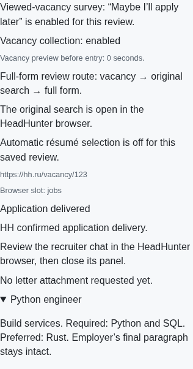
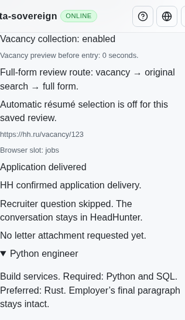

# Skip the current HeadHunter recruiter question

After an application is delivered, CV Sync offers **Skip recruiter question**
for the current vacancy's unanswered recruiter message once the native
composer is empty. The foreground batch CLI offers `skip-recruiter` or `s`
for its displayed recruiter review. The command retains the existing unread
chat shortcut when the displayed review belongs to the separate chat worker.

The worker verifies the current vacancy, question, composer and unique native
close control before using Skip. A draft, uncertain outgoing reply, changed
question, ambiguous control or stopped batch preserves the open conversation.
When HeadHunter closes the panel, the batch can continue. CV Sync records the
skip independently of the provider-confirmed application and earlier replies.
The conversation remains available in HeadHunter.

## Reproduce and verify

Start a paced batch from its original filtered vacancy search. Confirm an
application, wait for the recruiter panel to open, and empty its synthetic
draft. Published parent `69d4f19a` keeps the recruiter review open with no
Skip control. The same Chromium check now offers Skip, refuses an ambiguous
close, and records one native close with zero added replies. The combined
browser check also preserves both earlier reuse replies.

Node and Deno each passed 74 focused checks, including the batch CLI, both
Lino encodings, stale consent, concurrent Stop, and read-only recovery after
a failed receipt save. The independent Playwright replay verifies the native
close and recovered dismissal at 390 px. These checks use routed fixtures.

```sh
RUN_BROWSER_E2E=1 E2E_RECRUITER_PANEL_SKIP=1 E2E_RECRUITER_PANEL_IMMEDIATE=1 E2E_RECRUITER_PANEL_SKIP_BINDING=1 node experiments/issue-56/application-recruiter-panel-browser.mjs
```

To replay the parent, extract the evidence archive and set
`APPLICATION_RECRUITER_PANEL_PARENT` to its `parent-modules` directory. Save
`git show 69d4f19a:js/src/web/app.min.js` to a bundle and set
`APPLICATION_RECRUITER_PANEL_PARENT_WEB` to that file.

| Before                                                                                                                            | After                                                                                                               |
| --------------------------------------------------------------------------------------------------------------------------------- | ------------------------------------------------------------------------------------------------------------------- |
|  |  |

[Skip control](../../screenshots/application-recruiter-panel-skip/skip-ready.png) ·
[Phone recovery](../../screenshots/application-recruiter-panel-skip/skip-phone.png) ·
[Source and logs](data/application-recruiter-panel-skip.tar.gz) ·
[SHA-256 manifest](data/application-recruiter-panel-skip.json)

HH08 and HH10 remain open for remaining recruiter timing and authenticated
provider acceptance. [Pinned HeadHunter behavior](https://github.com/konard/hh-job-application-automation/blob/fa0991b8c2d0896fb3b4be6c69947f0590094b15/src/instant-chat.mjs#L169-L187)
