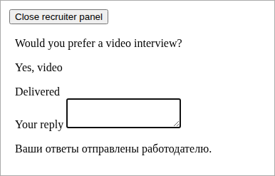
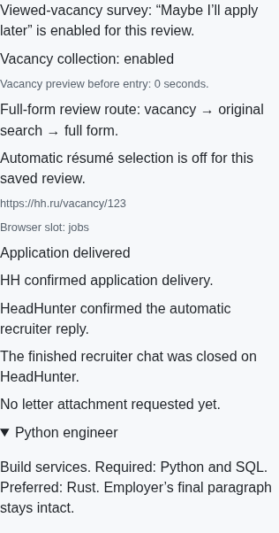

# Close a finished HeadHunter recruiter panel

After HeadHunter confirms the application, the paced batch checks the
recruiter panel attached to the same vacancy. A finished panel can close
automatically when the provider posts an explicit handover or disables the
conversation. The worker archives the visible conversation first, then verifies
the same vacancy, chat history and empty composer before activating the
single visible native close control. It waits for the panel to disappear before
recording the dismissal. An unanswered follow-up, an uncertain reply or text
in the owner's composer keeps the review open.

The session's **No-questionnaires mode** can also close the owned panel for
later review. The existing conversation stays in HeadHunter. CV Sync records
the reason separately from the application and recruiter reply delivery.

## Reproduce and verify

Start a one-vacancy paced batch from the original filtered search and confirm
the application. Respond to the recruiter questions, then let the recruiter
notify the applicant that the answers were sent to the employer. On published
`654ee0cc`, the notice remains visible and the batch waits for a manual close.
The Chromium regression now checks that a draft, a notice with an extra task,
and two visible close controls each keep the panel open. The plain notice with
one native close control produces one dismissal and lets the batch complete.

Node and Deno each passed 59 focused checks. An independent Playwright MCP
replay enabled No-questionnaires mode while the composer held the owner's
draft. The panel stayed open until the draft was cleared. The batch then
completed with zero recruiter sends and recovered the deferred dismissal at
390 px without horizontal overflow.

```sh
RUN_BROWSER_E2E=1 E2E_RECRUITER_PANEL_EXACT_REPLY=1 E2E_RECRUITER_PANEL_TERMINAL=1 E2E_RECRUITER_PANEL_IMMEDIATE=1 E2E_RECRUITER_PANEL_SKIP_BINDING=1 node experiments/issue-56/application-recruiter-panel-browser.mjs
```

To reproduce the parent, extract the evidence archive and point
`APPLICATION_RECRUITER_PANEL_PARENT` to its `parent-modules` directory. Set
`APPLICATION_RECRUITER_PANEL_PARENT_WEB` to the bundle saved with
`git show 654ee0cc:js/src/web/app.min.js`.

| Before · Completed handover holds the batch                                                                                                                       | After · Recovered provider dismissal                                                                                                                |
| ----------------------------------------------------------------------------------------------------------------------------------------------------------------- | --------------------------------------------------------------------------------------------------------------------------------------------------- |
|  |  |

[Deferred dismissal at 390 px](../../screenshots/application-recruiter-panel-terminal/application-recruiter-panel-terminal-deferred.png) ·
[Source and logs](data/application-recruiter-panel-terminal.tar.gz) ·
[SHA-256 manifest](data/application-recruiter-panel-terminal.json)

Accepted-summary replies, explicit Skip and authenticated provider acceptance
remain open under HH08 and HH10.
[Pinned HeadHunter requirements](https://github.com/konard/hh-job-application-automation/blob/fa0991b8c2d0896fb3b4be6c69947f0590094b15/docs/requirements/README.md#run-the-application-run)
