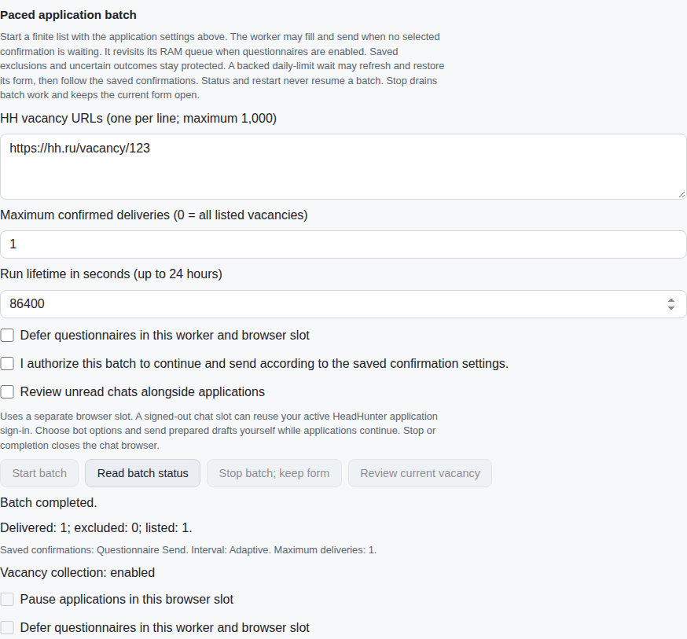
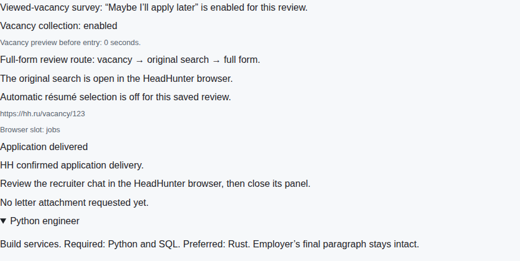

# Keep the HeadHunter recruiter panel open after delivery

In CV Sync, use the original search route and start a paced batch with a delivery
cap of one. Follow the current vacancy, review the native form and confirm
**Send**. When the recruiter panel opens on the returned search, the confirmed
delivery counts toward the cap and the worker waits in review. Finish reviewing
the chat and close its panel in the owned HeadHunter browser. The batch can then
continue or complete. Its delivery receipt remains confirmed throughout.

A separate letter waits while the panel is open. If the owned page changes and
the worker can no longer see whether the panel is open, it keeps the browser in
review. A later read of the bound HeadHunter page can clear the hold when the
panel is absent. Stopping the batch retains the current browser for the owner.
CLI and both Lino encodings expose the same live review state.

## Reproduction

The published parent `00316423` confirms the application and returns to the
original filtered search. It then closes the owned browser at the cap even
though the recruiter panel is visible there. The Chromium fixture restores the
published worker modules and web bundle to reproduce that outcome, then runs the
same flow against the current implementation.

```sh
node --test --test-concurrency=1 js/tests/job-application-recruiter-panel.test.js js/tests/job-application-batch-attachment.test.js
RUN_BROWSER_E2E=1 node experiments/issue-56/application-recruiter-panel-browser.mjs
```

The fixture routes HeadHunter locally. It verifies one native application send,
two visits to the exact search and an untouched reply in the cross-origin
recruiter frame before and after an operator reload. Only after the owner
dismisses the panel does the batch close its browser and complete. Node passed
63 focused checks and Deno passed 50, covering loss of visibility, Stop and
withholding automatic and explicit letter actions. An independent Playwright
window recovered the status, receipt and reply at 390 CSS pixels without
horizontal overflow or page exceptions. Its console recorded a missing fixture
favicon and a cache-write error. Both browser runs confirmed resource closure.

| Parent at the delivery cap                                                                                                              | Current review after delivery                                                                                                              |
| --------------------------------------------------------------------------------------------------------------------------------------- | ------------------------------------------------------------------------------------------------------------------------------------------ |
|  |  |

[Native recruiter frame](../../screenshots/application-recruiter-panel/application-recruiter-panel-native.png) ·
[Phone review](../../screenshots/application-recruiter-panel/application-recruiter-panel-phone.png) ·
[Source and logs](data/application-recruiter-panel.tar.gz) ·
[SHA-256 manifest](data/application-recruiter-panel.json)

The panel hold covers the manual handoff portion of RUN4 and B29. Detecting a
panel that opens later, matching and processing recruiter replies, learning owner
answers, terminal dismissal and authenticated acceptance remain open under HH08
and HH10. [Pinned HeadHunter requirements](https://github.com/konard/hh-job-application-automation/blob/fa0991b8c2d0896fb3b4be6c69947f0590094b15/docs/requirements/README.md#run-the-application-run)
