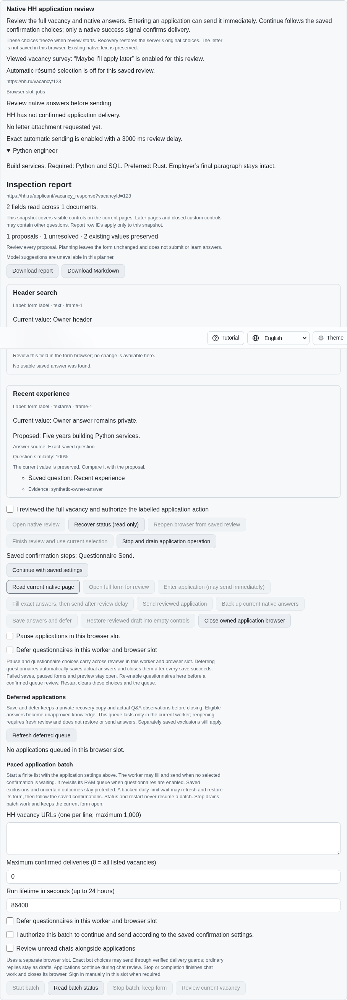
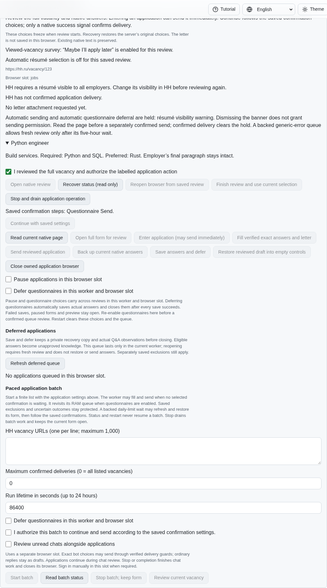
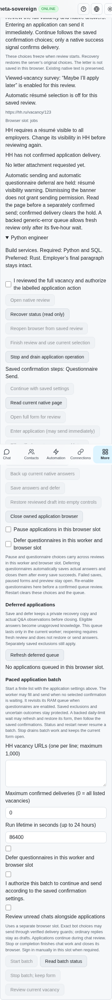

# Rendered résumé visibility warnings stop application actions

The pinned HH reference `fa0991b8c2d0896fb3b4be6c69947f0590094b15`
requires a visible résumé warning to stop an application. HH also includes a
collapsed warning in ordinary response popups. Treating that hidden text as an
active refusal would incorrectly stop every application.

At production parent `e68448ac0a526e5e62e5f5d178770a166d4e752b`, a rendered
warning still leaves the shared application panel in ordinary review. The
serialized native dispatch guard also admits it. Six regression cases fail
against those actual parent modules; an isolated native check passes ten hidden
controls before failing the rendered-warning assertion. No live HH account or
application is used.

The shared native reader now checks rendered text within the actual application
form, recognizing HH's warning selector and the reference's English/Russian
phrases. Ancestor visibility and clipping checks ignore hidden, inert, collapsed
and unrelated content. Bounded text and ancestor traversal run inside the native
document. A separate `resume-not-visible` receipt and automatic-action hold stop
prefilling, sending, questionnaire deferral and automatic recovery navigation.
The synchronous browser guard also refuses dispatch if the warning appears
after a review. Confirmed delivery keeps precedence, and an already issued or
uncertain send retains its reservation. Dismissing the warning does not grant
automatic sending permission.

CLI and text/binary Lino callers receive the same validated state. The shared
panel explains the required HH visibility change in English, Russian, Hindi and
Chinese. Existing owner answers and cover letters are preserved. This is one
part of HH05: durable reason records, permanent exclusions and later-run retry
policies remain unfinished, and HH05 remains open.

Reproduce the focused checks with:

```sh
node --test --test-concurrency=1 --test-timeout=30000 js/tests/job-application-resume-visibility.test.js js/tests/job-application-holds.test.js js/tests/ci-browser-shards.test.js
node experiments/issue-56/application-resume-visibility-native.mjs
```

The focused checks pass 24 cases. The native check covers ten hidden/unrelated
variants, four rendered variants, four synchronous refusals, all four UI
languages, owner text preservation, reload, phone layout and dismissal without
sending. A separate popup check verifies the same refusal through binary Lino.
The registered browser group requires both scenarios in hosted Chromium and
WebKit; those full hosted checks remain required for the publication commit.

The Playwright MCP scenario independently checks rendered/collapsed warnings,
reload, the 390-pixel viewport, preserved owner letter and answer, zero provider
submissions and closed native ownership. Its fixture's two generic provider
clicks open the response and letter controls; the actual submission counter
remains zero. The MCP page and its separate fixture server are closed afterward.
An initial fixture navigation included a trailing slash in its control URL,
producing unmatched double-slash control requests; correcting that test URL
resolves the setup failure. The only outer-page console error is the fixture's
missing favicon; native page errors are empty.

Before, the visible native warning leaves ordinary review:



After, the shared panel reports the visibility requirement and held actions:





`data/application-resume-visibility.tar.gz` preserves the pinned original
reference files, actual parent and corrected source bytes, focused logs, native
and MCP receipts, browser registration and screenshots. Its manifest hashes every
entry. No complete issue acceptance is inferred from this isolated correction.
