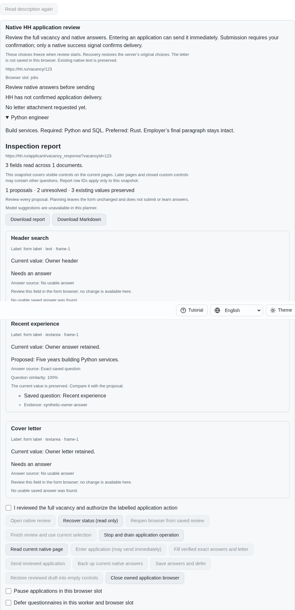
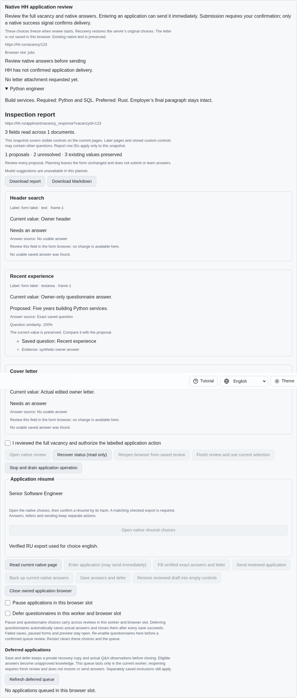
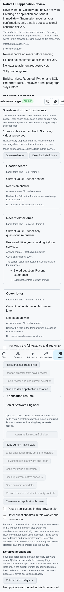

# Choosing a native application résumé explicitly

PR: https://github.com/link-foundation/meta-sovereign/pull/57

The application review now reads the bound native résumé chooser without opening
it. A separately confirmed action opens or closes the menu. Choosing an observed
hash requires another confirmation, a current review and a matching checked native
export from this browser slot. Selection verifies the native result and preserves
actual answers and the letter. It never sends an application.

HH02 and HH06 remain incomplete. Automatic language selection from salary,
questions and vacancy context, authenticated provider parity and all 81 original
unchecked inventory rows remain required. The PR stays draft and unmerged.

## Reproduction and verification

Published parent `1e6582c3adfe84bd383c28f9a45e98776fa869a0` has neither a native
résumé-choice service operation nor its review control. The bounded parent Node
reproduction fails on the missing operation; its production-browser reproduction
fails because the native choice action is absent. Both restore working sources and
drain their owned fixtures.

```sh
PYTHONDONTWRITEBYTECODE=1 python3 experiments/issue-56/application-resume-before.py
PYTHONDONTWRITEBYTECODE=1 python3 experiments/issue-56/application-resume-before.py --native
node --max-old-space-size=384 --test --test-concurrency=1 js/tests/job-application-resume.test.js js/tests/job-application-resume-controls.test.js js/tests/ci-browser-shards.test.js
deno test --allow-all --no-check --v8-flags=--max-old-space-size=384 js/tests/job-application-resume.test.js js/tests/job-application-resume-controls.test.js
RUN_BROWSER_E2E=1 E2E_BROWSER=chromium E2E_EXECUTABLE_PATH=/opt/google/chrome/chrome node --max-old-space-size=384 experiments/issue-56/application-resume-native.mjs
```

The shared operation serves the foreground CLI, both Lino encodings and all four
UI languages. Menu inspection is passive; preview performs no native write.
Stale revisions, owner edits, replaced documents, duplicate titles, invalid or
disabled options, challenges and absent or corrupt export evidence refuse the
operation. A fresh synchronous document guard also refuses submit buttons, links
and mismatched option/radio hashes. Bounded readback never repeats an effect.

Export language comes from the checked contents, not the résumé name. The fixture
deliberately chooses “Senior Software Engineer”, whose checked export language is
Russian. Latest and immutable receipts, slot, hash, title, observed update and file
digest must match. Evidence appears only in this operation's response; existing
durable list/journal formats stay unchanged. Read-only recovery cannot replay a
choice or assert an earlier choice receipt.

Twenty focused Node checks and fifteen Deno checks cover the service, CLI, real
HTTP routes, portable evidence and localized controls. Cancellation while reading
an export drains ownership before any choice. A failed acknowledgement after a
native choice requires a fresh read without repeating it. Additional existing
ownership, recovery, session, résumé-language and dictionary checks cover shared
paths. The new native scenario is registered in the existing bounded browser
groups for hosted Chromium and WebKit coverage.

One focused production Chromium scenario and an independent Playwright MCP
scenario verify separate confirmations, the actual selected hash, preserved
owner values, zero sends, read-only reload, all four locales and phone layout.
The native scenario also refuses three unsafe fresh controls. Every owned browser
and fixture closes; the fixture uses no authenticated provider or running user
server. Initial test and formatting failures are preserved with the final logs.

## Review images

Parent review before native résumé choice existed:



Verified choice with checked Russian export evidence and retained owner values:



Phone recovery preserves the selected native résumé without another mutation:



Source snapshots, the pinned native chooser reference, parent reproductions,
screenshots and validation logs are preserved in `data/application-resume.tar.gz`
with per-file hashes in `data/application-resume.tar.sha256.json`. Exact published
head CI remains required. The parent main workflow's separate macOS startup
failure is recorded in the work plan; this feature does not establish its cause.
