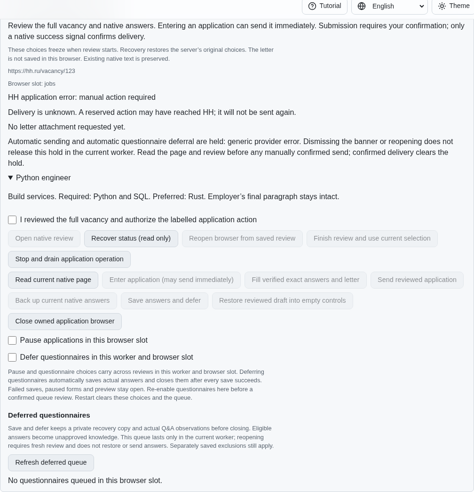
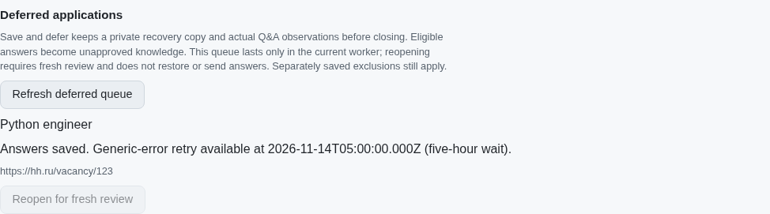
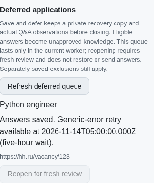
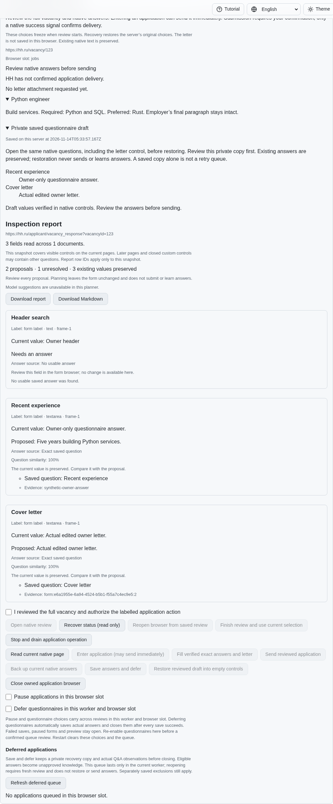

# Backed five-hour application retries

PR: https://github.com/link-foundation/meta-sovereign/pull/57

This is a partial HH08 implementation. The worker now preserves actual native
answers after a visible, bound generic provider error, closes only after every
required save is acknowledged, and excludes that vacancy for five hours. A due
retry opens a fresh review. Automatic paced queue revisits, the supervised
one-application preset, recruiter-panel behavior and every unchecked original
inventory requirement remain unfinished. PR57 stays draft and unmerged.

## Requirement and cause

The HH reference at `fa0991b8c2d0896fb3b4be6c69947f0590094b15`, README
lines 290–303, requires private recovery and Q&A preservation of actual owner
values before leaving a generic-error form. The temporary exclusion lasts five
hours in RAM; restarting clears it without turning recovery files into saved
exclusions. Other validation, verification and provider blocks remain manual.
The complete reference text is retained in the evidence archive.

Published `37d0a3c9` correctly retained a manual hold, but never backed or queued
that error automatically. Both the focused Node reproduction and the real
native Chromium reproduction fail with `provider-error` instead of `closed`.
The independent MCP before screenshot shows the live rejected form and empty
queue. Sources are restored and fixtures drained after each parent experiment.
Every hosted workflow for this exact parent passes; this unit needs its own CI.

## Behavior and evidence

| Requirement                           | Implementation and verification                                                                                                                                                                                                                                                                                                                                                                         |
| ------------------------------------- | ------------------------------------------------------------------------------------------------------------------------------------------------------------------------------------------------------------------------------------------------------------------------------------------------------------------------------------------------------------------------------------------------------- |
| Capture actual answers before closing | The generic-error capture reuses full-document and owned-native-form checks. It admits read-only backup after a failed dispatch without enabling another send. Actual free text, letter and supported choices use the existing complete draft/Q&A and eligible unapproved learning paths. Native Chromium and MCP preserve two owner answers.                                                           |
| Acknowledged preservation             | Private draft, Q&A, eligible learning and a separate private rejection receipt must all save and flush before the queue is created. Eight finite put/flush failures retain the live form and no queue. Late owner edits, verification, incomplete inspection and mode changes refuse closure. Pause and zero-effect preview retain the form.                                                            |
| Five-hour RAM exclusion               | The worker clock determines `retryAt` and public `ready`. Search reports `retry-wait` without deleting cards. Ordinary opening and confirmed queue retry both refuse early admission; the exact boundary admits fresh review. Slots and saved owner exclusions remain independent. No queue timestamp or retry exclusion is persisted.                                                                  |
| Failed versus unknown delivery        | The immutable private rejection receipt retains the original dispatch flags and unknown outcome. Only matching acknowledged native-rejection evidence permits a due, separately confirmed queue retry to release that reservation. A transport exception without that evidence remains unknown indefinitely. Missing, altered or nested-mutated evidence refuses admission; key ordering is immaterial. |
| Recovery after failures               | Rejected release put/flush preserves the original failed reservation and queue. A later browser-open failure retains the queue and acknowledged release for another explicit fresh review. Worker restart clears temporary exclusions while retaining private drafts and failed history. Native confirmed delivery removes an obsolete retry entry.                                                     |
| Explicit review and restoration       | Queue reopening neither fills nor sends. Existing draft restoration and native send confirmations remain separate; each accepted revision resets the UI confirmation. MCP verifies empty controls on reopening, unchanged owner header, restored owner values, no send during restoration and one separately confirmed successful retry.                                                                |
| Shared controls                       | CLI, real HTTP text/binary Lino routes, browser lost-response recovery and four-language render checks share the same worker eligibility. Browser storage retains only the pending identity. Four actual locale reloads retain the waiting state without replay. The phone viewport has no horizontal overflow.                                                                                         |

The existing shared queue, acknowledged storage and form planner are reused;
there is no second answer store or persistent retry skip list. Rejection records
are private `secret:` data. Their identifiers, original reservation revision and
native observation remain available after the active reservation is released.
Default-off `MS_JOBS_APPLICATION_DEBUG=1` reports retry/hold events without
questions, answers or credentials.

## Reproduction and checks

Use the isolated synthetic fixture; no live HH account or five-hour sleep is
needed. `applicationRetryFixture` injects a finite clock; the native scenario
actually clicks the application form and receives one synthetic provider error.

```sh
PYTHONDONTWRITEBYTECODE=1 python experiments/issue-56/application-retries-before.py
PYTHONDONTWRITEBYTECODE=1 python experiments/issue-56/application-retries-before.py --native
node --max-old-space-size=384 --test --test-concurrency=1 js/tests/job-application-retries.test.js js/tests/job-application-retry-controls.test.js
DENO_JOBS=1 deno test --allow-all --no-check js/tests/job-application-retries.test.js js/tests/job-application-retry-controls.test.js
RUN_BROWSER_E2E=1 E2E_BROWSER=chromium E2E_EXECUTABLE_PATH=/opt/google/chrome/chrome node --max-old-space-size=384 experiments/issue-56/application-retries-native.mjs
```

The focused new tests cover the exact boundary, saved exclusions, restart,
uncertain outcomes, release/open failures, changed evidence and separate
confirmations. Existing application and vacancy-selection compatibility checks
and dictionary parity are retained. The native retry scenario is registered
alongside the existing application browser scenarios for hosted engines; only
Chromium is exercised locally. Full runtime/browser matrices belong to CI.

Local results: 141 focused application Node tests, 31 new Deno tests, ten
vacancy-selection checks and 25 dictionary checks pass. All nine native
application Chromium scenarios pass, including existing ownership, delay,
recovery, draft, policy, deferral and manual-hold behavior. The final independent
MCP run reports four locale reloads, two restored owner answers, separately
confirmed sending, closed fixture browsers and no page errors.

Shared fixture setup, preservation assertions, read-only recovery and queue-review
assertions were consolidated without changing the duplication threshold. All 60
affected Node tests and the 31 new Deno tests pass after consolidation; scoped
formatting, lint, secrets and the unchanged 6.5% duplication gate also pass.

For independent browser checks, use the opt-in synthetic
`APPLICATION_RETRY_FIXTURE=1` with the existing review/draft fixture server.
`compose-application-mcp.py application-retries-mcp.mjs` composes the shared
isolated UI driver. Its fixture-only control port arms an actual native rejection
and advances a controlled clock. It is never mounted as a product endpoint.

The first MCP attempt restored successfully but waited for visibility inside a
collapsed draft panel. Its failure is preserved; the corrected probe waits for
the receipt to exist, expands the panel, verifies both actual values and sends
only after renewed confirmation. Initial test setup/format/lint failures are
preserved alongside the final checks. No deadline or static gate is relaxed.

## Screenshots

Before: the exact parent holds the rejected native form and has no backed queue.



After: acknowledged owner values are queued; early reopening is disabled.



The same queue at a 390-pixel phone viewport:



After the due, explicitly confirmed fresh review and separately confirmed draft
restoration, sending still requires a new confirmation:



The checksummed source/log/reference/screenshots bundle is
`data/application-retries.tar.gz` with `data/application-retries.tar.sha256.json`.
It records local evidence and parent CI separately from the new commit's hosted
verification. Synthetic success is not evidence of authenticated live-provider
parity. All original unchecked rows remain required.
