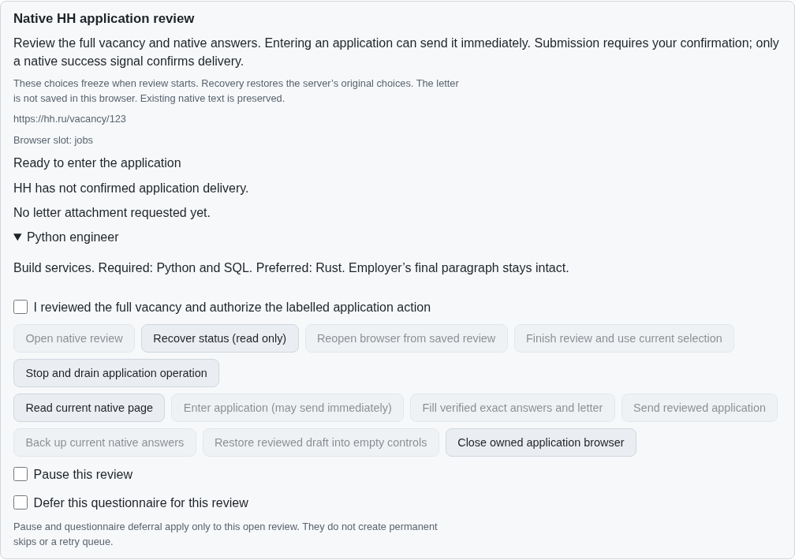
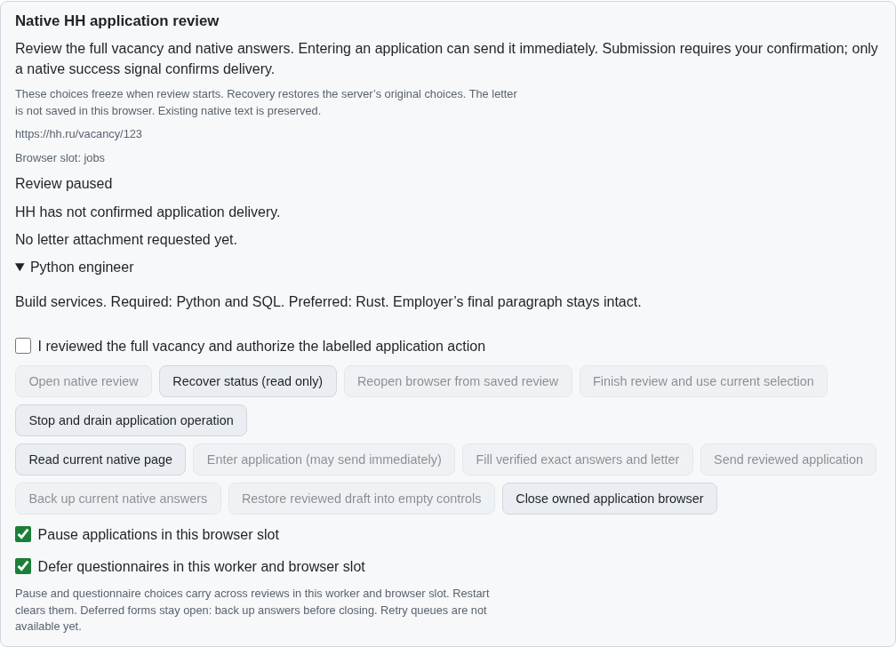
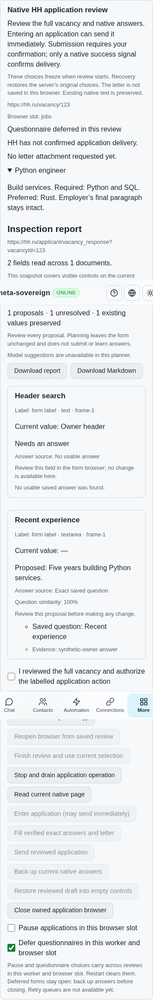

# Worker-scoped application policies

[PR #57](https://github.com/link-foundation/meta-sovereign/pull/57) retains pause
and questionnaire choices across reviews in one worker and named browser slot.
HH08 remains incomplete: automatic deferral backups, the RAM retry queue and the
supervised one-application preset still require implementation and verification.

## Reproduce the published loss

On published `d0a5e5e5`, enable both choices, close the owned native browser and
open another vacancy or explicitly reopen the saved review. Both choices reset.
The Node regression fails at “new vacancy inherits the worker policy”; the
production native Chromium scenario fails at “native reopening retains the
worker questionnaire policy”. Independent Playwright MCP confirms the same
unchecked choices after Close → Recover → Reopen.

Run `python3 -B experiments/issue-56/application-run-before.py`; add `--native`
for the intercepted native scenario, or `--mcp` for an isolated parent UI fixture.
The wrapper restores every replaced source byte in `finally`. No authenticated
provider is involved, and these fixtures never send a real application.

## Policy and interruption

The worker owns two in-memory choices per browser slot. A new review inherits
them; different slots remain independent. Worker shutdown clears them. Private
journals and browser recovery intent do not persist the choices or create skips.
An ordinary mode change requires the owned observed revision, a fresh native
inspection and acknowledged storage. A refused acknowledgement restores the last
accepted RAM policy.

The foreground POSIX CLI also accepts SIGUSR1 to defer questionnaires and SIGUSR2
to enable them. This internal interruption channel can run during an exact-answer
review delay or final asynchronous native guard. It performs no provider action
and is absent from the HTTP allowlist. Versioned RAM admission preserves a later
signal during either a successful or failed ordinary mode acknowledgement.
Windows uses the existing interactive commands instead; no unsupported signal
listeners are installed. Listener cleanup is idempotent.

Questionnaire deferral applies even when every answer is exact. A letter-only
application remains eligible for its usual reviewed action. Re-enabling questions
returns the held form to review; it does not send. Pause holds both kinds of
application. Native daily limits, challenges, uncertain delivery and durable
dispatch reservations retain their existing behavior. Reading and explicitly
backing up a held questionnaire remain available. Restore still requires an
unheld, separately confirmed review.

The four-language controls disclose the worker/slot scope, restart reset and the
current limitation: a deferred form stays open and needs an explicit backup
before closing. No RAM retry queue or automatic closing is claimed.

## Verification

- 62 focused application service, controls, ownership, recovery, draft and session
  cases pass with concurrency one, plus 15 shared native-prefill cases.
- All 11 new run-policy/HTTP/SSR cases also pass sequentially under Deno. They
  cover different vacancies, slot isolation, restart reset, exact-questionnaire
  deferral, letter-only submission, failed acknowledgements, interrupted guards,
  overlapping signals, both Lino encodings and the unexposed internal route.
- Four existing dictionary checks pass. SSR verifies translated scope/limitations,
  both retained choices and disabled submission in all four locales.
- The production Chromium scenario retains both choices through actual browser
  disposal and a fresh native document, holds the questionnaire, preserves the
  unrelated owner header, returns only to review and performs zero submissions.
- Independent Playwright MCP verifies the same desktop and 390-pixel controls,
  identity-only recovery intent and no page errors. Every owned browser/context
  and fixture server closes. Initial asynchronous-checkbox driver failures are
  retained alongside the corrected state-aware probe.

Full matrices remain hosted. The previous published snapshot correction's exact
Windows Deno shard 3 and all four CodeQL jobs pass; its aggregate workflow was
still unfinished during this unit. Every final-head check remains required.

The [archive](data/application-run-modes.tar.gz) and
[manifest](data/application-run-modes.tar.sha256.json) retain source snapshots,
exact-parent files, finite probes, logs and screenshot hashes.

Before, reopening silently clears both choices:

After, reopening remains paused with questionnaire deferral enabled:

The held questionnaire on a narrow viewport:

